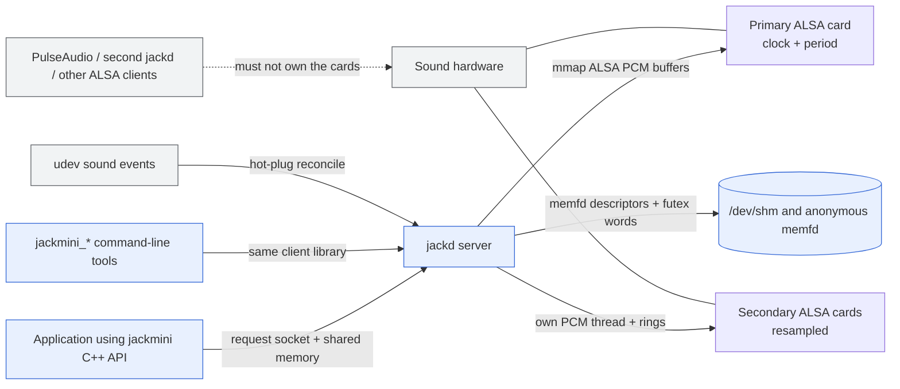
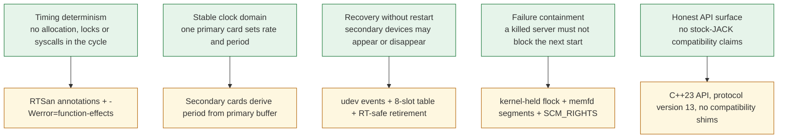
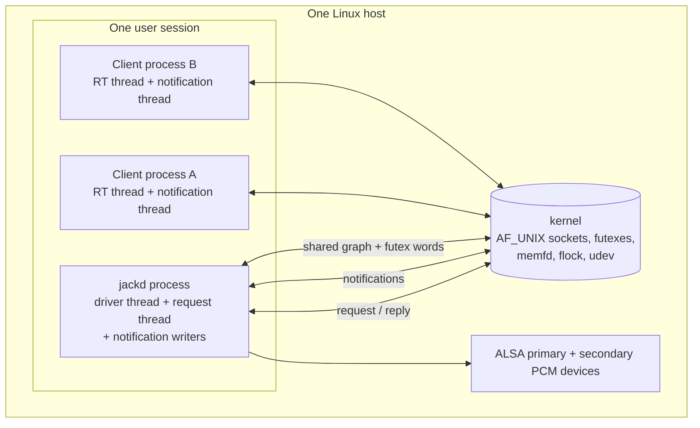

# 01 — Context and goals

jack2-mini is a Linux-only JACK-style audio server. One server owns the audio graph; clients connect to it over Unix
sockets, exchange audio through shared memory and synchronise through futexes. The clock of one **primary** ALSA card
drives the whole graph; other devices join as resampled **secondary** cards.

*Source: [README.rst](../../../README.rst), [ClientSession.cpp](../../../client/session/ClientSession.cpp#L141),
[AlsaDriver.cpp](../../../server/drivers/alsa/AlsaDriver.cpp#L622),
[AlsaHotplug.cpp](../../../server/drivers/alsa/AlsaHotplug.cpp#L77).*

## What the system is responsible for

| Responsibility | Where it is implemented |
|---|---|
| Own one audio graph and run its cycle | `server/core/Engine.*`, `ipc/memory/GraphManager.*` |
| Accept client requests and dispatch them | `server/ipc/RequestDecoder.*`, `ipc/protocol/Request.h` |
| Deliver asynchronous events to clients | `server/ipc/SocketNotifyChannel.*`, `client/session/ClientSession.cpp` |
| Own the primary ALSA device | `server/drivers/alsa/PcmSession.*`, `PcmCycle.hpp`, `PcmAlsa.*` |
| Discover and run secondary devices | `server/drivers/alsa/AlsaEnumerate.*`, `AlsaSecondaryCard.*`, `AlsaHotplug.*` |
| Give the application a typed C++ API | `client/api/*` |

## Quality goals

*Source: [Realtime.h](../../../common/Realtime.h#L19),
[CMakeLists.txt](../../../CMakeLists.txt#L106),
[AlsaSecondaryCard.cpp](../../../server/drivers/alsa/AlsaSecondaryCard.cpp#L189),
[ServerLock.cpp](../../../server/core/ServerLock.cpp#L42),
[Constants.h](../../../ipc/protocol/Constants.h#L66).*

## Constraints and non-goals

| Constraint / non-goal | Consequence |
|---|---|
| Linux, C++23, ALSA and libudev only | The build fails on other platforms; there is no portability layer. Source: [CMakeLists.txt](../../../CMakeLists.txt#L7). |
| No JACK2 wire compatibility | A JACK2 client cannot connect, and a jack2-mini client cannot connect to JACK2. Source: [README.rst](../../../README.rst#L172). |
| No installed C API | Applications use `<client/api/Jackmini.hpp>`; the internal C that remains is the resampler kernels, the module descriptor and MIDI helpers. Source: [CMakeLists.txt](../../../CMakeLists.txt#L332). |
| No hardware MIDI | MIDI is exchanged between clients only. Source: [README.rst](../../../README.rst#L183). |
| jack2-mini must own the cards | PulseAudio, a second jackd and other ALSA users must be stopped. Source: [README.rst](../../../README.rst#L64). |
| Fixed graph geometry at startup | Client and port maxima are compile-time values; the port array is allocated once. Source: [GraphManager.cpp](../../../ipc/memory/GraphManager.cpp#L46). |
| One server per user | A second server refuses to start even under another name. Source: [ServerLock.cpp](../../../server/core/ServerLock.cpp#L42). |

## Deployment view

*Source: [IpcName.h](../../../ipc/IpcName.h#L30),
[FdSegment.cpp](../../../ipc/memory/FdSegment.cpp#L71),
[LinuxFutex.cpp](../../../ipc/sync/LinuxFutex.cpp#L133),
[SocketServerChannel.cpp](../../../server/ipc/SocketServerChannel.cpp#L45).*

The two sockets are distinct: requests and replies never share a channel with notifications. The engine writes a
nonblocking notification request from the cycle path; a per-client writer thread delivers the queued notifications.
Source: [SocketServerNotifyChannel.cpp](../../../server/ipc/SocketServerNotifyChannel.cpp#L43),
[SocketNotifyChannel.cpp](../../../server/ipc/SocketNotifyChannel.cpp#L108).
