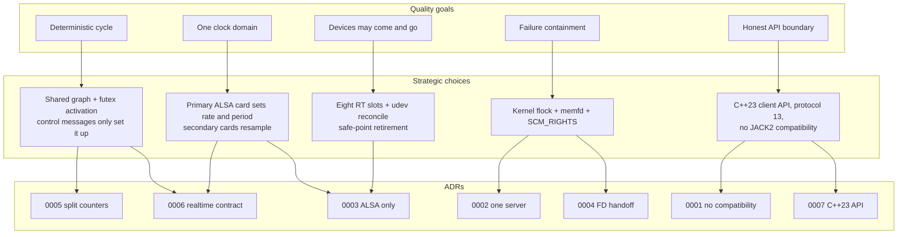

# 02 — Solution strategy

This is the arc42 solution-strategy chapter. The strategy is short: one clock drives one shared graph, control travels over
sockets, audio travels through shared memory, and every decision is recorded as a Nygard-style ADR in
[the decisions index](../decisions/README.md). The runtime consequences are in [04](04-runtime-view.md), the structures in
[03](03-building-blocks.md) and the boundary in [05](05-interfaces.md).

## Decision landscape

*Source: [GraphManager.h](../../../ipc/memory/GraphManager.h#L40),
[AlsaDriver.h](../../../server/drivers/alsa/AlsaDriver.h#L43),
[AlsaHotplug.cpp](../../../server/drivers/alsa/AlsaHotplug.cpp#L31),
[ServerLock.cpp](../../../server/core/ServerLock.cpp#L42),
[Constants.h](../../../ipc/protocol/Constants.h#L66),
[decisions/README.md](../decisions/README.md).*

<!-- fact: ipc/protocol/Constants.h:66 pattern="kProtocolVersion\\s*=\\s*13" -->
<!-- fact: server/drivers/alsa/AlsaDriver.h:44 pattern="AlsaSlotTable<AlsaSecondaryCard, 8>" -->

| Concern | Choice in this tree | Cost or constraint | Source |
|---|---|---|---|
| Audio data path | Shared graph segment; futex wake and activation counts | Fixed geometry at startup; no dynamic reallocation | [GraphManager.cpp](../../../ipc/memory/GraphManager.cpp#L46) |
| Clock | One primary ALSA card; secondary period derived from primary buffer and rate | A primary failure stops the server | [AlsaSecondaryCard.cpp](../../../server/drivers/alsa/AlsaSecondaryCard.cpp#L205), [AlsaDriver.cpp](../../../server/drivers/alsa/AlsaDriver.cpp#L283) |
| Device change | At most eight secondary slots; udev-driven reconcile with a settle delay | Cards beyond eight are skipped; safe-point wait may time out | [AlsaDriver.h](../../../server/drivers/alsa/AlsaDriver.h#L44), [AlsaHotplug.cpp](../../../server/drivers/alsa/AlsaHotplug.cpp#L32), [AlsaDriver.cpp](../../../server/drivers/alsa/AlsaDriver.cpp#L264) |
| Server identity | One server per user, kernel-held `flock`; sockets and segments in `/dev/shm` | Other audio users must be stopped before start | [ServerLock.cpp](../../../server/core/ServerLock.cpp#L42) |
| Wire boundary | Protocol version 13, 26 request types, two independent socket directions | No stock-JACK2 interoperability | [Constants.h](../../../ipc/protocol/Constants.h#L66), [Request.h](../../../ipc/protocol/Request.h#L60), [SocketServerChannel.cpp](../../../server/ipc/SocketServerChannel.cpp#L45) |
| Client surface | Move-only C++23 `Client` and value-like `Port`; no installed C API | Existing JACK2 applications cannot be reused | [Client.hpp](../../../client/api/Client.hpp#L63), [CMakeLists.txt](../../../CMakeLists.txt#L332) |
| Realtime guarantee | `JACK_REALTIME_FN` annotations, review, RTSan and `-Werror=function-effects` in RTSan builds | RTSan needs Clang 20+; control-path exceptions must be documented | [Realtime.h](../../../common/Realtime.h#L23), [CMakeLists.txt](../../../CMakeLists.txt#L67), [CMakeLists.txt](../../../CMakeLists.txt#L114) |

## Why this shape

1. **Control is not data.** A request/reply socket sets up ports and graph changes; the cycle reads the graph segment
   directly. This keeps syscalls out of the audio path and gives configuration a single writer, the control thread.
   Source: [RequestDecoder.cpp](../../../server/ipc/RequestDecoder.cpp#L71),
   [Engine.cpp](../../../server/core/Engine.cpp#L185), [06](06-memory-and-sync.md).
2. **One clock, many devices.** Secondary cards own their PCM thread and SPSC rings; only ring and port operations run
   on the primary RT thread. The PI drift controller changes the resampler rate rather than the server's period.
   Source: [AlsaSecondaryCard.h](../../../server/drivers/alsa/AlsaSecondaryCard.h#L41),
   [AlsaDriftController.cpp](../../../server/drivers/alsa/AlsaDriftController.cpp#L49).
3. **Configuration is copy-on-write; liveness is not.** Connection state is duplicated for the control thread while
   activation counters stay live outside the copy, so a control change never races a decrement. Source:
   [AtomicState.h](../../../ipc/memory/AtomicState.h#L122), [GraphManager.h](../../../ipc/memory/GraphManager.h#L45).
4. **Cleanup is owned by the kernel where possible.** The server lock is a `flock` on a file that is never removed, and
   shared segments are memfds handed over with `SCM_RIGHTS`, so a killed server leaves no registry to clean up. Source:
   [ServerLock.h](../../../server/core/ServerLock.h#L24), [ShmMem.cpp](../../../ipc/memory/ShmMem.cpp#L55).
5. **The boundary is explicit.** Driver modules are `dlopen`ed through a one-symbol ABI; client and wire contracts have
   verified fact sheets in [the reference shelf](../../reference/protocol.md). Source:
   [DriverModule.h](../../../server/drivers/DriverModule.h#L36), [DriverLoader.cpp](../../../server/drivers/DriverLoader.cpp#L107).

## Alternatives not taken

| Alternative | Why it is not used here | Source |
|---|---|---|
| Send audio frames over sockets | The cycle would add syscalls and a second copy; ports are mapped buffers instead | [FdSegment.cpp](../../../ipc/memory/FdSegment.cpp#L148), [ServerPort.h](../../../ipc/memory/ServerPort.h#L34) |
| Stock JACK2 wire or C API compatibility | The wire contract and client surface are deliberately independent; mismatches are refused | [RequestDecoder.cpp](../../../server/ipc/RequestDecoder.cpp#L64), [Client.hpp](../../../client/api/Client.hpp#L63) |
| A portable backend layer | Linux, ALSA and libudev are unconditional build dependencies | [CMakeLists.txt](../../../CMakeLists.txt#L7), [CMakeLists.txt](../../../CMakeLists.txt#L20) |
| A backend and graph driver that can be swapped at runtime | Drivers are discovered as modules, but the graph geometry and the primary clock domain are fixed for the server's life | [DriverLoader.cpp](../../../server/drivers/DriverLoader.cpp#L177), [GraphManager.cpp](../../../ipc/memory/GraphManager.cpp#L46) |

## Decision index

The short records live in [decisions](../decisions/README.md): 0001 no compatibility, 0002 one server per user, 0003
ALSA only, 0004 FD shared-memory handoff, 0005 split counters, 0006 realtime contract, 0007 C++23 client API. Each record
is context → decision → consequences; this chapter explains how they fit together, not what each one says in full.

## Validation consequences

Every strategic choice has a check: unit tests for layout and protocol framing, a concurrency test intended for TSAN,
RTSan e2e for the annotated cycle path, a private-server tool script, and CI on GCC, Clang, Clang 21 with RTSan, and
AArch64. See
[08](08-quality-and-validation.md) and [testing](../testing.md). Source:
[CMakeLists.txt](../../../CMakeLists.txt#L382),
[scripts/ci.sh](../../../scripts/ci.sh#L22),
[build.yml](../../../.github/workflows/build.yml#L11).
