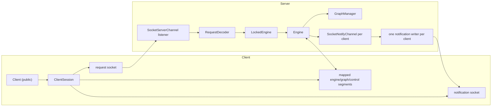
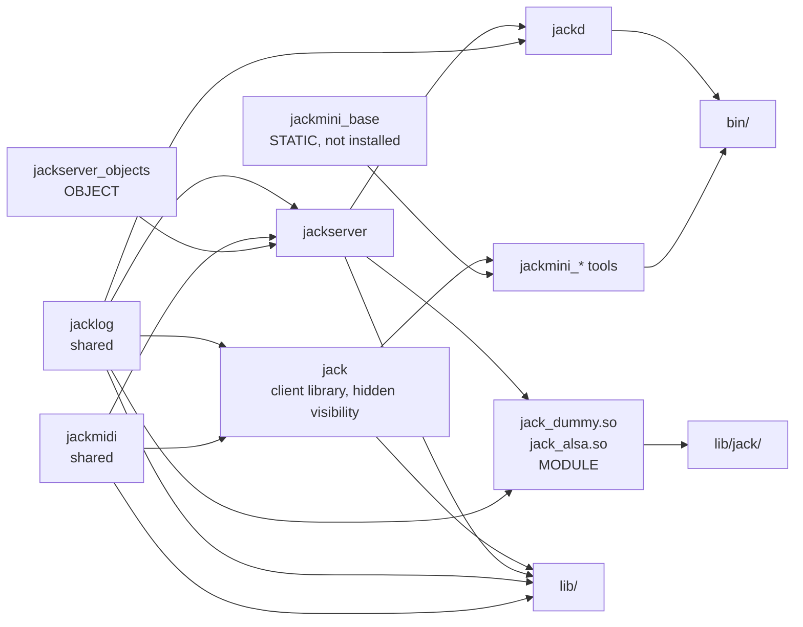

# 03 — Building blocks

This is the structural view: what runs where, which libraries are produced, and which directory owns which concept.

## Container view

```mermaid
flowchart TB
    subgraph Processes["Processes"]
        jackd["jackd<br/>server process"]
        client["Client process<br/>one or more Client objects"]
    end

    subgraph ServerLibs["Server side"]
        servercore["ServerCore + Engine + LockedEngine<br/>server/core"]
        ipcsrv["RequestDecoder + socket channels<br/>server/ipc"]
        graph["GraphManager + ConnectionManager<br/>EngineControl + ports<br/>ipc/memory"]
        drivers["DriverLoader + audio drivers<br/>server/drivers"]
        alsa["ALSA session, cycle, secondary cards<br/>server/drivers/alsa"]
    end

    subgraph ClientLibs["Client side"]
        api["Public headers<br/>client/api"]
        session["ClientSession + ProcessContext<br/>client/session"]
    end

    common["common/<br/>types, logging, MIDI buffer, OS primitives"]
    protocol["ipc/protocol + ipc/socket + ipc/sync<br/>wire, channels, futex"]

    client --> api --> session
    session --> protocol
    jackd --> servercore --> graph
    servercore --> ipcsrv --> protocol
    servercore --> drivers --> alsa
    drivers --> graph
    api -.->|"same vocabulary types"| common
    graph -.-> common
    alsa -.-> common
```

*Source: [ServerCore.h](../../../server/core/ServerCore.h#L43),
[Engine.h](../../../server/core/Engine.h),
[GraphManager.h](../../../ipc/memory/GraphManager.h#L40),
[ClientSession.hpp](../../../client/session/ClientSession.hpp#L43),
[CMakeLists.txt](../../../CMakeLists.txt#L147).*

## Component view of the request path



*Source: [SocketServerChannel.cpp](../../../server/ipc/SocketServerChannel.cpp#L206),
[RequestDecoder.cpp](../../../server/ipc/RequestDecoder.cpp),
[LockedEngine.h](../../../server/core/LockedEngine.h#L57),
[SocketNotifyChannel.cpp](../../../server/ipc/SocketNotifyChannel.cpp#L108).*

## Build and install graph

<!-- fact: CMakeLists.txt:211 pattern="add_library\\(jack SHARED" -->
<!-- fact: CMakeLists.txt:232 pattern="add_library\\(jackserver SHARED" -->
<!-- fact: CMakeLists.txt:355 pattern="add_library\\(jackmini_base STATIC" -->



*Source: [CMakeLists.txt](../../../CMakeLists.txt#L200),
[CMakeLists.txt](../../../CMakeLists.txt#L326),
[tools/CMakeLists.txt](../../../tools/CMakeLists.txt#L6).*

| Output | Kind | Installed to |
|---|---|---|
| `jack` | Shared client library, `SOVERSION 0`, hidden visibility | `${CMAKE_INSTALL_LIBDIR}` |
| `jackserver` | Shared server library, `SOVERSION 0` | `${CMAKE_INSTALL_LIBDIR}` |
| `jacklog`, `jackmidi` | Shared support libraries | `${CMAKE_INSTALL_LIBDIR}` |
| `jackmini_base` | Static helper (UUID and error text) | not installed |
| `jackd` | Server executable | `${CMAKE_INSTALL_BINDIR}` |
| `jack_dummy`, `jack_alsa` | Loadable driver modules | `${CMAKE_INSTALL_LIBDIR}/jack` |
| `jackmini_*` | Seven command-line tools | `${CMAKE_INSTALL_BINDIR}` |
| Public headers | `client/api/*`, `common/Uuid.hpp`, `server/control/Control.hpp` | matching paths under `${CMAKE_INSTALL_INCLUDEDIR}` |

*Source: [CMakeLists.txt](../../../CMakeLists.txt#L211),
[CMakeLists.txt](../../../CMakeLists.txt#L246),
[CMakeLists.txt](../../../CMakeLists.txt#L326),
[tools/CMakeLists.txt](../../../tools/CMakeLists.txt#L14).*

> Packaging note: `toString(Error)` and the UUID methods are compiled into `jackmini_base`, which is not installed.
> An out-of-tree program using only installed artifacts should avoid those helpers or provide the definitions itself.
> This is derived from the source lists and install rules, not from a link test. Source:
> [CMakeLists.txt](../../../CMakeLists.txt#L355).

## Source tree

<!-- generated:tree:start -->
```text
jack2-mini/
├── client/
│   ├── api/
│   └── session/
├── common/
│   └── os/
├── docs/
│   ├── archive/
│   ├── developer/
│   │   ├── architecture/
│   │   └── decisions/
│   ├── measurements/
│   │   └── perf-baseline/
│   ├── reference/
│   ├── scripts/
│   └── user/
├── ipc/
│   ├── memory/
│   ├── protocol/
│   ├── socket/
│   └── sync/
├── scripts/
├── server/
│   ├── control/
│   ├── core/
│   ├── drivers/
│   │   └── alsa/
│   │       └── resample/
│   └── ipc/
├── tests/
│   └── perf/
└── tools/
```
<!-- generated:tree:end -->

*Source: the repository directory layout. `docs/scripts/check_docs.py --update` regenerates this block.*

## Ownership of a change

| If you change… | Start in… | Then check… |
|---|---|---|
| Client behaviour or API | `client/api/`, `client/session/` | `tests/JackminiClientE2e.cpp`, `tests/JackminiApiUnit.cpp` |
| Wire messages | `ipc/protocol/`, `server/ipc/`, `client/session/ClientSession.cpp` | `tests/MessageFrameUnit.cpp`, `tests/ProtocolConformanceUnit.cpp` |
| Shared-memory layout | `ipc/memory/` | `tests/ShmLayoutUnit.cpp`, `tests/CounterTsanUnit.cpp` |
| Graph semantics | `ipc/memory/GraphManager.*`, `ConnectionManager.*`, `server/core/Engine.*` | `tests/JackminiGraphE2e.cpp`, `tests/DeactivateGraphUnit.cpp` |
| ALSA cards or resampling | `server/drivers/alsa/` | `tests/AlsaSecondaryUnit.cpp`, `tests/PcmCycleUnit.cpp` |
| CLI or tools | `server/Jackdmp.cpp`, `server/control/`, `tools/` | `tests/tools_e2e.sh` |

*Source: [CMakeLists.txt](../../../CMakeLists.txt#L382).*
