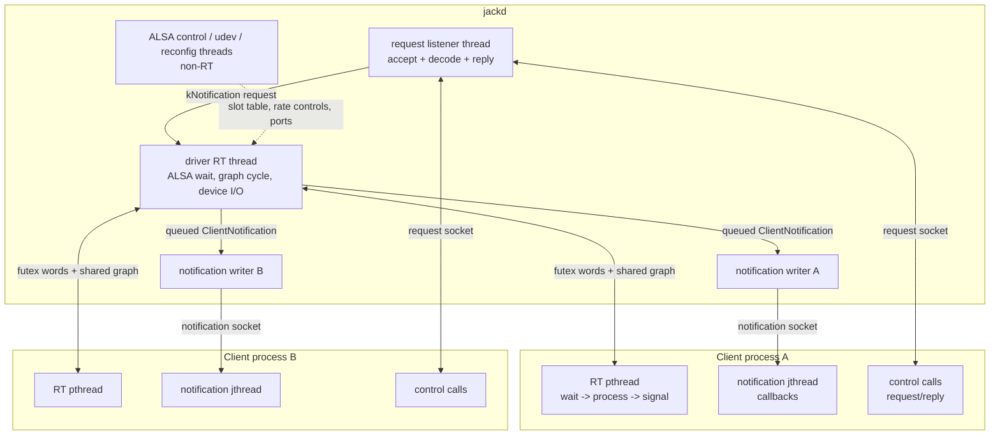
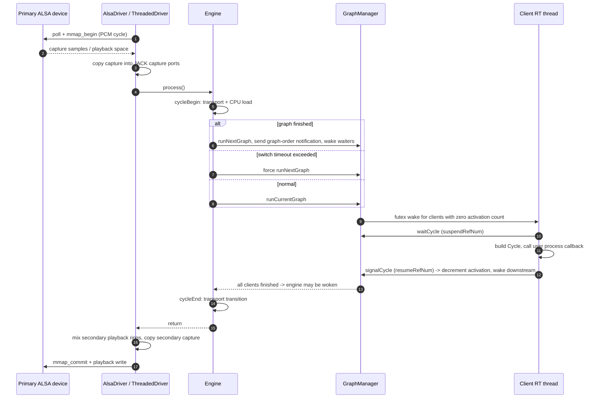
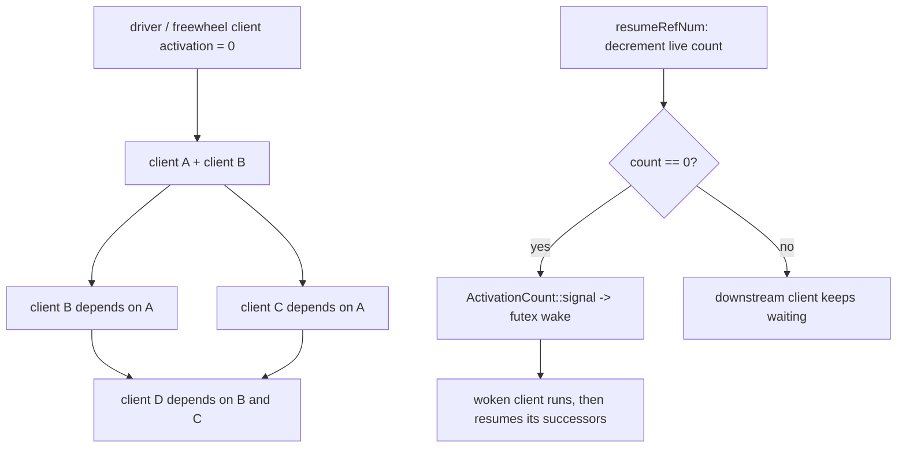

# 04 — Runtime view

This is the process/execution view. It answers *what happens in time*: startup, the handshake, one cycle, lifecycle
changes and shutdown. The concurrency rules are the reason the wire protocol and the shared-memory layout look the way
they do.

## Server startup

```mermaid
sequenceDiagram
    autonumber
    actor User
    participant Main as Jackdmp.cpp
    participant Server as control::Server
    participant Lock as ServerLock
    participant Core as ServerCore
    participant Driver as AudioDriver module
    participant Chan as SocketServerChannel

    User->>Main: jackd [global options] -d alsa [driver options]
    Main->>Main: pre-scan -V / --version
    Main->>Server: create, parse options
    Main->>Server: selectDriver("alsa")
    Main->>Main: remaining argv = driver arguments
    Main->>Server: start(freewheel)
    Server->>Lock: flock(LOCK_EX | LOCK_NB) on /dev/shm/jack_<uid>_server.lock
    alt lock held
        Lock-->>Server: EWOULDBLOCK -> file_exists
        Server-->>User: "'<name>' server already active"
    else lock acquired
        Server->>Core: construct (graph allocate, EngineControl, Engine, FreewheelDriver)
        Server->>Driver: open with parsed parameters
        Server->>Core: open driver, request channel, engine, freewheel; attach master/slave
        Server->>Core: start audio driver (or threaded freewheel), then request channel
        Core->>Chan: bind /dev/shm/jack_<name>_<uid>_0 and start listener thread
        Server-->>User: server running
    end
```

*Source: [Jackdmp.cpp](../../../server/Jackdmp.cpp#L129),
[Control.cpp](../../../server/control/Control.cpp#L541),
[ServerLock.cpp](../../../server/core/ServerLock.cpp#L42),
[ServerCore.cpp](../../../server/core/ServerCore.cpp#L91),
[SocketServerChannel.cpp](../../../server/ipc/SocketServerChannel.cpp#L45).*

The first `-d` selects the driver and ends global option parsing; every following argument belongs to the driver. The
ALSA driver requires an id-based primary device such as `hw:CARD=PCH`; numeric `hw:0` is refused because card numbers
can change. Source: [Jackdmp.cpp](../../../server/Jackdmp.cpp#L193),
[AlsaDriver.cpp](../../../server/drivers/alsa/AlsaDriver.cpp#L1608).

## Threads and ownership



*Source: [SocketServerChannel.cpp](../../../server/ipc/SocketServerChannel.cpp#L206),
[ThreadedDriver.cpp](../../../server/drivers/ThreadedDriver.cpp#L243),
[SocketNotifyChannel.cpp](../../../server/ipc/SocketNotifyChannel.cpp#L108),
[AlsaControlMonitor.cpp](../../../server/drivers/alsa/AlsaControlMonitor.cpp#L216),
[ClientSession.cpp](../../../client/session/ClientSession.cpp#L217).*

`LockedEngine` serialises control calls, while `Engine::process` is explicitly a no-lock RT path. The client's RT thread
is a `pthread` with `SCHED_FIFO` when engine realtime is enabled; the notification thread is a `std::jthread`. Source:
[LockedEngine.h](../../../server/core/LockedEngine.h#L57),
[ClientSession.cpp](../../../client/session/ClientSession.cpp#L753).

## Client open handshake

```mermaid
sequenceDiagram
    autonumber
    participant App
    participant CS as ClientSession
    participant Srv as SocketServerChannel / RequestDecoder
    participant Eng as Engine
    participant Ext as ExternalClient

    App->>CS: Client::open(name, options)
    CS->>CS: acquire process-wide ProcessContext; block SIGPIPE
    CS->>Srv: connect /dev/shm/jack_<name>_<uid>_0
    Note over CS: failure -> Error::kNoServer (clients never start a server)
    CS->>Srv: ClientCheck(name, version=13, uuid, open=true)
    Srv->>Eng: clientCheck
    alt version mismatch
        Eng-->>Srv: failure | version error
        Srv-->>CS: status 7, disconnect
    else version ok
        Eng-->>CS: resolved name (unique suffix or kNameTaken for exact)
        CS->>CS: bind notification socket, start jthread
        CS->>Srv: ClientOpen(name, pid, uuid)
        Srv->>Eng: clientOpen
        Eng->>Ext: allocate refnum, ClientControl segment, futex, synchro
        Eng->>Ext: open server-side notify channel to client socket
        Eng-->>Srv: status + 3 segment sizes + 3 descriptors
        Srv-->>CS: reply with SCM_RIGHTS(engine, graph, control)
        CS->>CS: map 3 segments, read refnum, connect futex
    end
    CS-->>App: Client
```

*Source: [ClientSession.cpp](../../../client/session/ClientSession.cpp#L141),
[Engine.cpp](../../../server/core/Engine.cpp#L448),
[RequestDecoder.cpp](../../../server/ipc/RequestDecoder.cpp#L83),
[ExternalClient.cpp](../../../server/core/ExternalClient.cpp#L45),
[FdSegment.cpp](../../../ipc/memory/FdSegment.cpp#L71).

There is no registry: the server creates memfd segments and passes their descriptors in the `ClientOpen` reply. Source:
[ShmMem.cpp](../../../ipc/memory/ShmMem.cpp#L55),
[Request.h](../../../ipc/protocol/Request.h#L384).

## One engine cycle



*Source: [AudioDriver.cpp](../../../server/drivers/AudioDriver.cpp#L205),
[Engine.cpp](../../../server/core/Engine.cpp#L185),
[GraphManager.cpp](../../../ipc/memory/GraphManager.cpp#L110),
[ConnectionManager.cpp](../../../ipc/memory/ConnectionManager.cpp#L210),
[ClientSession.cpp](../../../client/session/ClientSession.cpp#L801),
[AlsaDriver.cpp](../../../server/drivers/alsa/AlsaDriver.cpp#L1135).*

The client's first cycle is a dummy wait + signal with no callback, which puts its thread in step with the graph before
the first real process call. Source: [ClientSession.cpp](../../../client/session/ClientSession.cpp#L801).

## Activation tree and futex wake



*Source: [ConnectionManager.cpp](../../../ipc/memory/ConnectionManager.cpp#L224),
[ActivationCount.cpp](../../../ipc/memory/ActivationCount.cpp#L25),
[LinuxFutex.cpp](../../../ipc/sync/LinuxFutex.cpp#L52).*

Live activation counts are outside the copy-on-write connection state, so the RT thread only decrements atomics; the
control thread never copies a counter mid-decrement. Source: [GraphManager.h](../../../ipc/memory/GraphManager.h#L45),
[AtomicState.h](../../../ipc/memory/AtomicState.h#L122).

## Client lifecycle

```mermaid
stateDiagram-v2
    [*] --> Opened: Client::open
    Opened --> Active: activate()
    Active --> Inactive: deactivate()
    Inactive --> Active: activate()
    Active --> Inactive: process callback returned false (self-deactivation)
    Opened --> Closed: close() / destructor
    Inactive --> Closed: close() / destructor
    Active --> Closed: close() / destructor
    Closed --> [*]

    note right of Opened
      ports and callbacks may be set
    end note
    note right of Active
      callbacks are fixed; RT thread exists
      only if onProcess was set
    end note
    note right of Inactive
      same session; connections and ports survive;
      callbacks may be changed
    end note
```

*Source: [Client.hpp](../../../client/api/Client.hpp#L75),
[Client.cpp](../../../client/api/Client.cpp#L185),
[ClientSession.cpp](../../../client/session/ClientSession.cpp#L699),
[ClientSession.cpp](../../../client/session/ClientSession.cpp#L732),
[JackminiClientE2e.cpp](../../../tests/JackminiClientE2e.cpp#L85).*

Two nuances are worth stating explicitly:

- “Inactive” is not a separate object state; it is the same session with shared `m_active = false`. Source:
  [Client.hpp](../../../client/api/Client.hpp#L51).
- After a process callback returns `false`, the client deactivates itself on the session side. A subsequent public
  `deactivate()` returns `kInvalidState`; the finished RT thread is joined at `close()`. Source:
  [ClientSession.cpp](../../../client/session/ClientSession.cpp#L875),
  [Client.cpp](../../../client/api/Client.cpp#L193).

## Shutdown path

```mermaid
sequenceDiagram
    autonumber
    actor Signal
    participant Main as Jackdmp.cpp
    participant Server as control::Server
    participant Core as ServerCore
    participant Eng as Engine
    participant Clients

    Signal->>Main: SIGINT / SIGTERM / SIGHUP / SIGQUIT
    Main->>Server: waitForSignal -> stop()
    Server->>Eng: stop()
    Server->>Core: closeEngine()
    Core->>Core: stop active driver
    Core->>Eng: notifyQuit()
    Eng->>Clients: kQUIT on notification channels
    Note over Clients: shutdown callback once (if active); RT threads see graph wait fail
    Core->>Core: stop request channel (QuitException ends listener)
    Core->>Core: notify failure/shutdown, detach and close drivers, close engine
    Server->>Server: cleanupFiles(), release flock
```

*Source: [Control.cpp](../../../server/control/Control.cpp#L638),
[Control.cpp](../../../server/control/Control.cpp#L628),
[ServerCore.cpp](../../../server/core/ServerCore.cpp#L177),
[Engine.cpp](../../../server/core/Engine.cpp#L99),
[RequestDecoder.cpp](../../../server/ipc/RequestDecoder.cpp#L264).*

The single-instance lock is held by the process, not by a file that is removed on release: removing the file could let a
second server lock a new inode while the first still holds the old one. Source:
[ServerLock.h](../../../server/core/ServerLock.h#L24).
