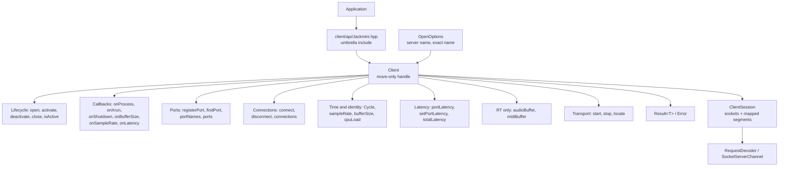
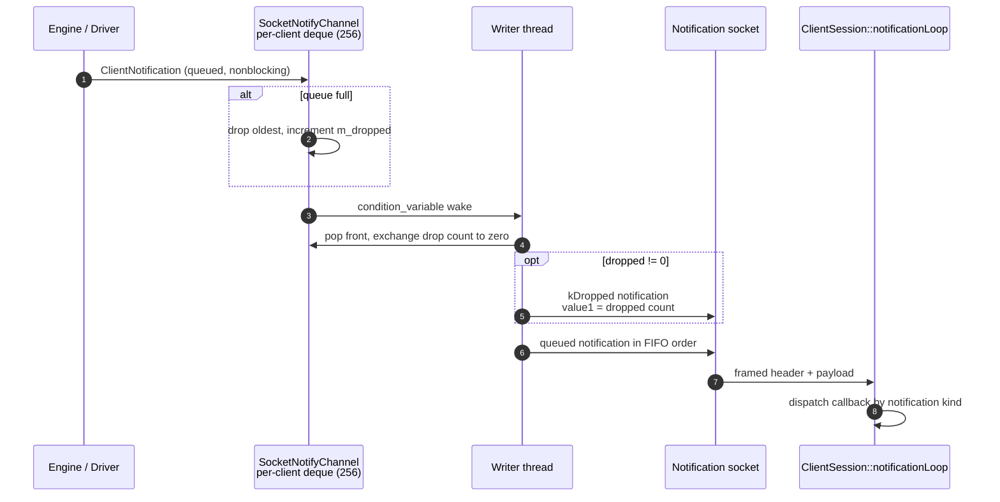
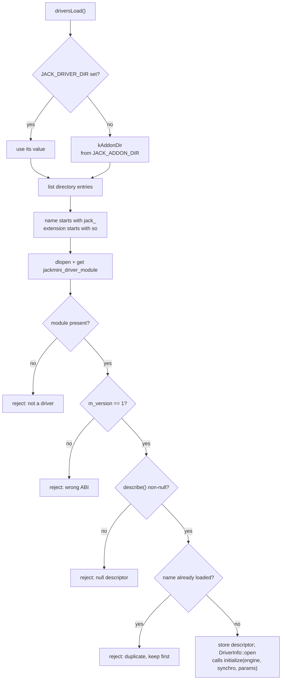

# 05 — Interfaces

This is the interface view: the public C++ surface, the request/reply contract, the notification path and the driver-module
ABI. It complements the [protocol fact sheet](../../reference/protocol.md), the
[client API fact sheet](../../reference/client-api.md) and the runtime sequences in [04](04-runtime-view.md).

## Public API class map



*Source: [Jackmini.hpp](../../../client/api/Jackmini.hpp#L19),
[Client.hpp](../../../client/api/Client.hpp#L63),
[Options.hpp](../../../client/api/Options.hpp#L23),
[Error.hpp](../../../client/api/Error.hpp#L26),
[ClientSession.hpp](../../../client/session/ClientSession.hpp#L43).*

`Client` is intentionally small: control calls return `Result<T>`, while the two buffer accessors are `noexcept` and valid
only inside the process callback. Source: [Client.hpp](../../../client/api/Client.hpp#L135),
[Error.hpp](../../../client/api/Error.hpp#L37).

<!-- fact: ipc/protocol/Message.h:42 pattern="sizeof\\(MsgHeader\\) == 16" -->
<!-- fact: ipc/protocol/Message.h:44 pattern="0x4a4d4e53" -->
<!-- fact: ipc/protocol/Constants.h:66 pattern="kProtocolVersion\\s*=\\s*13" -->
<!-- fact: ipc/protocol/Request.h:88 pattern="kComputeTotalLatencies\\s*=\\s*26" -->
<!-- fact: ipc/protocol/Message.h:46 pattern="kJackMsgProtocolError\\s*=\\s*7" -->

| Wire property | Value | Source |
|---|---|---|
| Frame header | `MsgHeader`, 16 bytes | [Message.h](../../../ipc/protocol/Message.h#L35) |
| Magic | `0x4a4d4e53` (`JMNS`) | [Message.h](../../../ipc/protocol/Message.h#L44) |
| Protocol version | 13; a mismatch is refused, not negotiated | [Constants.h](../../../ipc/protocol/Constants.h#L66), [RequestDecoder.cpp](../../../server/ipc/RequestDecoder.cpp#L64) |
| Request types | 26 values, numbered 1…26 | [Request.h](../../../ipc/protocol/Request.h#L62) |
| Notification kinds | enum values 0–21 (with gaps), 64 reserved for the client callback table | [Notification.h](../../../ipc/protocol/Notification.h#L23) |
| Maximum payload | 4096 bytes; the frame is built on the stack | [Message.h](../../../ipc/protocol/Message.h#L49) |
| Normal reply status | `0` success, `-1` failure; the reason is logged where detected | [RequestDecoder.h](../../../server/ipc/RequestDecoder.h#L29) |
| Protocol refusal | status `7` (`kJackMsgProtocolError`), then the client socket is killed | [Message.h](../../../ipc/protocol/Message.h#L46), [SocketServerChannel.cpp](../../../server/ipc/SocketServerChannel.cpp#L230) |

## Request and reply

```mermaid
sequenceDiagram
    autonumber
    participant App as Application
    participant CS as ClientSession
    participant Srv as SocketServerChannel
    participant Dec as RequestDecoder
    participant Lock as LockedEngine
    participant Eng as Engine

    App->>CS: control call (for example connect)
    CS->>Srv: MsgHeader{magic, version 13, type, length, id} + payload
    Srv->>Srv: poll request socket, read + check header
    alt bad magic or bad length
        Srv->>CS: close socket
    else version mismatch
        Srv->>Dec: refuse(request)
        Dec-->>CS: Reply{result = 7}
        Srv->>CS: close socket
    else accepted
        Srv->>Dec: handleRequest(header)
        Dec->>Lock: typed call from RequestType
        Lock->>Eng: serialised control operation
        Eng-->>Dec: Result&lt;T&gt;
        Dec-->>CS: Reply{result = 0 or -1, echoed id}
    end
    CS-->>App: Result&lt;T&gt;
```

*Source: [Message.h](../../../ipc/protocol/Message.h#L33),
[SocketServerChannel.cpp](../../../server/ipc/SocketServerChannel.cpp#L206),
[RequestDecoder.cpp](../../../server/ipc/RequestDecoder.cpp#L64),
[LockedEngine.h](../../../server/core/LockedEngine.h#L57),
[Request.h](../../../ipc/protocol/Request.h#L183).*

The request and notification sockets are separate. `ClientOpen` carries three descriptors with `SCM_RIGHTS` (engine
control, graph, client control); no other request attaches descriptors. Source:
[Request.h](../../../ipc/protocol/Request.h#L388), [FdSegment.cpp](../../../ipc/memory/FdSegment.cpp#L38),
[ClientSession.cpp](../../../client/session/ClientSession.cpp#L176).

## Notification queue path



*Source: [SocketNotifyChannel.h](../../../server/ipc/SocketNotifyChannel.h#L61),
[SocketNotifyChannel.cpp](../../../server/ipc/SocketNotifyChannel.cpp#L90),
[SocketNotifyChannel.cpp](../../../server/ipc/SocketNotifyChannel.cpp#L108),
[SocketNotifyChannel.cpp](../../../server/ipc/SocketNotifyChannel.cpp#L142),
[ClientSession.cpp](../../../client/session/ClientSession.cpp#L225).*

<!-- fact: server/ipc/SocketNotifyChannel.h:63 pattern="kQueueSize\\s*=\\s*256" -->

| Queue property | Value | Source |
|---|---|---|
| Capacity | 256 entries per client | [SocketNotifyChannel.h](../../../server/ipc/SocketNotifyChannel.h#L63) |
| Overflow policy | Drop the oldest entry, increment `m_dropped`, release a waiting synchronous caller | [SocketNotifyChannel.cpp](../../../server/ipc/SocketNotifyChannel.cpp#L90) |
| Drop report | `kDropped` (21) with the count in `value1`, sent before the next queued notification | [Notification.h](../../../ipc/protocol/Notification.h#L43), [SocketNotifyChannel.cpp](../../../server/ipc/SocketNotifyChannel.cpp#L144) |
| Ordering | One writer thread per client owns socket writes | [SocketNotifyChannel.cpp](../../../server/ipc/SocketNotifyChannel.cpp#L108) |
| Verification | `notify_overflow_unit` checks delivered + dropped, newest delivered and order | [NotifyOverflowUnit.cpp](../../../tests/NotifyOverflowUnit.cpp#L126) |

### Which notifications are dispatched

| Kind | Client-side effect | Source |
|---|---|---|
| `kAddClient`, `kRemoveClient` | connect/disconnect the futex synchro entry | [ClientSession.cpp](../../../client/session/ClientSession.cpp#L296) |
| `kShutDownCallback`, `kXRunCallback`, `kBufferSizeCallback`, `kSampleRateCallback`, `kLatencyCallback` | call the matching stored callback when active | [ClientSession.cpp](../../../client/session/ClientSession.cpp#L307) |
| `kStartFreewheelCallback`, `kStopFreewheelCallback` | switch driver sync and realtime class | [ClientSession.cpp](../../../client/session/ClientSession.cpp#L333) |
| `kDropped` | logged as a lost-notification error | [ClientSession.cpp](../../../client/session/ClientSession.cpp#L264) |
| `kSecondarySampleRateCallback` | **wire only**: emitted on a secondary card rate change; the public API has no dispatch for it | [Engine.cpp](../../../server/core/Engine.cpp#L389), [Notification.h](../../../ipc/protocol/Notification.h#L42), [ClientSession.cpp](../../../client/session/ClientSession.cpp#L295) |

## Driver module ABI



*Source: [DriverLoader.cpp](../../../server/drivers/DriverLoader.cpp#L177),
[DriverLoader.cpp](../../../server/drivers/DriverLoader.cpp#L131),
[DriverModule.h](../../../server/drivers/DriverModule.h#L33),
[DriverInfo.h](../../../server/drivers/DriverInfo.h#L25),
[CMakeLists.txt](../../../CMakeLists.txt#L122).*

<!-- fact: server/drivers/DriverModule.h:34 pattern="kModuleVersion\\s*=\\s*1" -->
<!-- fact: server/drivers/DriverModule.h:37 pattern="kModuleSymbol" -->
<!-- fact: server/drivers/DriverLoader.cpp:183 pattern="JACK_DRIVER_DIR" -->
<!-- fact: server/drivers/DriverLoader.cpp:200 pattern="starts_with" -->

| ABI property | Value | Source |
|---|---|---|
| Module version | `kModuleVersion = 1`; mismatches are refused on discovery and on open | [DriverModule.h](../../../server/drivers/DriverModule.h#L34), [DriverLoader.cpp](../../../server/drivers/DriverLoader.cpp#L151), [DriverLoader.cpp](../../../server/drivers/DriverLoader.cpp#L251) |
| Exported symbol | one `extern "C"` function, `jackmini_driver_module` | [DriverModule.h](../../../server/drivers/DriverModule.h#L37), [DriverModule.h](../../../server/drivers/DriverModule.h#L60) |
| Module table | `m_version`, `m_describe`, `m_initialize` | [DriverModule.h](../../../server/drivers/DriverModule.h#L46) |
| Descriptor shape | `DriverDesc` with fixed-size name, description, path and parameter array | [DriverInterface.h](../../../server/drivers/DriverInterface.h#L123) |
| Fixed text limits | driver name 15, parameter name 15, parameter string 127, description 255 | [DriverInterface.h](../../../server/drivers/DriverInterface.h#L32) |
| Discovery directory | `$JACK_DRIVER_DIR`, else `kAddonDir` configured from `JACK_ADDON_DIR` | [DriverLoader.cpp](../../../server/drivers/DriverLoader.cpp#L182), [CMakeLists.txt](../../../CMakeLists.txt#L122) |
| Accepted filenames | prefix `jack_`, extension starting with `so` | [DriverLoader.cpp](../../../server/drivers/DriverLoader.cpp#L93), [DriverLoader.cpp](../../../server/drivers/DriverLoader.cpp#L197) |
| Rejection rules | wrong version, null descriptor, duplicate descriptor name | [DriverLoader.cpp](../../../server/drivers/DriverLoader.cpp#L146), [DriverLoader.cpp](../../../server/drivers/DriverLoader.cpp#L157), [DriverLoader.cpp](../../../server/drivers/DriverLoader.cpp#L162) |

`DriverInfo` keeps the `dlopen` handle for the lifetime of the backend and unloads it in its destructor; discovery uses a
temporary handle and a `unique_ptr` closer. Source: [DriverInfo.h](../../../server/drivers/DriverInfo.h#L25),
[DriverLoader.cpp](../../../server/drivers/DriverLoader.cpp#L121), [DriverLoader.cpp](../../../server/drivers/DriverLoader.cpp#L224).
