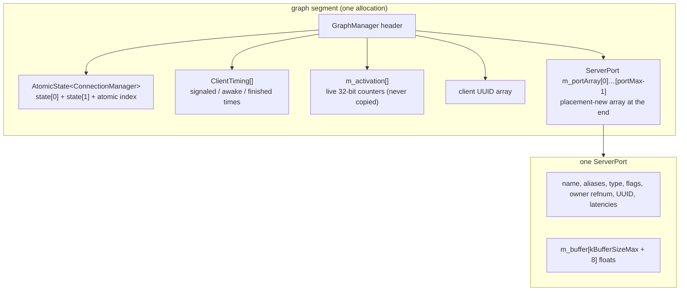
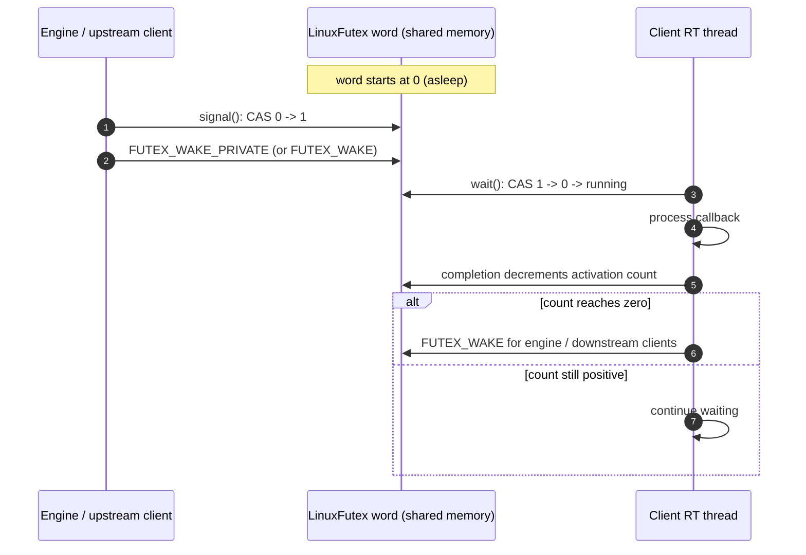
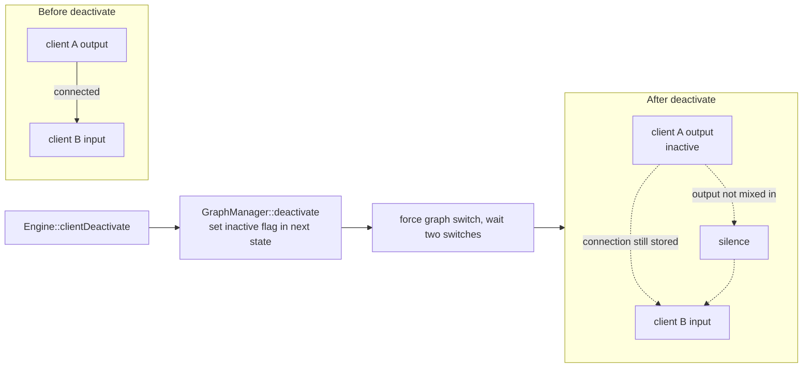
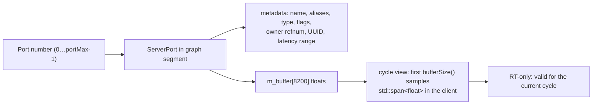

# 06 — Memory and synchronisation

The graph is shared memory, not a socket protocol. Control messages set it up and change it; the cycle reads and writes
it directly. This view is the data view plus the realtime cross-cutting concept.

## Segment handoff

```mermaid
sequenceDiagram
    autonumber
    participant Srv as Server (ShmMem)
    participant Memfd as memfd_create("jack-sharedN")
    participant Dec as RequestDecoder
    participant Sock as AF_UNIX socket
    participant Cli as ClientSession

    Srv->>Memfd: create + ftruncate + mmap(MAP_SHARED)
    Note over Srv: engine control, graph, per-client control
    Srv->>Dec: three ShmSegment{fd,size}
    Dec->>Sock: ClientOpenResult + SCM_RIGHTS(fd[0..2])
    Sock->>Cli: recvWithFds (MSG_CMSG_CLOEXEC), kMaxFds = 8
    Cli->>Cli: ShmReadWritePtr maps each segment
    Cli->>Cli: close the received descriptors; mappings remain
    Note over Cli: no registry, no /dev/shm table to leak
```

*Source: [ShmMem.cpp](../../../ipc/memory/ShmMem.cpp#L55),
[ShmMem.h](../../../ipc/memory/ShmMem.h#L56),
[FdSegment.cpp](../../../ipc/memory/FdSegment.cpp#L38),
[ClientSession.cpp](../../../client/session/ClientSession.cpp#L176).*

<!-- fact: ipc/memory/FdSegment.cpp:39 pattern="kMaxFds\\s*=\\s*8" -->
<!-- fact: ipc/protocol/Constants.h:28 pattern="kBufferSizeMax\\s*=\\s*8192" -->

| Property | Value | Source |
|---|---|---|
| Segment naming | `jack-sharedN` via `memfd_create(..., MFD_CLOEXEC)` | [ShmMem.cpp](../../../ipc/memory/ShmMem.cpp#L55) |
| Descriptor passing | `SCM_RIGHTS`, at most 8 descriptors per message | [FdSegment.cpp](../../../ipc/memory/FdSegment.cpp#L38) |
| Descriptors in `ClientOpen` reply | exactly 3, in order: engine control, graph, client control | [Request.h](../../../ipc/protocol/Request.h#L384) |
| Client mapping | `mmap(PROT_READ | PROT_WRITE, MAP_SHARED)`; `mlock` where possible | [FdSegment.cpp](../../../ipc/memory/FdSegment.cpp#L148) |
| Maximum audio frames per port buffer | 8192 (`kBufferSizeMax`) | [Constants.h](../../../ipc/protocol/Constants.h#L28) |

## Graph segment layout



*Source: [GraphManager.h](../../../ipc/memory/GraphManager.h#L40),
[GraphManager.cpp](../../../ipc/memory/GraphManager.cpp#L46),
[ConnectionManager.h](../../../ipc/memory/ConnectionManager.h#L374),
[ServerPort.h](../../../ipc/memory/ServerPort.h#L34),
[ShmLayoutUnit.cpp](../../../tests/ShmLayoutUnit.cpp#L41).*

The array is allocated as `sizeof(GraphManager) + portMax * sizeof(ServerPort)` and is never reallocated. The port count
is fixed by the server's `-p` option, capped at `kPortNumMax = 4096`; the default is 2048. Source:
[GraphManager.cpp](../../../ipc/memory/GraphManager.cpp#L46),
[Constants.h](../../../ipc/protocol/Constants.h#L45),
[Control.cpp](../../../server/control/Control.cpp#L586).

## Copy-on-write state switch

```mermaid
sequenceDiagram
    autonumber
    participant Ctrl as Control thread
    participant State as AtomicState&lt;ConnectionManager&gt;
    participant RT as Engine RT thread

    Ctrl->>State: writeNextStateStart()
    State->>State: invalidate next, copy current configuration into next
    Ctrl->>State: mutate next (connect, disconnect, activate, deactivate, ports)
    Ctrl->>State: writeNextStateStop()
    State->>State: publish next index atomically
    RT->>State: readCurrentState() each cycle
    Note over RT: live activation counters are outside the copied state
    RT->>State: CAS next -> current at a safe cycle boundary
    State-->>Ctrl: two graph switches are awaited before the change is considered live
```

*Source: [AtomicState.h](../../../ipc/memory/AtomicState.h#L122),
[GraphManager.cpp](../../../ipc/memory/GraphManager.cpp#L110),
[Engine.cpp](../../../server/core/Engine.cpp#L162),
[ConnectionManager.h](../../../ipc/memory/ConnectionManager.h#L374).*

| State part | Written by | Copied? | Source |
|---|---|---|---|
| Connections, port lists, matrix, configured input counts, inactive flags | Control path only | Yes, copy-on-write | [ConnectionManager.h](../../../ipc/memory/ConnectionManager.h#L374) |
| Live activation counts | RT thread | No; separate `m_activation[]` | [GraphManager.h](../../../ipc/memory/GraphManager.h#L45) |
| Client timing and UUIDs | Control and RT at defined points | No | [GraphManager.h](../../../ipc/memory/GraphManager.h#L45) |

## Futex wait and wake



*Source: [LinuxFutex.cpp](../../../ipc/sync/LinuxFutex.cpp#L52),
[LinuxFutex.cpp](../../../ipc/sync/LinuxFutex.cpp#L78),
[LinuxFutex.h](../../../ipc/sync/LinuxFutex.h#L36),
[ActivationCount.cpp](../../../ipc/memory/ActivationCount.cpp#L25).*

The futex word is the first field of `FutexData`; the remaining fields track internal/external transitions and are
guarded by a mutex on the control path. Source: [LinuxFutex.h](../../../ipc/sync/LinuxFutex.h#L36),
[LinuxFutex.cpp](../../../ipc/sync/LinuxFutex.cpp#L182).

## Deactivate keeps the connections



*Source: [Engine.cpp](../../../server/core/Engine.cpp#L795),
[GraphManager.cpp](../../../ipc/memory/GraphManager.cpp#L578),
[ConnectionManager.h](../../../ipc/memory/ConnectionManager.h#L381),
[GraphManager.cpp](../../../ipc/memory/GraphManager.cpp#L204),
[DeactivateGraphUnit.cpp](../../../tests/DeactivateGraphUnit.cpp#L103).*

An inactive client's input receives silence and its outputs are not mixed into any input; no disconnection notification
is sent because nothing was disconnected. Source: [GraphManager.cpp](../../../ipc/memory/GraphManager.cpp#L204).

## Port buffer layout



*Source: [ServerPort.h](../../../ipc/memory/ServerPort.h#L34),
[Client.cpp](../../../client/api/Client.cpp#L488),
[ClientSession.cpp](../../../client/session/ClientSession.cpp#L660).*

`ServerPort::m_buffer` holds `kBufferSizeMax + 8` floats; the extra room is not part of the client-visible span. Source:
[ServerPort.h](../../../ipc/memory/ServerPort.h#L50).
