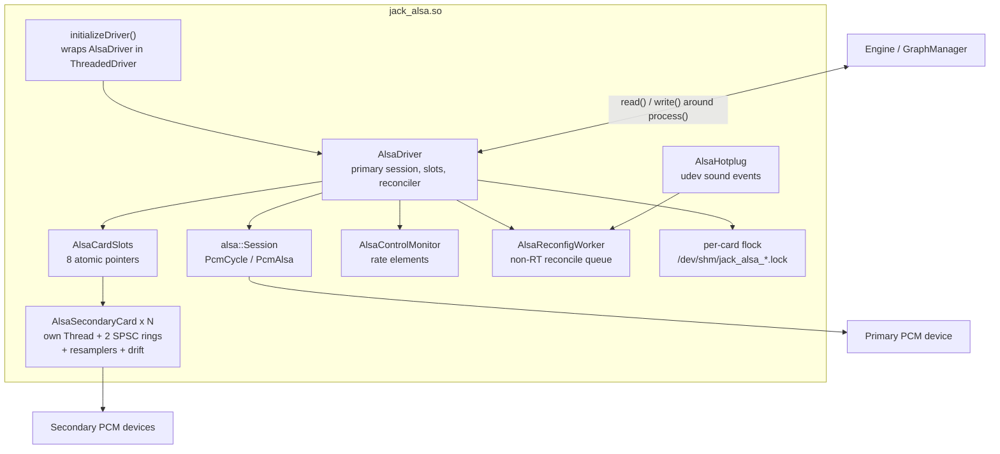
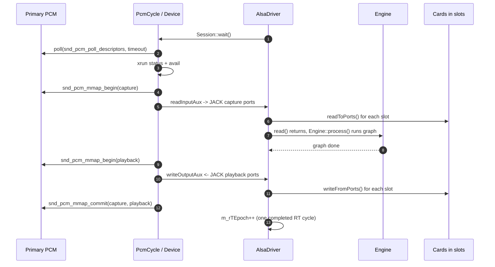
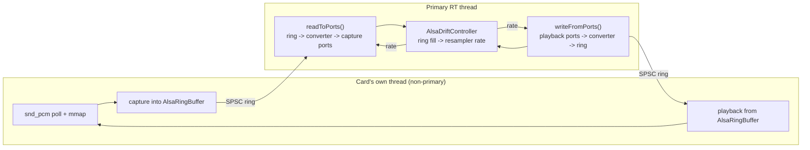
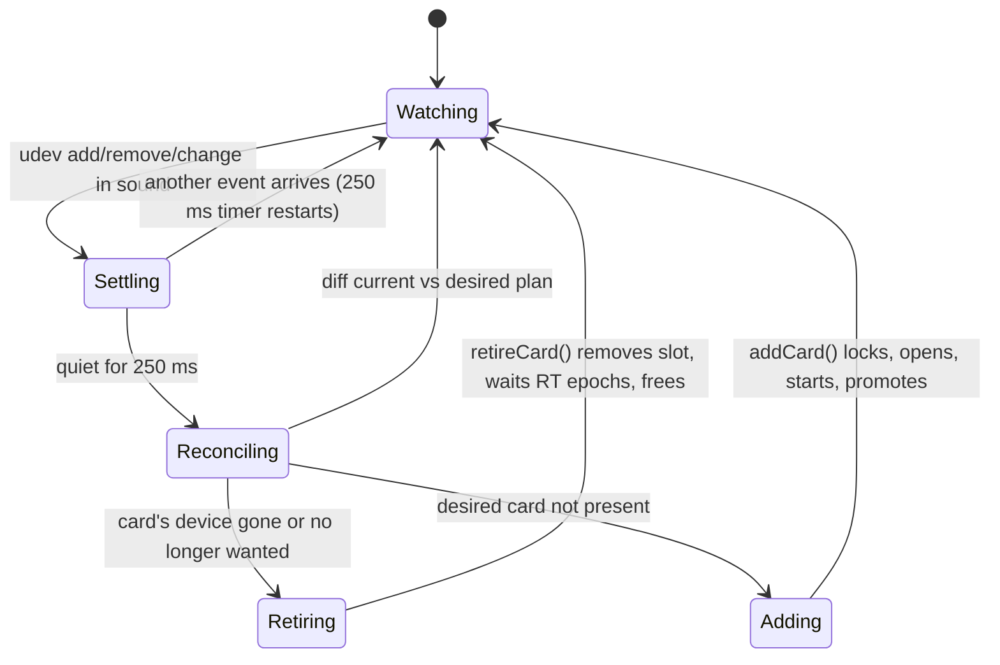
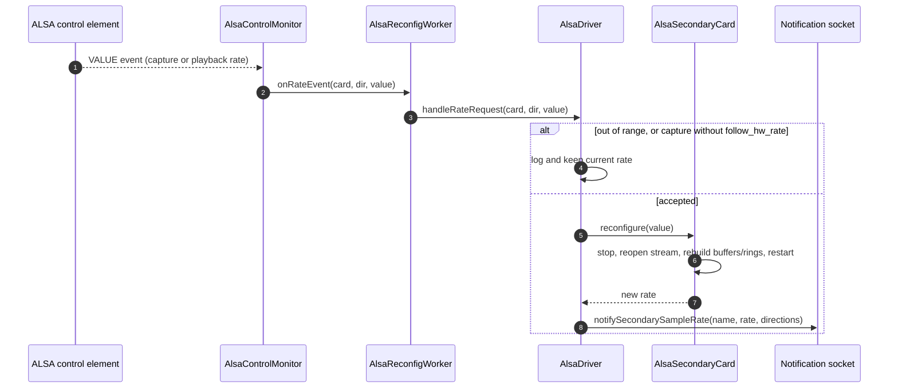
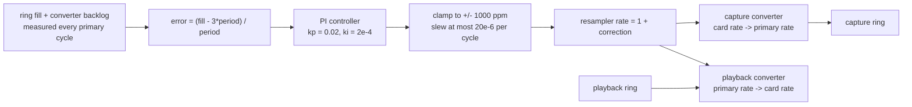

# 07 — ALSA driver

This is the SEI component/module view of the only hardware backend. It complements the structural view in
[03](03-building-blocks.md), the cycle sequence in [04](04-runtime-view.md) and the operator view in
[secondary cards](../../user/secondary-cards.md).

## ALSA component map

*Source: [AlsaDriver.cpp](../../../server/drivers/alsa/AlsaDriver.cpp#L1617),
[PcmSession.hpp](../../../server/drivers/alsa/PcmSession.hpp#L30),
[AlsaDriver.h](../../../server/drivers/alsa/AlsaDriver.h#L43),
[AlsaSecondaryCard.h](../../../server/drivers/alsa/AlsaSecondaryCard.h#L41),
[AlsaHotplug.h](../../../server/drivers/alsa/AlsaHotplug.h#L42),
[AlsaControl.cpp](../../../server/drivers/alsa/AlsaControl.cpp#L45).*

The module is a `ThreadedDriver` decorator around `AlsaDriver`: the blocking PCM wait runs on the driver thread while
the engine sees the usual `read`/`write` calls. Source:
[AlsaDriver.cpp](../../../server/drivers/alsa/AlsaDriver.cpp#L1617),
[ThreadedDriver.h](../../../server/drivers/ThreadedDriver.h#L27).

<!-- fact: server/drivers/alsa/AlsaDriver.h:44 pattern="AlsaSlotTable<AlsaSecondaryCard, 8>" -->
<!-- fact: server/drivers/alsa/AlsaHotplug.cpp:32 pattern="gKSettleMs\\s*=\\s*250" -->
<!-- fact: server/drivers/alsa/AlsaDriftController.h:44 pattern="kp\\s*=\\s*0.02" -->

| Property | Value | Source |
|---|---|---|
| Secondary capacity | 8 slots (`AlsaSlotTable<AlsaSecondaryCard, 8>`) | [AlsaDriver.h](../../../server/drivers/alsa/AlsaDriver.h#L44), [AlsaSlotTable.h](../../../server/drivers/alsa/AlsaSlotTable.h#L51) |
| Primary cycle core | `PcmCycle = Cycle<alsa::Device>`; poll descriptors and `snd_pcm_mmap_begin`/`commit` | [PcmSession.hpp](../../../server/drivers/alsa/PcmSession.hpp#L30), [PcmCycle.hpp](../../../server/drivers/alsa/PcmCycle.hpp#L72), [PcmAlsa.cpp](../../../server/drivers/alsa/PcmAlsa.cpp#L363), [PcmAlsa.cpp](../../../server/drivers/alsa/PcmAlsa.cpp#L400) |
| Cycle allocation | none after construction; vectors are sized in the constructor | [PcmCycle.hpp](../../../server/drivers/alsa/PcmCycle.hpp#L102), [PcmCycle.hpp](../../../server/drivers/alsa/PcmCycle.hpp#L178) |
| Hot-plug settle | 250 ms after the last `sound` udev event | [AlsaHotplug.cpp](../../../server/drivers/alsa/AlsaHotplug.cpp#L31), [AlsaHotplug.cpp](../../../server/drivers/alsa/AlsaHotplug.cpp#L103) |
| Card lock | `/dev/shm/jack_alsa_<sanitised card>.lock`, `flock(LOCK_EX \| LOCK_NB)` | [AlsaControl.cpp](../../../server/drivers/alsa/AlsaControl.cpp#L45), [Constants.h](../../../ipc/protocol/Constants.h#L61) |
| Primary device naming | must be an id-based PCM such as `hw:CARD=PCH`; numeric `hw:0` is refused | [AlsaDriver.cpp](../../../server/drivers/alsa/AlsaDriver.cpp#L1608) |
| Resampler implementations | only `pipewire` is registered | [Resampler.cpp](../../../server/drivers/alsa/resample/Resampler.cpp#L75), [Resampler.cpp](../../../server/drivers/alsa/resample/Resampler.cpp#L95) |

## Primary capture and playback flow

*Source: [PcmCycle.hpp](../../../server/drivers/alsa/PcmCycle.hpp#L293),
[PcmCycle.hpp](../../../server/drivers/alsa/PcmCycle.hpp#L479),
[PcmAlsa.cpp](../../../server/drivers/alsa/PcmAlsa.cpp#L378),
[AlsaDriver.cpp](../../../server/drivers/alsa/AlsaDriver.cpp#L1135),
[AlsaDriver.cpp](../../../server/drivers/alsa/AlsaDriver.cpp#L1197).*

An xrun with zero ready frames is retried, resets resampler history for every card in a slot, and notifies clients; a
negative wait status or a repeated stall calls `primaryFailed()`. Source:
[AlsaDriver.cpp](../../../server/drivers/alsa/AlsaDriver.cpp#L1142),
[AlsaDriver.cpp](../../../server/drivers/alsa/AlsaDriver.cpp#L1159),
[AlsaDriver.cpp](../../../server/drivers/alsa/AlsaDriver.cpp#L1170).

## Secondary sample flows

*Source: [AlsaSecondaryCard.h](../../../server/drivers/alsa/AlsaSecondaryCard.h#L41),
[AlsaRingBuffer.h](../../../server/drivers/alsa/AlsaRingBuffer.h#L26),
[AlsaSecondaryCard.cpp](../../../server/drivers/alsa/AlsaSecondaryCard.cpp#L892),
[AlsaSecondaryCard.cpp](../../../server/drivers/alsa/AlsaSecondaryCard.cpp#L937),
[AlsaSecondaryCard.cpp](../../../server/drivers/alsa/AlsaSecondaryCard.cpp#L862).*

The primary thread never calls ALSA for a secondary card; it only reads and writes rings and JACK port buffers. Rings are
power-of-two SPSC buffers with cache-line-separated positions; a full producer drops frames and an empty consumer reads
silence. Source: [AlsaSecondaryCard.h](../../../server/drivers/alsa/AlsaSecondaryCard.h#L43),
[AlsaRingBuffer.h](../../../server/drivers/alsa/AlsaRingBuffer.h#L26),
[AlsaRingBuffer.h](../../../server/drivers/alsa/AlsaRingBuffer.h#L74).

<!-- fact: server/drivers/alsa/AlsaSecondaryCard.cpp:205 pattern="primaryBufferSize \\* \\(double\\)rate" -->

| Secondary property | Value / rule | Source |
|---|---|---|
| Hardware period | `round(primaryBufferSize * rate / primaryRate)`, minimum 1 frame | [AlsaSecondaryCard.cpp](../../../server/drivers/alsa/AlsaSecondaryCard.cpp#L200), [AlsaSecondaryCard.cpp](../../../server/drivers/alsa/AlsaSecondaryCard.cpp#L205) |
| Period count | configured `m_nperiods`, otherwise the primary's value | [AlsaSecondaryCard.cpp](../../../server/drivers/alsa/AlsaSecondaryCard.cpp#L391) |
| Converter use | async clock always converts, even at equal rates; sync clock converts only on a rate mismatch | [AlsaSecondaryCard.cpp](../../../server/drivers/alsa/AlsaSecondaryCard.cpp#L284) |
| Ring capacity | `period * 8`, at least `period + 1` | [AlsaSecondaryCard.cpp](../../../server/drivers/alsa/AlsaSecondaryCard.cpp#L324) |
| Explicit cards | one value per driver option; use `--secondary-file` for several cards | [Control.cpp](../../../server/control/Control.cpp#L447), [AlsaDriver.cpp](../../../server/drivers/alsa/AlsaDriver.cpp#L1590) |
| Card exclusion | comma-separated `--exclude-card` ids, case-insensitive; applies only to automatic discovery | [AlsaDriver.cpp](../../../server/drivers/alsa/AlsaDriver.cpp#L1572), [AlsaSecondaryConfig.h](../../../server/drivers/alsa/AlsaSecondaryConfig.h#L119) |

## Hot-plug reconcile state machine

*Source: [AlsaHotplug.cpp](../../../server/drivers/alsa/AlsaHotplug.cpp#L31),
[AlsaHotplug.cpp](../../../server/drivers/alsa/AlsaHotplug.cpp#L103),
[AlsaDriver.cpp](../../../server/drivers/alsa/AlsaDriver.cpp#L948),
[AlsaDriver.cpp](../../../server/drivers/alsa/AlsaDriver.cpp#L983),
[AlsaDriver.cpp](../../../server/drivers/alsa/AlsaDriver.cpp#L997).*

The reconcile runs on the reconfig worker, not on the RT thread. A failed automatic card is logged and skipped; it is
tried again at the next device change. Source: [AlsaDriver.cpp](../../../server/drivers/alsa/AlsaDriver.cpp#L1018),
[AlsaDriver.cpp](../../../server/drivers/alsa/AlsaDriver.cpp#L1031).

### Safe retirement

| Step | Action | Source |
|---|---|---|
| 1 | Erase from owned vector and clear every slot holding the card | [AlsaDriver.cpp](../../../server/drivers/alsa/AlsaDriver.cpp#L251) |
| 2 | Wait for two RT epochs (`m_rTEpoch >= start + 2`, polled up to 2 s) | [AlsaDriver.cpp](../../../server/drivers/alsa/AlsaDriver.cpp#L233), [AlsaDriver.cpp](../../../server/drivers/alsa/AlsaDriver.cpp#L239) |
| 3 | Remove control watches and unregister the card's ports | [AlsaDriver.cpp](../../../server/drivers/alsa/AlsaDriver.cpp#L272) |
| 4 | Delete the card and refresh secondary latencies | [AlsaDriver.cpp](../../../server/drivers/alsa/AlsaDriver.cpp#L276) |
| Failure path | If no safe point is reached, leave the unused card allocated rather than free memory the RT thread may still use | [AlsaDriver.cpp](../../../server/drivers/alsa/AlsaDriver.cpp#L264) |

## Secondary rate-change sequence

*Source: [AlsaControlMonitor.h](../../../server/drivers/alsa/AlsaControlMonitor.h#L31),
[AlsaReconfigWorker.cpp](../../../server/drivers/alsa/AlsaReconfigWorker.cpp#L94),
[AlsaDriver.cpp](../../../server/drivers/alsa/AlsaDriver.cpp#L1072),
[AlsaSecondaryCard.cpp](../../../server/drivers/alsa/AlsaSecondaryCard.cpp#L701),
[Engine.cpp](../../../server/core/Engine.cpp#L389).*

`kSecondarySampleRateCallback` exists on the wire, but `ClientSession::handleNotification` has no case for it and the
public `Client` has no matching callback. Source: [Notification.h](../../../ipc/protocol/Notification.h#L42),
[ClientSession.cpp](../../../client/session/ClientSession.cpp#L291), [Client.hpp](../../../client/api/Client.hpp#L69).

## Resampler and drift pipeline

*Source: [AlsaDriftController.h](../../../server/drivers/alsa/AlsaDriftController.h#L21),
[AlsaDriftController.cpp](../../../server/drivers/alsa/AlsaDriftController.cpp#L49),
[AlsaSecondaryCard.cpp](../../../server/drivers/alsa/AlsaSecondaryCard.cpp#L862),
[AlsaSecondaryCard.cpp](../../../server/drivers/alsa/AlsaSecondaryCard.cpp#L294).*

<!-- fact: server/drivers/alsa/AlsaDriftController.h:45 pattern="1000e-6, double slew = 20e-6" -->

| Controller constant | Value | Source |
|---|---|---|
| `kp` | 0.02 per period of fill error | [AlsaDriftController.h](../../../server/drivers/alsa/AlsaDriftController.h#L44) |
| `ki` | 2e-4 per period of fill error | [AlsaDriftController.h](../../../server/drivers/alsa/AlsaDriftController.h#L44) |
| Maximum correction | 1000e-6 (±1000 ppm) | [AlsaDriftController.h](../../../server/drivers/alsa/AlsaDriftController.h#L45) |
| Slew per cycle | 20e-6 | [AlsaDriftController.h](../../../server/drivers/alsa/AlsaDriftController.h#L45) |
| Target fill | 3 periods | [AlsaSecondaryCard.cpp](../../../server/drivers/alsa/AlsaSecondaryCard.cpp#L874) |

## Failure behaviour

- **Primary device:** a negative wait status or a write error reaches `primaryFailed()`, which reports
  `notifyFailure(kBackendError, …)` and calls `Tools::killServer()`; only the first failure is reported. Source:
  [AlsaDriver.cpp](../../../server/drivers/alsa/AlsaDriver.cpp#L280),
  [AlsaDriver.cpp](../../../server/drivers/alsa/AlsaDriver.cpp#L291),
  [AlsaDriver.cpp](../../../server/drivers/alsa/AlsaDriver.cpp#L292).
- **Secondary device:** an I/O error stops that card and calls the failure sink, which retires only that slot; the primary
  graph keeps running. Source: [AlsaSecondaryCard.h](../../../server/drivers/alsa/AlsaSecondaryCard.h#L126),
  [AlsaDriver.cpp](../../../server/drivers/alsa/AlsaDriver.cpp#L295).
- **Unknown resampler name:** refused when the card is created, independently of the card's optional flag. Source:
  [Resampler.cpp](../../../server/drivers/alsa/resample/Resampler.cpp#L95),
  [AlsaDriver.cpp](../../../server/drivers/alsa/AlsaDriver.cpp#L750).
