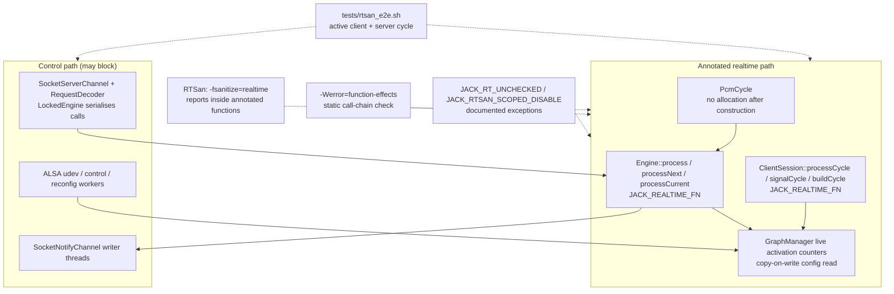
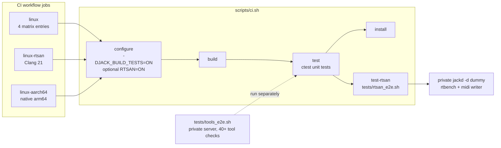

# 08 — Quality and validation

This chapter closes the arc42 loop: quality goals become mechanisms, mechanisms become checks, and the checks are wired
into [CI](#ci). It also records the known documentation drift that this guide deliberately does not repeat. The complete
test inventory is in [testing](../testing.md).

## Realtime and control boundary

*Source: [Engine.h](../../../server/core/Engine.h#L144),
[ClientSession.hpp](../../../client/session/ClientSession.hpp#L169),
[PcmCycle.hpp](../../../server/drivers/alsa/PcmCycle.hpp#L102),
[GraphManager.h](../../../ipc/memory/GraphManager.h#L45),
[Realtime.h](../../../common/Realtime.h#L19),
[CMakeLists.txt](../../../CMakeLists.txt#L108),
[tests/rtsan_e2e.sh](../../../tests/rtsan_e2e.sh#L1).*

`JACK_REALTIME_FN` expands to `[[clang::nonblocking]]` only in an RTSan build with a Clang that has the attribute; in
other builds it is empty. Exemptions are explicit macros with a compile-time reason string. Source:
[Realtime.h](../../../common/Realtime.h#L23), [Realtime.h](../../../common/Realtime.h#L39).

<!-- fact: CMakeLists.txt:67 pattern="VERSION_LESS 20" -->
<!-- fact: CMakeLists.txt:114 pattern="-Werror=function-effects" -->

| Quality requirement | Mechanism | Verification | Source |
|---|---|---|---|
| Deterministic cycle | No allocation after cycle construction; no locks in `Engine::process`; live counters outside copied state | RTSan e2e with active clients; function-effect analysis in RTSan builds | [PcmCycle.hpp](../../../server/drivers/alsa/PcmCycle.hpp#L102), [Engine.cpp](../../../server/core/Engine.cpp#L185), [AtomicState.h](../../../ipc/memory/AtomicState.h#L122), [tests/rtsan_e2e.sh](../../../tests/rtsan_e2e.sh#L116) |
| One stable clock domain | Primary card sets rate and buffer; secondary period derived from it | `alsa_secondary_unit` checks secondary building blocks; `pcm_cycle_unit` checks the cycle core | [AlsaSecondaryCard.cpp](../../../server/drivers/alsa/AlsaSecondaryCard.cpp#L205), [CMakeLists.txt](../../../CMakeLists.txt#L403), [CMakeLists.txt](../../../CMakeLists.txt#L410) |
| Recovery without restart | 8 RT slots, udev reconcile, safe-point retirement | `alsa_secondary_unit`, tool e2e, manual hardware checks | [AlsaDriver.h](../../../server/drivers/alsa/AlsaDriver.h#L44), [AlsaHotplug.cpp](../../../server/drivers/alsa/AlsaHotplug.cpp#L32), [AlsaDriver.cpp](../../../server/drivers/alsa/AlsaDriver.cpp#L251) |
| Failure containment | Kernel-held `flock`, memfd segments, `SCM_RIGHTS`, socket cleanup | One-server ADR, protocol conformance, layout and descriptor tests | [ServerLock.cpp](../../../server/core/ServerLock.cpp#L42), [FdSegment.cpp](../../../ipc/memory/FdSegment.cpp#L38), [tests/ProtocolConformanceUnit.cpp](../../../tests/ProtocolConformanceUnit.cpp#L17) |
| Honest external boundary | C++23 API, protocol version 13, one driver ABI version | API and frame compile-time checks, protocol conformance, driver-loader rules | [Client.hpp](../../../client/api/Client.hpp#L63), [Constants.h](../../../ipc/protocol/Constants.h#L66), [DriverModule.h](../../../server/drivers/DriverModule.h#L34), [tests/MessageFrameUnit.cpp](../../../tests/MessageFrameUnit.cpp#L17) |

## Test and sanitizer map

*Source: [scripts/ci.sh](../../../scripts/ci.sh#L18),
[tests/rtsan_e2e.sh](../../../tests/rtsan_e2e.sh#L104),
[tests/tools_e2e.sh](../../../tests/tools_e2e.sh#L1),
[build.yml](../../../.github/workflows/build.yml#L11).*

<!-- fact: CMakeLists.txt:13 pattern="JACK_BUILD_TESTS.*OFF" -->

| Validation property | Value | Source |
|---|---|---|
| Test build default | `JACK_BUILD_TESTS=OFF`; turn it on to build test programs | [CMakeLists.txt](../../../CMakeLists.txt#L13) |
| Registered CTest tests | 14 | [CMakeLists.txt](../../../CMakeLists.txt#L403), [CMakeLists.txt](../../../CMakeLists.txt#L490) |
| `linux` matrix | 4 entries: GCC, Clang, GCC with SSE4.1/AVX2 flags, GCC Debug | [build.yml](../../../.github/workflows/build.yml#L26) |
| RTSan CI compiler | Clang 21 (`clang-21`, `clang++-21`) | [build.yml](../../../.github/workflows/build.yml#L72), [build.yml](../../../.github/workflows/build.yml#L73) |
| RTSan compiler floor | Clang 20+ | [CMakeLists.txt](../../../CMakeLists.txt#L62), [CMakeLists.txt](../../../CMakeLists.txt#L67) |
| Other CI jobs | `linux-aarch64` on a native arm64 runner | [build.yml](../../../.github/workflows/build.yml#L87) |
| RTSan runtime probe | configure compiles a deliberate `[[clang::nonblocking]]` allocation and requires a reported violation | [CMakeLists.txt](../../../CMakeLists.txt#L75), [CMakeLists.txt](../../../CMakeLists.txt#L99) |
| RTSan compile policy | `-fsanitize=realtime`, function-effect warnings as errors, frame pointers | [CMakeLists.txt](../../../CMakeLists.txt#L108), [CMakeLists.txt](../../../CMakeLists.txt#L114) |

There is **no runtime allocation-count check in the client cycle**. The RT guarantee rests on annotations, review,
layout/protocol tests and RTSan; `tests/perf/Alloccount.cpp` is a standalone helper and is not a CMake target — only
`jack_rtbench` is built from `tests/perf`. Source: [CMakeLists.txt](../../../CMakeLists.txt#L365),
[Alloccount.cpp](../../../tests/perf/Alloccount.cpp#L1).

## CI

`scripts/ci.sh configure|build|test|test-rtsan|install` is the single path used by every CI job, so a local run uses the
same flags. `test` runs CTest; `test-rtsan` calls `tests/rtsan_e2e.sh` against the instrumented build. Source:
[scripts/ci.sh](../../../scripts/ci.sh#L2), [scripts/ci.sh](../../../scripts/ci.sh#L33),
[scripts/ci.sh](../../../scripts/ci.sh#L36).

`tests/tools_e2e.sh` is deliberately outside CTest: it starts and stops its own `jackd -d dummy` under a private name,
and the per-user server lock prevents a concurrent server. Source: [tools_e2e.sh](../../../tests/tools_e2e.sh#L1),
[tools_e2e.sh](../../../tests/tools_e2e.sh#L10). The RTSan script has the same private-server requirement and keeps logs
on failure. Source: [rtsan_e2e.sh](../../../tests/rtsan_e2e.sh#L1),
[rtsan_e2e.sh](../../../tests/rtsan_e2e.sh#L39).

## Known documentation drift

The following statements appeared in historical records. They are **not** claims of this guide; each row names the code
that supersedes it. Historical text stays under [archive](../../archive/README.md) and is never authoritative when it
disagrees here.

<!-- docs-check: allow-stale -->
| Old claim (stale) | Current code | Source |
|---|---|---|
| “15 suites” driven by `check.sh` | 14 tests registered with `add_test`, run by CTest; `scripts/ci.sh` and the two shell scripts are the current runners | [CMakeLists.txt](../../../CMakeLists.txt#L403), [scripts/ci.sh](../../../scripts/ci.sh#L33) |
| Protocol version 12 | `kProtocolVersion = 13`; a mismatch is refused with status 7 | [Constants.h](../../../ipc/protocol/Constants.h#L66), [RequestDecoder.cpp](../../../server/ipc/RequestDecoder.cpp#L64) |
| `--secondary` and `--exclude-card` could be given several times | One `Parameter` object exists per descriptor field and each occurrence assigns into it; several cards come from `--secondary-file`, and the exclusion list is comma-separated in one value. The descriptor's short help text is misleading here | [Control.cpp](../../../server/control/Control.cpp#L447), [Control.cpp](../../../server/control/Control.cpp#L511), [AlsaDriver.cpp](../../../server/drivers/alsa/AlsaDriver.cpp#L1572), [AlsaDriver.cpp](../../../server/drivers/alsa/AlsaDriver.cpp#L1590) |
| A snake_case C client API | One umbrella header and a C++23 `Client` with `Result<T>`, typed callbacks and move-only ownership; no installed C API | [Jackmini.hpp](../../../client/api/Jackmini.hpp#L19), [Client.hpp](../../../client/api/Client.hpp#L63), [CMakeLists.txt](../../../CMakeLists.txt#L332) |
| An unknown resampler name is acceptable unless the card is `optional` | `ResamplerFactory::find` returns null and card creation fails; the optional flag is consulted only after card creation fails | [Resampler.cpp](../../../server/drivers/alsa/resample/Resampler.cpp#L95), [AlsaDriver.cpp](../../../server/drivers/alsa/AlsaDriver.cpp#L750), [AlsaDriver.cpp](../../../server/drivers/alsa/AlsaDriver.cpp#L758) |
| No plug-in loading | Driver modules are `dlopen`ed through the one-symbol `jackmini_driver_module` ABI | [DriverLoader.cpp](../../../server/drivers/DriverLoader.cpp#L107), [DriverModule.h](../../../server/drivers/DriverModule.h#L37) |
| Total latency is not exposed by the API | `Client::totalLatency(Port)` returns the server's last computed value | [Client.hpp](../../../client/api/Client.hpp#L133), [Client.cpp](../../../client/api/Client.cpp#L316) |
<!-- docs-check: end-allow-stale -->

## Risks and technical debt

| Risk | Mitigation or current limit | Source |
|---|---|---|
| A missed RT safe point leaves a removed secondary card allocated | Deliberate leak instead of a use-after-free; logged once with the card name | [AlsaDriver.cpp](../../../server/drivers/alsa/AlsaDriver.cpp#L264) |
| Eight secondary slots is a hard ceiling | Extra devices are skipped with a log message; the table is fixed at compile time | [AlsaDriver.cpp](../../../server/drivers/alsa/AlsaDriver.cpp#L205), [AlsaDriver.h](../../../server/drivers/alsa/AlsaDriver.h#L44) |
| RTSan annotations are empty in GCC and older Clang builds | Function-effect analysis only runs in the Clang 20+ build; other builds rely on review and the CI matrix | [Realtime.h](../../../common/Realtime.h#L23), [CMakeLists.txt](../../../CMakeLists.txt#L114) |
| Hardware timing is not exercised by CI | Measurements are labelled **recorded observation** and kept in [measurements](../../measurements/README.md) | [build.yml](../../../.github/workflows/build.yml#L87), [measurements/README.md](../../measurements/README.md) |
| The driver descriptor's secondary help text overstates what the option parser accepts | Documented in the drift table above; the parser is the authority | [AlsaDriver.cpp](../../../server/drivers/alsa/AlsaDriver.cpp#L1432), [Control.cpp](../../../server/control/Control.cpp#L447) |
