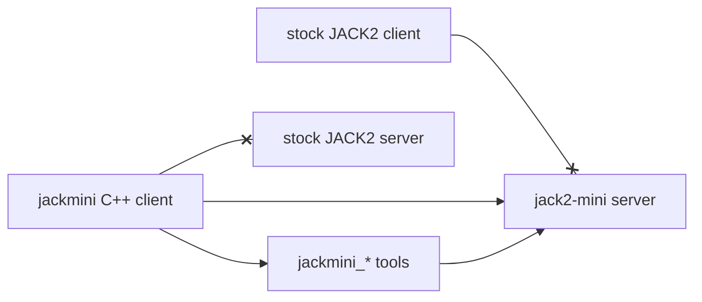

# 0001: No compatibility with stock JACK2 clients or servers

Status: Accepted

## Context

jack2-mini is a focused fork of JACK2: the engine and graph come from that codebase, but the wire protocol, Linux
hardware discovery and client library were replaced. Source: [README.rst](../../../README.rst#L179). Keeping the stock
wire contract would pin the message formats and shared-memory layout to a design this fork no longer uses.

## Decision

jack2-mini defines its own protocol (version 13). Stock JACK2 clients cannot connect to a jack2-mini server, and a
jack2-mini client cannot connect to a stock JACK2 server; applications must use the jack2-mini client library with the
jack2-mini server. Source: [README.rst](../../../README.rst#L172),
[Constants.h](../../../ipc/protocol/Constants.h#L66).

*Source: [README.rst](../../../README.rst#L172),
[Client.cpp](../../../client/api/Client.cpp#L150),
[CMakeLists.txt](../../../CMakeLists.txt#L14),
[CMakeLists.txt](../../../CMakeLists.txt#L363).*

| Contract | Value | Source |
|---|---|---|
| Protocol version | 13 (`kProtocolVersion`) | [Constants.h](../../../ipc/protocol/Constants.h#L66) |
| Version sent by the client | `kProtocolVersion` in `ClientCheckRequest` | [ClientSession.cpp](../../../client/session/ClientSession.cpp#L152) |
| Cross-server compatibility | None in either direction | [README.rst](../../../README.rst#L172) |

*Source: [Constants.h](../../../ipc/protocol/Constants.h#L66),
[ClientSession.cpp](../../../client/session/ClientSession.cpp#L152).*

## Consequences

- Existing JACK2 applications are not clients of this server. The tools and test programs use the jackmini client API
  instead. Source: [MonitorClient.cpp](../../../tools/MonitorClient.cpp#L114),
  [Cpu.cpp](../../../tests/Cpu.cpp#L26).
- A version mismatch fails the `ClientCheck` reply with `Error::kProtocol`; there is no negotiation or fallback to an
  older wire format. Source: [ClientSession.cpp](../../../client/session/ClientSession.cpp#L157).
- Message formats and the descriptor handoff can change with the engine without a compatibility shim, but every client
  must be rebuilt against the current API (see [0007](0007-cxx23-client-api.md)). Source:
  [ClientSession.cpp](../../../client/session/ClientSession.cpp#L176).
- All interoperability claims must be tested with jackmini clients only; this page is the authority for the boundary.
  Source: [README.rst](../../../README.rst#L172).

## Related

- [0007: C++23 client API](0007-cxx23-client-api.md) — the replacement surface for JACK2's C API.
- [0004: FD shared-memory handoff](0004-fd-shm-handoff.md) — one of the wire changes that breaks compatibility.
