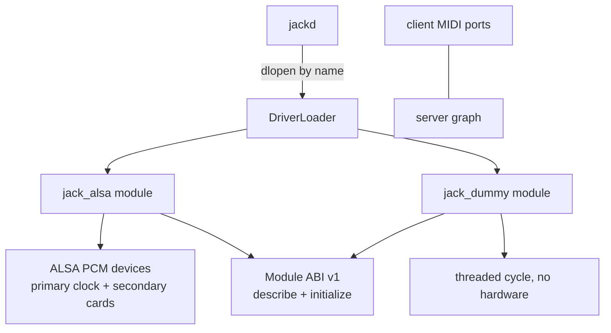

# 0003: ALSA is the only hardware backend; MIDI is client-to-client

Status: Accepted

## Context

The build is Linux-only and links ALSA and libudev unconditionally; one primary ALSA card supplies the graph clock and
secondary cards join as resampled devices. Source: [CMakeLists.txt](../../../CMakeLists.txt#L7),
[README.rst](../../../README.rst#L7). The fork also needs a replaceable driver entry point so hardware support can be
built and loaded separately from `jackd`.

## Decision

ALSA is the only hardware audio backend; the `dummy` driver exists for tests. The server does not read or write MIDI on
hardware — MIDI is exchanged between clients. Each driver is a dlopen module exporting a single `jackmini_driver_module`
symbol that returns a versioned `Module` descriptor. Source:
[CMakeLists.txt](../../../CMakeLists.txt#L246),
[README.rst](../../../README.rst#L179),
[DriverModule.h](../../../server/drivers/DriverModule.h#L33).

*Source: [CMakeLists.txt](../../../CMakeLists.txt#L246),
[CMakeLists.txt](../../../CMakeLists.txt#L316),
[DriverModule.h](../../../server/drivers/DriverModule.h#L33),
[README.rst](../../../README.rst#L7).*

| Property | Value | Source |
|---|---|---|
| Supported platforms | Linux only; configuration fails otherwise | [CMakeLists.txt](../../../CMakeLists.txt#L7) |
| Required libraries | `alsa>=1.0.18`, `libudev` | [CMakeLists.txt](../../../CMakeLists.txt#L21) |
| Built driver modules | `jack_alsa` and `jack_dummy` | [CMakeLists.txt](../../../CMakeLists.txt#L316), [CMakeLists.txt](../../../CMakeLists.txt#L258) |
| Module ABI version | 1 (`kModuleVersion`) | [DriverModule.h](../../../server/drivers/DriverModule.h#L33) |
| Exported symbol | `jackmini_driver_module` | [DriverModule.h](../../../server/drivers/DriverModule.h#L36) |
| Hardware MIDI | None; MIDI traffic is between clients only | [README.rst](../../../README.rst#L183) |

*Source: [CMakeLists.txt](../../../CMakeLists.txt#L7),
[DriverModule.h](../../../server/drivers/DriverModule.h#L33).*

## Consequences

- There is no portable backend layer; ports of the server must supply a new module implementing this ABI. Source:
  [CMakeLists.txt](../../../CMakeLists.txt#L7), [DriverModule.h](../../../server/drivers/DriverModule.h#L42).
- Applications that need MIDI hardware must bridge to a client MIDI port; the server never opens a MIDI device. Source:
  [README.rst](../../../README.rst#L183).
- ALSA-specific behaviour (card enumeration, hot-plug, resampling) stays inside the ALSA module and its helpers rather
  than in the engine. Source: [CMakeLists.txt](../../../CMakeLists.txt#L316).
- A module built against a different `kModuleVersion` is refused when loaded, so driver and server must be rebuilt
  together. Source: [DriverModule.h](../../../server/drivers/DriverModule.h#L33).
