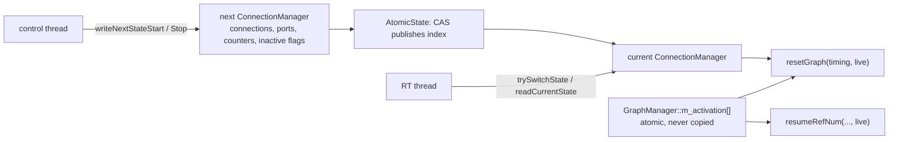

# 0005: Copy-on-write configuration is split from live activation counters

Status: Accepted

## Context

Control operations rewire the graph while the realtime thread reads it each cycle. `AtomicState<T>` already solves the
read side with two copies of a state and a compare-and-swap index: the control path writes the inactive copy, and the RT
thread switches to it at a cycle boundary. Source: [AtomicState.h](../../../ipc/memory/AtomicState.h#L117). Copying the
live activation counters with that state would reset or race counters that the RT thread still needs across a switch.

## Decision

`GraphManager` derives from `AtomicState<ConnectionManager>`, so connections, port lists, the connection matrix,
configured input counts and inactive flags are copy-on-write. The live activation counters are a separate atomic array
in `GraphManager`, outside the copied state, and are passed into `resetGraph`/`resumeRefNum` as a pointer. Source:
[GraphManager.h](../../../ipc/memory/GraphManager.h#L40),
[ConnectionManager.h](../../../ipc/memory/ConnectionManager.h#L374),
[GraphManager.cpp](../../../ipc/memory/GraphManager.cpp#L110).

*Source: [AtomicState.h](../../../ipc/memory/AtomicState.h#L122),
[GraphManager.h](../../../ipc/memory/GraphManager.h#L45),
[GraphManager.cpp](../../../ipc/memory/GraphManager.cpp#L110),
[ConnectionManager.h](../../../ipc/memory/ConnectionManager.h#L449).*

| State part | Owner / writer | Copied on graph change? | Source |
|---|---|---|---|
| Connections, port lists, connection matrix, configured input counts, inactive flags | Control thread via `writeNextStateStart()` | Yes: inside `ConnectionManager` | [ConnectionManager.h](../../../ipc/memory/ConnectionManager.h#L374) |
| Live activation counters (`m_activation[]`) | RT thread | No: separate atomic array in `GraphManager` | [GraphManager.h](../../../ipc/memory/GraphManager.h#L45) |
| Client timing | Written at defined points by control and RT | No: sibling array | [GraphManager.h](../../../ipc/memory/GraphManager.h#L44) |
| Port array and metadata | Control mutates entries; RT reads buffers | No: trailing array | [GraphManager.h](../../../ipc/memory/GraphManager.h#L47) |

*Source: [GraphManager.h](../../../ipc/memory/GraphManager.h#L40),
[ConnectionManager.h](../../../ipc/memory/ConnectionManager.h#L374).*

## Consequences

- The RT path reads one state pointer per cycle and switches without locks; `runCurrentGraph`, `runNextGraph` and
  `resumeRefNum` are annotated realtime functions. Source: [GraphManager.h](../../../ipc/memory/GraphManager.h#L121),
  [GraphManager.cpp](../../../ipc/memory/GraphManager.cpp#L110).
- Live counters survive a graph switch because they are not part of the copied payload. Source:
  [GraphManager.h](../../../ipc/memory/GraphManager.h#L45).
- Control publishes a change with `writeNextStateStop()`; the RT reader adopts it through `trySwitchState()` in a later
  cycle, so a control caller that needs the new graph waits for that switch. Source:
  [AtomicState.h](../../../ipc/memory/AtomicState.h#L187),
  [GraphManager.cpp](../../../ipc/memory/GraphManager.cpp#L118).
- The in-memory layout is now part of the contract between server and client mappings; size and offset assertions are
  required when fields move. Source: [ShmLayoutUnit.cpp](../../../tests/ShmLayoutUnit.cpp#L43).
- A deactivated client keeps its connections; `setInactive` adjusts the copied input counts so its outputs no longer
  activate downstream clients. Source: [ConnectionManager.cpp](../../../ipc/memory/ConnectionManager.cpp#L346).
