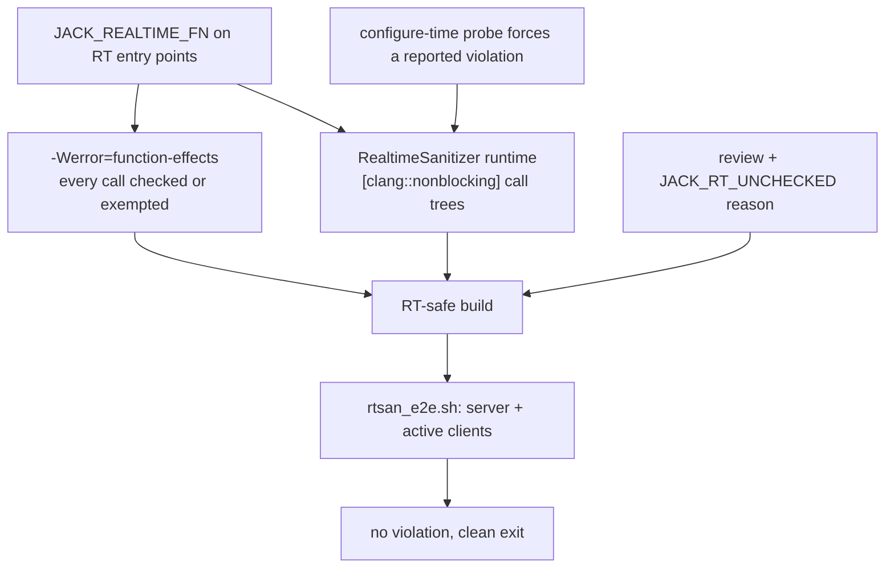

# 0006: The cycle contract is enforced by annotation, review and sanitizers

Status: Accepted

## Context

The audio cycle must not allocate, take a lock or make a system call, apart from the futex wait and wake that drive the
graph. Source: [style.md](../style.md#L72). Those rules cross process, module and callback boundaries, so a comment alone
cannot keep them true. RealtimeSanitizer only instruments calls made from functions marked `[[clang::nonblocking]]`,
and those attributes are absent from a normal build. Source: [Realtime.h](../../../common/Realtime.h#L19).

## Decision

`JACK_REALTIME_FN` expands to `[[clang::nonblocking]]` only in a Clang RealtimeSanitizer build and marks RT entry points
such as `Engine::process` and `ClientSession::processCycle`. That build is probed at configure time, compiles with
`-Werror=function-effects`, requires `JACK_RT_UNCHECKED` for documented exemptions, and is exercised by an end-to-end
script that starts a server and active audio/MIDI clients. There is no in-library runtime allocation counter. Source:
[Realtime.h](../../../common/Realtime.h#L19),
[CMakeLists.txt](../../../CMakeLists.txt#L62),
[ClientSession.cpp](../../../client/session/ClientSession.cpp#L828),
[rtsan_e2e.sh](../../../tests/rtsan_e2e.sh#L1).

*Source: [Realtime.h](../../../common/Realtime.h#L19),
[CMakeLists.txt](../../../CMakeLists.txt#L72),
[CMakeLists.txt](../../../CMakeLists.txt#L108),
[rtsan_e2e.sh](../../../tests/rtsan_e2e.sh#L104).*

| Mechanism | What it checks | Source |
|---|---|---|
| `JACK_REALTIME_FN` / `JACK_BLOCKING_FN` | Marks RT and blocking functions; attributes only exist in an RTSan build | [Realtime.h](../../../common/Realtime.h#L23) |
| Configure-time probe | Un-instrumented builds cannot pass CI silently | [CMakeLists.txt](../../../CMakeLists.txt#L72) |
| `-Werror=function-effects` | Unannotated calls from RT functions fail compilation | [CMakeLists.txt](../../../CMakeLists.txt#L111) |
| `JACK_RT_UNCHECKED(reason, ...)` | Deliberate, documented exemptions | [Realtime.h](../../../common/Realtime.h#L47) |
| End-to-end RTSan run | Active audio and MIDI clients plus server cycles | [rtsan_e2e.sh](../../../tests/rtsan_e2e.sh#L104) |
| Runtime allocation counter | None; the RT accessors return spans/buffers and cannot report errors | [Client.hpp](../../../client/api/Client.hpp#L135), [Client.cpp](../../../client/api/Client.cpp#L488) |

*Source: [CMakeLists.txt](../../../CMakeLists.txt#L62),
[Realtime.h](../../../common/Realtime.h#L39).*

## Consequences

- RTSan requires Clang 20 or newer and is a separate build, not combined with ASan, UBSan or TSan. Source:
  [CMakeLists.txt](../../../CMakeLists.txt#L67),
  [README.rst](../../../README.rst#L150).
- User callbacks are type-erased and cannot be checked statically; the call site is explicitly exempted, so application
  code remains a review obligation. Source: [ClientSession.cpp](../../../client/session/ClientSession.cpp#L831).
- Every new exemption is visible in code and must carry a reason; silent disables are not part of the contract. Source:
  [Realtime.h](../../../common/Realtime.h#L39).
- In normal builds the annotations are empty, so GCC and older Clang remain usable without the sanitizer runtime.
  Source: [Realtime.h](../../../common/Realtime.h#L34).
- A violation reported by the end-to-end script fails the run even if the process exit status alone would not. Source:
  [rtsan_e2e.sh](../../../tests/rtsan_e2e.sh#L148).
