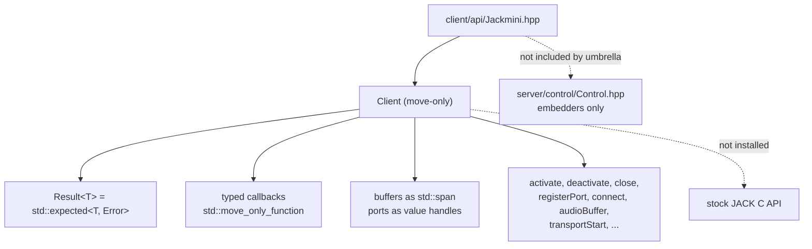

# 0007: The public client surface is C++23 with no installed C API

Status: Accepted

## Context

The inherited client vocabulary lived in C headers. This fork uses RAII ownership, typed errors, spans and typed
callbacks, and the compiler baseline has moved to C++23. Only the pieces of the surface that integrators actually need
should be installed. Source: [style.md](../style.md#L20),
[CMakeLists.txt](../../../CMakeLists.txt#L25).

## Decision

Applications include `<client/api/Jackmini.hpp>` and use `namespace jackmini`. `Client` is a move-only handle, fallible
operations return `Result<T> = std::expected<T, Error>`, and nothing in the installed header set is a C API. The server
control header is installed separately for embedders. Source:
[Jackmini.hpp](../../../client/api/Jackmini.hpp#L19),
[Client.hpp](../../../client/api/Client.hpp#L63),
[Error.hpp](../../../client/api/Error.hpp#L22),
[CMakeLists.txt](../../../CMakeLists.txt#L332).

*Source: [Jackmini.hpp](../../../client/api/Jackmini.hpp#L19),
[Client.hpp](../../../client/api/Client.hpp#L63),
[Client.hpp](../../../client/api/Client.hpp#L65),
[Error.hpp](../../../client/api/Error.hpp#L37),
[CMakeLists.txt](../../../CMakeLists.txt#L332).*

| Contract | Value | Source |
|---|---|---|
| Language standard | C++23, required (`CMAKE_CXX_STANDARD 23`) | [CMakeLists.txt](../../../CMakeLists.txt#L25) |
| Minimum compilers | GCC 13 or Clang 16 | [CMakeLists.txt](../../../CMakeLists.txt#L29) |
| Result alias | `std::expected<T, Error>` | [Error.hpp](../../../client/api/Error.hpp#L37) |
| Error values | 8 (`kInvalidArgument` … `kIo`) | [Error.hpp](../../../client/api/Error.hpp#L26) |
| Umbrella header | `client/api/Jackmini.hpp` | [Jackmini.hpp](../../../client/api/Jackmini.hpp#L19) |
| Installed public headers | 9 headers in `include/client/api`, plus `common/Uuid.hpp`; `server/control/Control.hpp` for embedders | [CMakeLists.txt](../../../CMakeLists.txt#L334) |

*Source: [CMakeLists.txt](../../../CMakeLists.txt#L25),
[CMakeLists.txt](../../../CMakeLists.txt#L332),
[Error.hpp](../../../client/api/Error.hpp#L26).*

## Consequences

- Integrators need a C++23 toolchain and must include the C++ headers; stock JACK C applications are not clients of this
  server (see [0001](0001-no-jack2-compatibility.md)). Source: [CMakeLists.txt](../../../CMakeLists.txt#L29),
  [README.rst](../../../README.rst#L172).
- Method names are camelCase (`registerPort`, `onProcess`, `transportLocate`), and the public API lives in `jackmini`;
  this is the naming used by tools and tests. Source: [Client.hpp](../../../client/api/Client.hpp#L117),
  [MonitorClient.cpp](../../../tools/MonitorClient.cpp#L117).
- `Error` is one enum shared by all fallible calls, so callers handle failure without inspecting wire status codes.
  Source: [Error.hpp](../../../client/api/Error.hpp#L24).
- Port handles carry an owner token, so a handle obtained by one client is rejected by another. Source:
  [Port.hpp](../../../client/api/Port.hpp#L87), [Client.cpp](../../../client/api/Client.cpp#L73).
- Internal C remains for resampler kernels, module descriptors, MIDI helpers and logging; it is not part of the installed
  client API. Source: [style.md](../style.md#L20), [DriverModule.h](../../../server/drivers/DriverModule.h#L59).
- The full verified surface, including threading and the minimal example, is in the
  [client API reference](../../reference/client-api.md).
