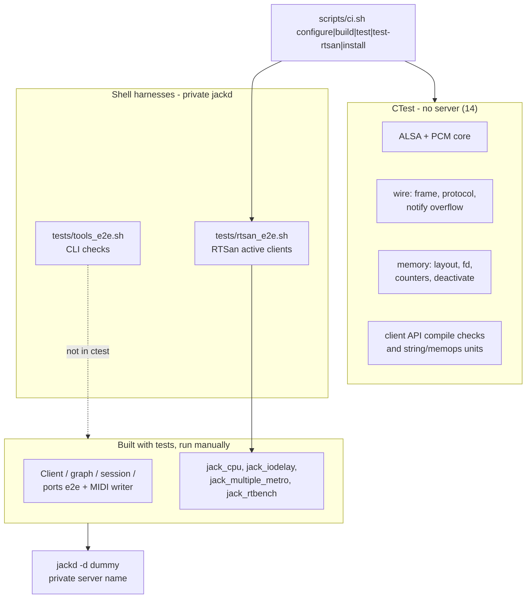

# Testing

Tests are off by default. A test build adds 14 CTest unit tests, five client/server end-to-end programs that need a
running server, four benchmark/interactive programs, and two shell harnesses that are intentionally not registered with
CTest. The quality rationale is in [08 quality and validation](architecture/08-quality-and-validation.md); the wire and
client contracts they pin down are in [the reference shelf](../reference/protocol.md).



*Source: [CMakeLists.txt](../../CMakeLists.txt#L363),
[CMakeLists.txt](../../CMakeLists.txt#L492),
[tools_e2e.sh](../../tests/tools_e2e.sh#L1),
[rtsan_e2e.sh](../../tests/rtsan_e2e.sh#L1),
[scripts/ci.sh](../../scripts/ci.sh#L18).*

## Configure, build, run

```bash
# From the repository root
cmake -S . -B build -DJACK_BUILD_TESTS=ON
cmake --build build --parallel
ctest --test-dir build --output-on-failure
```

`JACK_BUILD_TESTS` defaults to `OFF`; `ctest` can only run the 14 registered tests. Source:
[CMakeLists.txt](../../CMakeLists.txt#L13), [CMakeLists.txt](../../CMakeLists.txt#L382).

The CI wrapper uses the same steps and is what every workflow job calls:

```bash
scripts/ci.sh configure   # -DJACK_BUILD_TESTS=ON, optional RTSAN=ON
scripts/ci.sh build
scripts/ci.sh test        # ctest --output-on-failure
scripts/ci.sh install
# RTSan build only:
scripts/ci.sh test-rtsan  # tests/rtsan_e2e.sh <build-dir>
```

Source: [scripts/ci.sh](../../scripts/ci.sh#L22),
[build.yml](../../.github/workflows/build.yml#L50). For a local RTSan build use Clang 20+ and
`RTSAN=ON scripts/ci.sh configure`; configure runs a probe that must report a realtime violation. Source:
[CMakeLists.txt](../../CMakeLists.txt#L67), [CMakeLists.txt](../../CMakeLists.txt#L75),
[CMakeLists.txt](../../CMakeLists.txt#L99).

## The 14 CTest tests

Each row names the CTest name, the built binary and the behaviour it pins down.

| CTest name | Binary | What it pins down | Source |
|---|---|---|---|
| `alsa_secondary_unit` | `jack_alsa_unit` | Secondary-card building blocks without hardware: config parsing, card diff, 8-slot table, ring buffer, rate converter, drift controller and resampler | [CMakeLists.txt](../../CMakeLists.txt#L383), [AlsaSecondaryUnit.cpp](../../tests/AlsaSecondaryUnit.cpp#L17) |
| `pcm_cycle_unit` | `jack_pcm_cycle_unit` | `PcmCycle` against a scripted fake backend: `avail`, xrun recovery, poll timeout, start/stop sync and channel copies | [CMakeLists.txt](../../CMakeLists.txt#L405), [PcmCycleUnit.cpp](../../tests/PcmCycleUnit.cpp#L17) |
| `message_buffer_unit` | `jack_message_unit` | Realtime message buffer with the real singleton and flush thread: per-producer order or counted overrun | [CMakeLists.txt](../../CMakeLists.txt#L412), [MessageBufferUnit.cpp](../../tests/MessageBufferUnit.cpp#L17) |
| `cstring_unit` | `jack_cstring_unit` | Fixed-string helpers: truncation, termination, zero fill and integer parsing | [CMakeLists.txt](../../CMakeLists.txt#L422), [CstringUnit.cpp](../../tests/CstringUnit.cpp#L17) |
| `memops_unit` | `jack_memops_unit` | Sample conversions and interleaved copies against the bytes of the replaced C implementation | [CMakeLists.txt](../../CMakeLists.txt#L426), [MemopsUnit.cpp](../../tests/MemopsUnit.cpp#L17) |
| `jackmini_api_unit` | `jack_api_unit` | Compile-time API types and overloads for the client and server-control headers; no implementation linked | [CMakeLists.txt](../../CMakeLists.txt#L432), [JackminiApiUnit.cpp](../../tests/JackminiApiUnit.cpp#L17) |
| `shm_layout_unit` | `jack_shm_layout_unit` | Static size/alignment/offset checks for every shared-memory structure | [CMakeLists.txt](../../CMakeLists.txt#L437), [ShmLayoutUnit.cpp](../../tests/ShmLayoutUnit.cpp#L17) |
| `fd_segment_unit` | `jack_fd_segment_unit` | `SCM_RIGHTS` descriptor passing over a Unix socket and anonymous shared-memory segment mapping | [CMakeLists.txt](../../CMakeLists.txt#L443), [FdSegmentUnit.cpp](../../tests/FdSegmentUnit.cpp#L17) |
| `message_frame_unit` | `jack_message_frame_unit` | 16-byte frame header, exact payload length, and reply writer/reader over a byte buffer | [CMakeLists.txt](../../CMakeLists.txt#L448), [MessageFrameUnit.cpp](../../tests/MessageFrameUnit.cpp#L17) |
| `counter_unit` | `jack_counter_unit` | Activation counters under a cycle thread racing connection changes; intended to be run under TSAN | [CMakeLists.txt](../../CMakeLists.txt#L455), [CounterTsanUnit.cpp](../../tests/CounterTsanUnit.cpp#L17) |
| `deactivate_graph_unit` | `jack_deactivate_graph_unit` | Deactivation keeps connections: inactive input is silent, output not mixed, connection restored on activation | [CMakeLists.txt](../../CMakeLists.txt#L463), [DeactivateGraphUnit.cpp](../../tests/DeactivateGraphUnit.cpp#L17) |
| `protocol_conformance_unit` | `jack_protocol_conformance_unit` | Requests/replies through real framing, plus malformed and version-mismatched messages through the real decoder | [CMakeLists.txt](../../CMakeLists.txt#L471), [ProtocolConformanceUnit.cpp](../../tests/ProtocolConformanceUnit.cpp#L17) |
| `notify_overflow_unit` | `jack_notify_overflow_unit` | 256-entry notification queue: every notification delivered or counted as dropped, newest delivered, order preserved | [CMakeLists.txt](../../CMakeLists.txt#L479), [NotifyOverflowUnit.cpp](../../tests/NotifyOverflowUnit.cpp#L17) |
| `jackmini_unit` | `jack_jackmini_unit` | Server-independent client helpers: ring buffer, UUID generation and error text | [CMakeLists.txt](../../CMakeLists.txt#L488), [JackminiUnit.cpp](../../tests/JackminiUnit.cpp#L17) |

> `counter_unit` is a concurrency test that the project documents as a TSAN target; CTest itself does not add a sanitizer
> flag. Source: [CMakeLists.txt](../../CMakeLists.txt#L455), [CounterTsanUnit.cpp](../../tests/CounterTsanUnit.cpp#L17).

## Programs that are not CTest tests

These targets are built with `JACK_BUILD_TESTS=ON` but no `add_test` line registers them because they need a live server.
Start one under a private name, run the program with `-s <name>` where supported, then stop the server. The per-user
server lock means another `jackd` must not already be running. Source:
[CMakeLists.txt](../../CMakeLists.txt#L492), [tools_e2e.sh](../../tests/tools_e2e.sh#L10).

### Client and session end-to-end programs

| Binary | What it exercises | Source |
|---|---|---|
| `jack_jackmini_client_e2e` | Public client lifecycle, callbacks, identity and error reports | [CMakeLists.txt](../../CMakeLists.txt#L494), [JackminiClientE2e.cpp](../../tests/JackminiClientE2e.cpp#L17) |
| `jack_jackmini_graph_e2e` | Graph chains, ports at scale, connection rules, naming and several clients (realtime or freewheel) | [CMakeLists.txt](../../CMakeLists.txt#L498), [JackminiGraphE2e.cpp](../../tests/JackminiGraphE2e.cpp#L17) |
| `jack_client_session_e2e` | `ClientSession` open, name handling and close | [CMakeLists.txt](../../CMakeLists.txt#L502), [ClientSessionE2e.cpp](../../tests/ClientSessionE2e.cpp#L17) |
| `jack_jackmini_ports_e2e` | Port listing, connections, UUIDs and total latency from one graph read | [CMakeLists.txt](../../CMakeLists.txt#L511), [JackminiPortsE2e.cpp](../../tests/JackminiPortsE2e.cpp#L17) |
| `jack_midi_writer` | MIDI source used by `jackmini_midi_dump` checks: one note-on per cycle | [CMakeLists.txt](../../CMakeLists.txt#L507), [MidiWriter.cpp](../../tests/MidiWriter.cpp#L14) |

### Benchmark and interactive programs

| Binary | Purpose | Source |
|---|---|---|
| `jack_cpu` | CPU-load watchdog client; command-line times are converted to server cycles | [CMakeLists.txt](../../CMakeLists.txt#L366), [Cpu.cpp](../../tests/Cpu.cpp#L20) |
| `jack_iodelay` | Round-trip delay measurement between a capture and a playback port | [CMakeLists.txt](../../CMakeLists.txt#L367), [Iodelay.cpp](../../tests/Iodelay.cpp#L17) |
| `jack_multiple_metro` | Interactive metronome client used for timing experiments | [CMakeLists.txt](../../CMakeLists.txt#L368), [ExternalMetro.cpp](../../tests/ExternalMetro.cpp#L17) |
| `jack_rtbench` | Real-time cycle benchmark; also the active client in the RTSan e2e run | [CMakeLists.txt](../../CMakeLists.txt#L369), [Rtbench.cpp](../../tests/perf/Rtbench.cpp#L17), [rtsan_e2e.sh](../../tests/rtsan_e2e.sh#L118) |

There is no runtime allocation-count check in the client cycle. `tests/perf/Alloccount.cpp` exists as a helper but is not
a CMake target; only `jack_rtbench` is built from `tests/perf`. Source: [CMakeLists.txt](../../CMakeLists.txt#L365),
[Alloccount.cpp](../../tests/perf/Alloccount.cpp#L1).

## Shell harnesses (separate from CTest)

| Script | Invocation | What it does | Source |
|---|---|---|---|
| `tests/tools_e2e.sh` | `tests/tools_e2e.sh <build-dir> [realtime\|freewheel]` | Starts a private `jackd -d dummy`, checks the `jackmini_*` CLI tools and MIDI dump against it, stops the server, then checks the no-server error paths. Prints `tools: N checks, M failed`. | [tools_e2e.sh](../../tests/tools_e2e.sh#L1), [tools_e2e.sh](../../tests/tools_e2e.sh#L103), [tools_e2e.sh](../../tests/tools_e2e.sh#L239) |
| `tests/rtsan_e2e.sh` | `tests/rtsan_e2e.sh <build-dir>` | Requires an RTSan build. Starts a private server, runs `jackmini_lsp`, `jack_rtbench` and `jack_midi_writer`, scans logs for RealtimeSanitizer reports, checks shutdown status, and keeps logs on failure. | [rtsan_e2e.sh](../../tests/rtsan_e2e.sh#L1), [rtsan_e2e.sh](../../tests/rtsan_e2e.sh#L104), [rtsan_e2e.sh](../../tests/rtsan_e2e.sh#L150) |

Both scripts refuse to run while another `jackd` for the user is alive. Source:
[tools_e2e.sh](../../tests/tools_e2e.sh#L33), [rtsan_e2e.sh](../../tests/rtsan_e2e.sh#L71).
