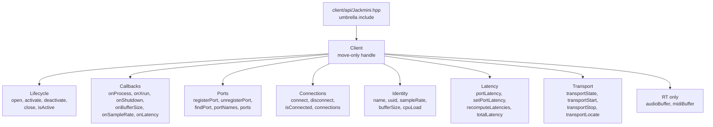
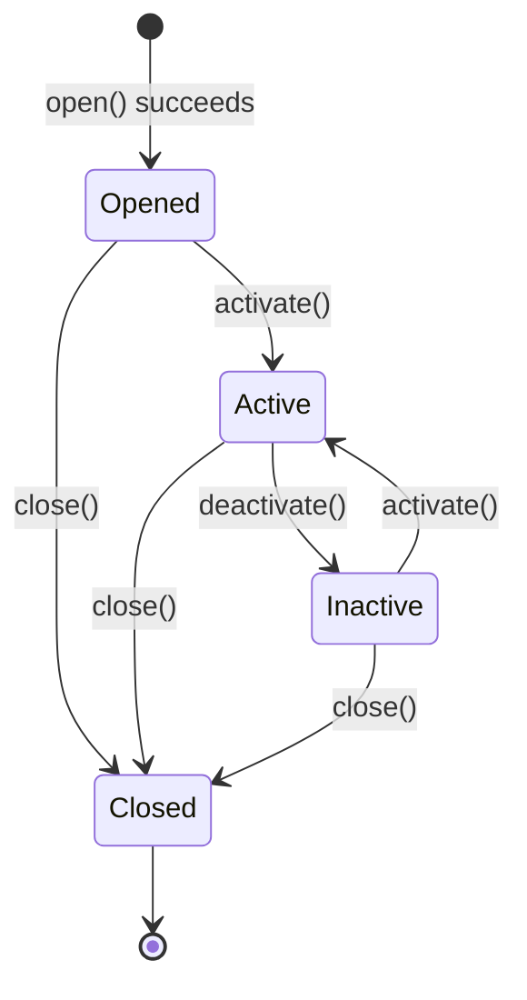
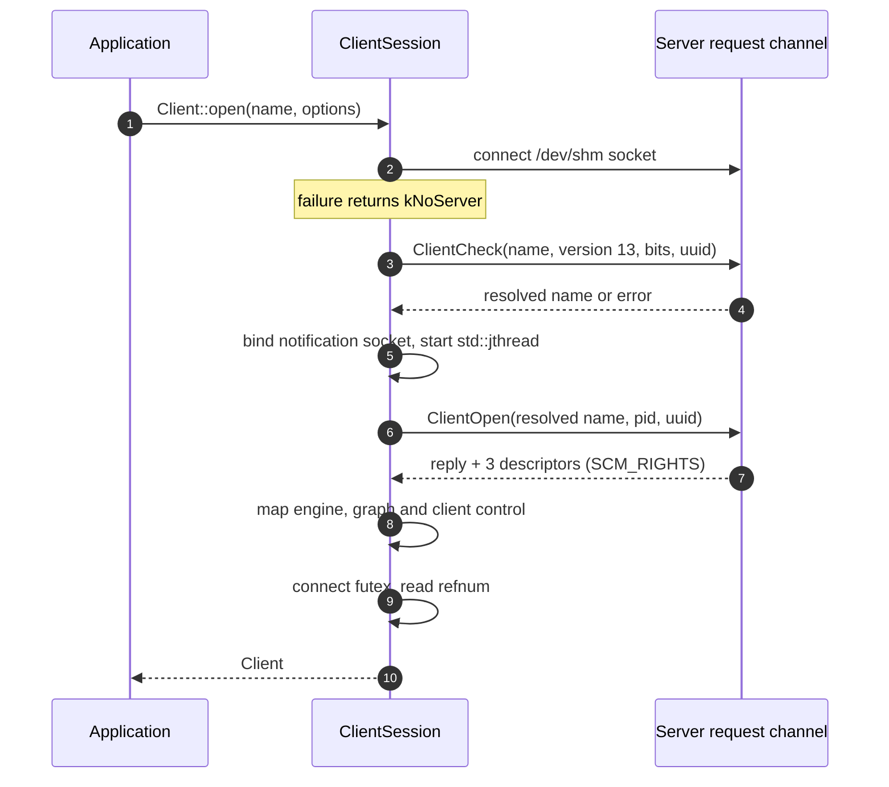
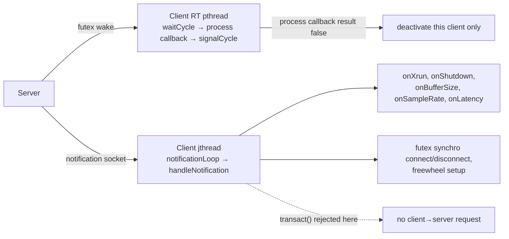

# Client API reference

This is the verified fact sheet for the public client surface. It describes the C++23 API in the current tree, not the
historical C API in [archive/client-api-original.md](../archive/client-api-original.md). Code is the authority; claims
elsewhere in the guide that disagree with this page are stale.

## API shape

The whole API is `namespace jackmini`; one umbrella header includes every public header. There is no installed C API:
the install rules list only `.hpp` files under `client/api`, one forwarding UUID header under `common`, and the server
control header for embedders.



*Source: [Jackmini.hpp](../../client/api/Jackmini.hpp#L19),
[Client.hpp](../../client/api/Client.hpp#L63),
[Client.hpp](../../client/api/Client.hpp#L75),
[Client.hpp](../../client/api/Client.hpp#L135),
[CMakeLists.txt](../../CMakeLists.txt#L332).*

| Group | Public members | Source |
|---|---|---|
| Construction | static `open`, move constructor/assignment, deleted copies, destructor | [Client.hpp](../../client/api/Client.hpp#L75) |
| Lifecycle | `activate`, `deactivate`, `close`, `isActive` | [Client.hpp](../../client/api/Client.hpp#L84) |
| Callbacks | `onProcess`, `onXrun`, `onShutdown`, `onBufferSize`, `onSampleRate`, `onLatency` | [Client.hpp](../../client/api/Client.hpp#L92) |
| Ports | `registerPort`, `unregisterPort`, `findPort`, `portNames`, `ports` | [Client.hpp](../../client/api/Client.hpp#L117) |
| Connections | `connect`, `disconnect`, `isConnected`, `connections` | [Client.hpp](../../client/api/Client.hpp#L126) |
| Identity | `name`, `uuid`, `sampleRate`, `bufferSize`, `cpuLoad` | [Client.hpp](../../client/api/Client.hpp#L110) |
| Latency | `portLatency`, `setPortLatency`, `recomputeLatencies`, `totalLatency` | [Client.hpp](../../client/api/Client.hpp#L105) |
| Transport | `transportState`, `transportStart`, `transportStop`, `transportLocate` | [Client.hpp](../../client/api/Client.hpp#L141) |
| Realtime only | `audioBuffer`, `midiBuffer` | [Client.hpp](../../client/api/Client.hpp#L137) |

*Source: [Client.hpp](../../client/api/Client.hpp#L75).*

## Lifecycle

A client is opened, then may be activated and deactivated repeatedly. Port handles and connections survive deactivation;
the destructor deactivates an active client and then closes it.



*Source: [Client.hpp](../../client/api/Client.hpp#L51),
[Client.cpp](../../client/api/Client.cpp#L185),
[Client.cpp](../../client/api/Client.cpp#L193),
[Client.cpp](../../client/api/Client.cpp#L178).*

| State | Meaning for process callbacks | Meaning for data and connections | Source |
|---|---|---|---|
| opened | Callbacks may be set; no process callback runs | Ports can be registered; connections can be made | [Client.hpp](../../client/api/Client.hpp#L51) |
| active | Process callback runs once per cycle on the RT thread | Callbacks cannot be changed (`kInvalidState`) | [Client.cpp](../../client/api/Client.cpp#L374) |
| inactive | Callbacks may be changed and `activate()` called again | Connections kept; the client's inputs are silent and its outputs are not mixed in | [ConnectionManager.cpp](../../ipc/memory/ConnectionManager.cpp#L346), [GraphManager.cpp](../../ipc/memory/GraphManager.cpp#L204) |
| closed | No callbacks | Destructor/`close()` releases the session | [Client.cpp](../../client/api/Client.cpp#L201) |

*Source: [Client.hpp](../../client/api/Client.hpp#L51), [Client.cpp](../../client/api/Client.cpp#L201).*

### Minimal example

The shape below follows the test and tool clients in `tests/Cpu.cpp` and `tools/MonitorClient.cpp`: open, register ports
and set callbacks while inactive, then activate. Any waiting belongs on the control thread; buffer access happens inside
the process callback.

```cpp
#include <algorithm>
#include <client/api/Jackmini.hpp>

int main()
{
    auto opened = jackmini::Client::open("example");
    if (!opened) return 1;
    jackmini::Client& client = *opened;

    auto port = client.registerPort("out", jackmini::PortType::kAudio, jackmini::PortFlags::kOutput);
    if (!port) return 1;

    if (auto set = client.onProcess([&client, p = *port](const jackmini::Cycle&) {
            auto out = client.audioBuffer(p);
            std::fill(out.begin(), out.end(), 0.0f);
            return true;
        }); !set) {
        return 1;
    }
    if (auto ok = client.activate(); !ok) return 1;

    // ... run until signalled ...
    (void)client.deactivate();
    return 0;
}
```

*Source: [Client.hpp](../../client/api/Client.hpp#L75),
[Cpu.cpp](../../tests/Cpu.cpp#L64),
[MonitorClient.cpp](../../tools/MonitorClient.cpp#L114).*

## Opening a client

`Client::open` delegates to `ClientSession::open`. The client never starts a server: a failed connect returns
`kNoServer`. The handshake sends `ClientCheck` with protocol version 13, binds and starts the notification channel,
sends `ClientOpen`, receives three segment descriptors and maps the engine, graph and client-control segments before it
connects the per-client futex.



*Source: [Client.cpp](../../client/api/Client.cpp#L150),
[ClientSession.cpp](../../client/session/ClientSession.cpp#L141),
[ClientSession.cpp](../../client/session/ClientSession.cpp#L176),
[ClientSession.cpp](../../client/session/ClientSession.cpp#L217),
[Constants.h](../../ipc/protocol/Constants.h#L66).*

| Failure point | Public error | Source |
|---|---|---|
| Request socket connect fails | `kNoServer` | [ClientSession.cpp](../../client/session/ClientSession.cpp#L147) |
| Version mismatch in `ClientCheck` | `kProtocol` | [ClientSession.cpp](../../client/session/ClientSession.cpp#L157) |
| Name already taken | `kNameTaken` | [ClientSession.cpp](../../client/session/ClientSession.cpp#L162) |
| Notification bind/thread start, mapping, futex connect fails | `kIo` | [ClientSession.cpp](../../client/session/ClientSession.cpp#L167) |
| Server refuses `ClientOpen` | `kServerFailure` | [ClientSession.cpp](../../client/session/ClientSession.cpp#L186) |

*Source: [ClientSession.cpp](../../client/session/ClientSession.cpp#L141).*

## Errors and results

Fallible operations return `Result<T>`, an alias for `std::expected<T, Error>` with one shared error enum. Operations on
the realtime path do not return errors.

| `Error` value | Meaning | Source |
|---|---|---|
| `kInvalidArgument` | A name, port or value is not acceptable | [Error.hpp](../../client/api/Error.hpp#L27) |
| `kInvalidState` | Operation is not allowed in the current client state | [Error.hpp](../../client/api/Error.hpp#L28) |
| `kNameTaken` | A client or port with this name exists | [Error.hpp](../../client/api/Error.hpp#L29) |
| `kNotFound` | No such client, port or parameter | [Error.hpp](../../client/api/Error.hpp#L30) |
| `kNoServer` | The server is not running and could not be started | [Error.hpp](../../client/api/Error.hpp#L31) |
| `kServerFailure` | The server refused or failed the request | [Error.hpp](../../client/api/Error.hpp#L32) |
| `kProtocol` | The reply did not match the protocol | [Error.hpp](../../client/api/Error.hpp#L33) |
| `kIo` | The connection to the server failed | [Error.hpp](../../client/api/Error.hpp#L34) |

*Source: [Error.hpp](../../client/api/Error.hpp#L24), [Error.hpp](../../client/api/Error.hpp#L37).*

## Threading and callbacks

Two client threads exist after activation. The process callback runs on a `pthread` that is given `SCHED_FIFO` when the
engine is realtime; it waits and signals the cycle through shared futex words. Notification callbacks run on a
`std::jthread` that reads the notification socket and dispatches by notification kind. `transact()` refuses calls from
that thread.



*Source: [ClientSession.cpp](../../client/session/ClientSession.cpp#L217),
[ClientSession.cpp](../../client/session/ClientSession.cpp#L291),
[ClientSession.cpp](../../client/session/ClientSession.cpp#L753),
[ClientSession.cpp](../../client/session/ClientSession.cpp#L828),
[ClientSession.cpp](../../client/session/ClientSession.cpp#L356).*

| Callback | Called from | Condition | Source |
|---|---|---|---|
| `onProcess` | RT pthread, once per cycle | Active client; returning `false` ends this client's cycles and deactivates it | [ClientSession.cpp](../../client/session/ClientSession.cpp#L821), [ClientSession.cpp](../../client/session/ClientSession.cpp#L875) |
| `onXrun` | Notification jthread | `kXRunCallback` while active | [ClientSession.cpp](../../client/session/ClientSession.cpp#L318) |
| `onShutdown` | Notification jthread | `kShutDownCallback` while active, or lost socket | [ClientSession.cpp](../../client/session/ClientSession.cpp#L307) |
| `onBufferSize` | Notification jthread | `kBufferSizeCallback` while active | [ClientSession.cpp](../../client/session/ClientSession.cpp#L323) |
| `onSampleRate` | Notification jthread | `kSampleRateCallback` while active | [ClientSession.cpp](../../client/session/ClientSession.cpp#L328) |
| `onLatency` | Notification jthread | `kLatencyCallback`, server asks for port ranges | [ClientSession.cpp](../../client/session/ClientSession.cpp#L313) |

*Source: [ClientSession.cpp](../../client/session/ClientSession.cpp#L291).*

There is no public callback for `kSecondarySampleRateCallback`: the notification kind exists in the wire enum, but
`handleNotification` has no case for it and no `Client` setter for it. Source:
[Notification.h](../../ipc/protocol/Notification.h#L42),
[ClientSession.cpp](../../client/session/ClientSession.cpp#L291),
[Client.hpp](../../client/api/Client.hpp#L92).

## Realtime access, latency and transport

`audioBuffer` and `midiBuffer` are valid only inside the process callback for the cycle being processed. They allocate
nothing, take no lock and report no error; an unknown port or a port of the wrong type yields an empty buffer. The
library has no runtime allocation counter: the dynamic realtime check is the opt-in RealtimeSanitizer build described in
[ADR 0006](../developer/decisions/0006-realtime-contract.md).

| Accessor | Return for an unknown port | Source |
|---|---|---|
| `audioBuffer(Port)` | Empty `std::span<float>` | [Client.cpp](../../client/api/Client.cpp#L489) |
| `midiBuffer(Port)` | Empty `midi::Buffer` | [Client.cpp](../../client/api/Client.cpp#L499) |

*Source: [Client.hpp](../../client/api/Client.hpp#L135), [Client.cpp](../../client/api/Client.cpp#L488).*

Latency is set per port as a `LatencyRange` and recomputed by the server; `totalLatency` reads the last computed value.
Transport is queried with `transportState` and changed with `transportStart`, `transportStop` and `transportLocate`.
Source: [Client.hpp](../../client/api/Client.hpp#L104),
[Client.hpp](../../client/api/Client.hpp#L140),
[Client.cpp](../../client/api/Client.cpp#L428),
[Client.cpp](../../client/api/Client.cpp#L541).

## Installed surface

| Installed path | Contents | Source |
|---|---|---|
| `include/client/api/*.hpp` | `Client`, `Error`, `Jackmini`, `Midi`, `Options`, `Port`, `Ringbuffer`, `Transport`, `Uuid` | [CMakeLists.txt](../../CMakeLists.txt#L334) |
| `include/common/Uuid.hpp` | Forwarding header for the public UUID type | [CMakeLists.txt](../../CMakeLists.txt#L346) |
| `include/server/control/Control.hpp` | Server management for embedders, not part of the client API | [CMakeLists.txt](../../CMakeLists.txt#L349) |

*Source: [CMakeLists.txt](../../CMakeLists.txt#L332).*

The build requires C++23 and a compiler with the `cxx_std_23` feature (GCC 13+ or Clang 16+). Source:
[CMakeLists.txt](../../CMakeLists.txt#L25), [CMakeLists.txt](../../CMakeLists.txt#L29).
