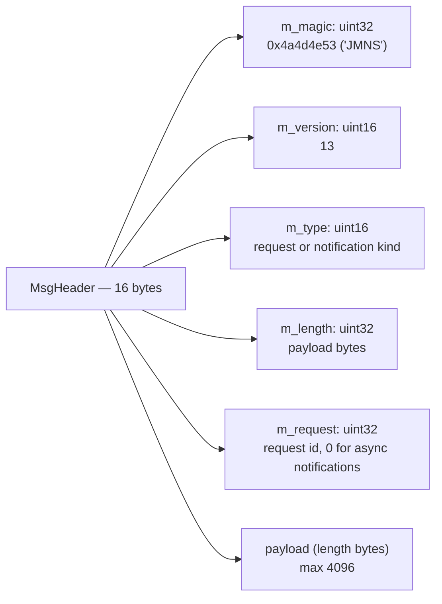
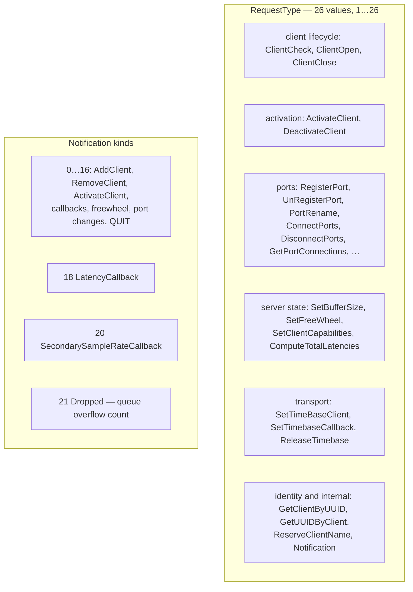
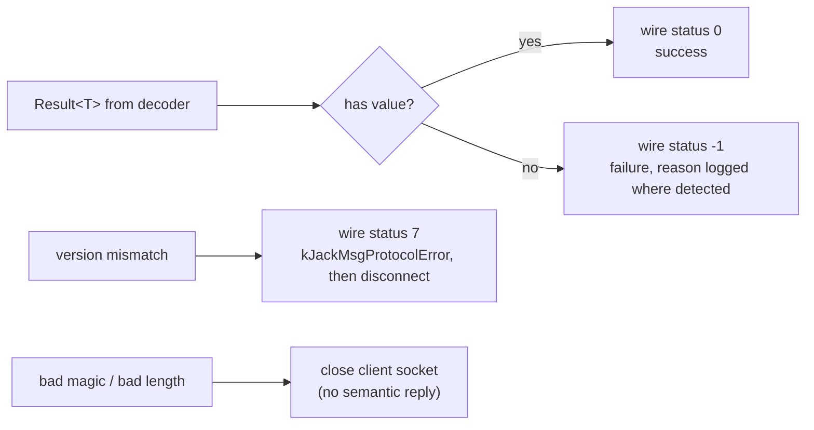

# Protocol and IPC reference

This is the verified description of the current client/server contract. It replaces the proposal in
<!-- docs-check: allow-stale -->
[archive/protocol-original.md](../../archive/protocol-original.md), which names protocol version 12 and older socket paths.
<!-- docs-check: end-allow-stale -->
Facts here were verified against code and tests at commit `3807a0f2`.

## Channels

| Channel | Direction | Carries | Source |
|---|---|---|---|
| Request socket | client → server, one reply per request | requests and replies, plus `SCM_RIGHTS` descriptors on `ClientOpen` | [SocketServerChannel.cpp](../../server/ipc/SocketServerChannel.cpp#L45) |
| Notification socket | server → client | asynchronous notifications, framed like requests | [SocketNotifyChannel.cpp](../../server/ipc/SocketNotifyChannel.cpp#L142) |
| Shared memory | both | engine control, graph, ports, audio buffers, client control | [FdSegment.cpp](../../ipc/memory/FdSegment.cpp#L148) |
| Futex words | both | cycle wake-up and completion | [LinuxFutex.cpp](../../ipc/sync/LinuxFutex.cpp#L52) |

The request and notification sockets are separate, so a busy RT thread cannot delay a reply and a notification cannot be
mistaken for one. Source: [README.rst](../../README.rst) heritage notes and [ClientSession.cpp](../../client/session/ClientSession.cpp#L225).

## Frame layout

<!-- fact: ipc/protocol/Constants.h:66 pattern="kProtocolVersion\\s*=\\s*13" -->
<!-- fact: ipc/protocol/Message.h:44 pattern="0x4a4d4e53" -->

*Source: [Message.h](../../ipc/protocol/Message.h#L33),
[Message.h](../../ipc/protocol/Message.h#L44),
[Constants.h](../../ipc/protocol/Constants.h#L66),
[MessageFrameUnit.cpp](../../tests/MessageFrameUnit.cpp#L73).*

| Field | Type | Meaning |
|---|---|---|
| `m_magic` | `std::uint32_t` | Constant `0x4a4d4e53`; rejects a stray connection. |
| `m_version` | `std::uint16_t` | `kProtocolVersion = 13`; mismatch is refused with no negotiation. |
| `m_type` | `std::uint16_t` | Request or notification kind. |
| `m_length` | `std::uint32_t` | Exact payload length; the reader rejects over-reads and leftover bytes. |
| `m_request` | `std::uint32_t` | Monotonically increasing id, echoed in the reply; `0` for asynchronous notifications. |

*Source: [Message.h](../../ipc/protocol/Message.h#L33),
[Message.h](../../ipc/protocol/Message.h#L51),
[Message.h](../../ipc/protocol/Message.h#L113),
[RequestDecoder.cpp](../../server/ipc/RequestDecoder.cpp#L28).*

Every message is written with header and payload in one `writeWithFds()` call. Descriptors are attached with `SCM_RIGHTS`,
at most eight per message, and received with `MSG_CMSG_CLOEXEC`. Source:
[Message.h](../../ipc/protocol/Message.h#L58),
[FdSegment.cpp](../../ipc/memory/FdSegment.cpp#L71).

## Requests and notifications

*Source: [Request.h](../../ipc/protocol/Request.h#L60),
[Notification.h](../../ipc/protocol/Notification.h#L23),
[SocketNotifyChannel.cpp](../../server/ipc/SocketNotifyChannel.cpp#L142).*

`kNotification` is a server-internal notification request used by the RT-to-request-thread bridge (and `kQUIT` ends the
listener loop); notification *interest* bits live in `ClientControl`. Source:
[RequestDecoder.cpp](../../server/ipc/RequestDecoder.cpp#L264),
[ClientControl.h](../../ipc/memory/ClientControl.h#L62).

### Notification queue

| Property | Value | Source |
|---|---|---|
| Queue size | 256 entries per client (`SocketNotifyChannel::kQueueSize`) | [SocketNotifyChannel.h](../../server/ipc/SocketNotifyChannel.h#L61) |
| On overflow | Drop the oldest, increment a drop count, emit `kDropped`, release any waiting sync caller | [SocketNotifyChannel.cpp](../../server/ipc/SocketNotifyChannel.cpp#L75) |
| Ordering | One writer thread per client owns the socket writes | [SocketNotifyChannel.cpp](../../server/ipc/SocketNotifyChannel.cpp#L108) |
| Delivery | Non-blocking `sendmsg`; a full socket drops the message rather than blocking the cycle | [Socket.cpp](../../ipc/socket/Socket.cpp#L190) |
| Verification | `NotifyOverflowUnit` checks delivered + dropped, newest delivered, order preserved | [NotifyOverflowUnit.cpp](../../tests/NotifyOverflowUnit.cpp#L126) |

## Reply status mapping

*Source: [RequestDecoder.h](../../server/ipc/RequestDecoder.h#L29),
[RequestDecoder.cpp](../../server/ipc/RequestDecoder.cpp#L64),
[Message.h](../../ipc/protocol/Message.h#L46),
[SocketServerChannel.cpp](../../server/ipc/SocketServerChannel.cpp#L222).*

> The old proposal listed statuses 1–8 as a direct mapping of `Error`. The implementation uses `0` and `-1` for normal
> results and reserves `7` for a protocol refusal. Source: [RequestDecoder.h](../../server/ipc/RequestDecoder.h#L29).

## Naming rules

| Object | Non-promiscuous | Promiscuous (`JACK_PROMISCUOUS_SERVER` set) |
|---|---|---|
| Server request socket | `/dev/shm/jack_<name>_<uid>_0` | `/dev/shm/jack_<name>_0` |
| Client notification socket | same pattern, client name | same pattern, no uid |
| Client futex | `jack_sem.<uid>_<server>_<client>` | `jack_sem.<server>_<client>` |
| Server lock | `/dev/shm/jack_<uid>_server.lock` | unchanged |

*Source: [IpcName.h](../../ipc/IpcName.h#L30),
[Constants.h](../../ipc/protocol/Constants.h#L60),
[ServerLock.cpp](../../server/core/ServerLock.cpp#L42),
[ProtocolConformanceUnit.cpp](../../tests/ProtocolConformanceUnit.cpp#L351).*

## Client-visible errors

| `jackmini::Error` | Text |
|---|---|
| `kInvalidArgument` | invalid argument |
| `kInvalidState` | operation not allowed in the current state |
| `kNameTaken` | name already in use |
| `kNotFound` | not found |
| `kNoServer` | server not running and could not be started |
| `kServerFailure` | server failed the request |
| `kProtocol` | unexpected reply from the server |
| `kIo` | connection to the server failed |

*Source: [Error.hpp](../../client/api/Error.hpp#L24),
[Error.cpp](../../client/api/Error.cpp#L24).*

The `kNoServer` text is historical: a client never starts a server. Source:
[ClientSession.cpp](../../client/session/ClientSession.cpp#L147).
