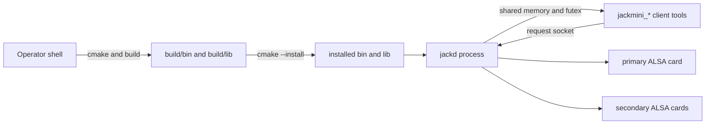
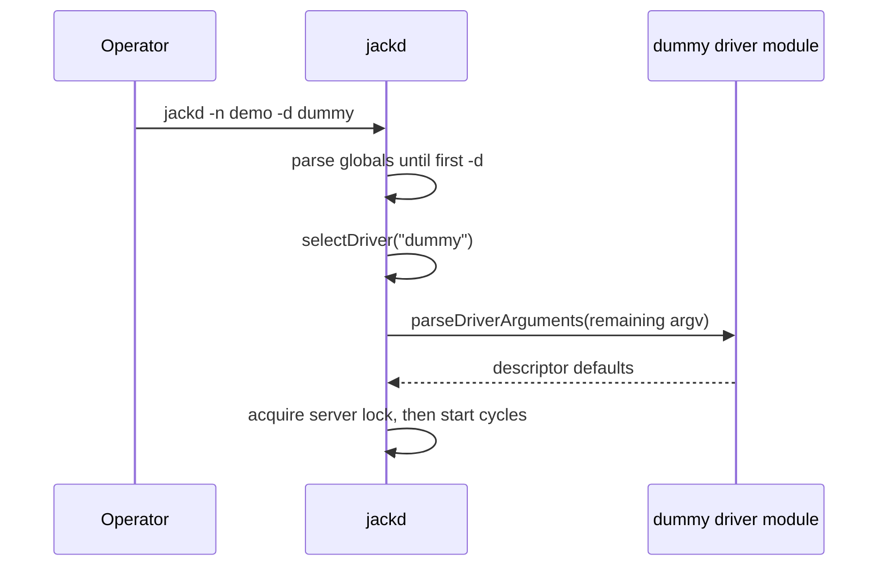
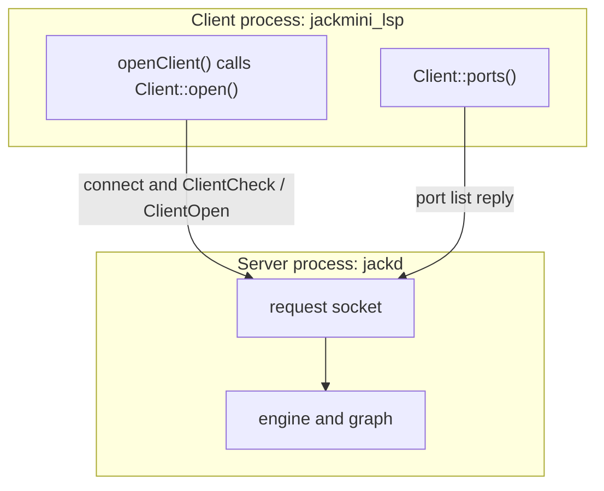
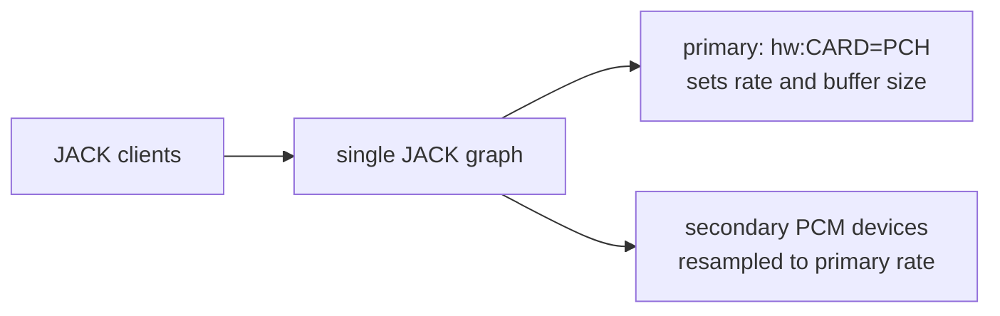
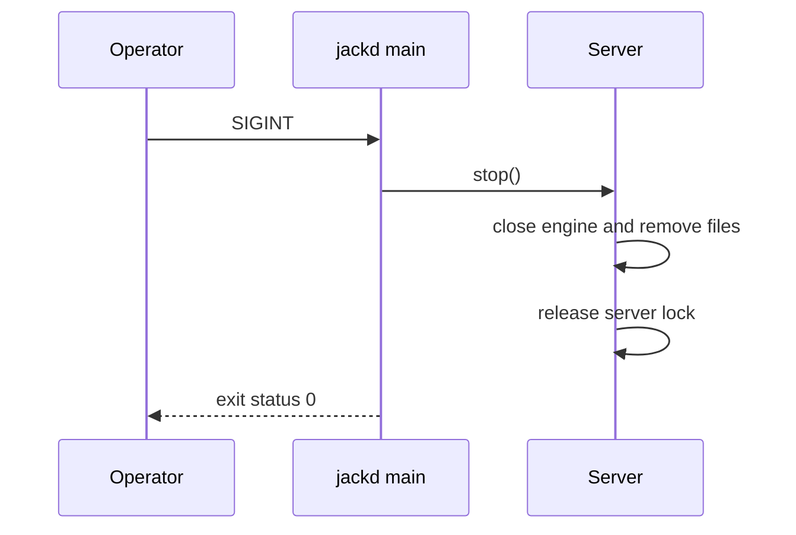

# Quickstart

This is a Linux-only JACK server with one clock: a primary ALSA card drives the graph and secondary cards are resampled
into it. It is not wire-compatible with JACK2 clients or servers. Source: [README.rst:7](../../README.rst#L7),
[README.rst:14](../../README.rst#L14), [Constants.h:66](../../ipc/protocol/Constants.h#L66).



*Source: [CMakeLists.txt:118](../../CMakeLists.txt#L118),
[tools/CMakeLists.txt:11](../../tools/CMakeLists.txt#L11),
[Constants.h:60](../../ipc/protocol/Constants.h#L60),
[IpcName.h:34](../../ipc/IpcName.h#L34), [README.rst:17](../../README.rst#L17).*

## 1. Build

<!-- fact: CMakeLists.txt:13 pattern="JACK_BUILD_TESTS" -->

| Requirement | Verified value | Source |
|---|---|---|
| Platform | Linux only; configuration fails on any other system | [CMakeLists.txt:7](../../CMakeLists.txt#L7) |
| CMake | 3.20 or newer | [CMakeLists.txt:1](../../CMakeLists.txt#L1) |
| Language | C++23, required; GCC >= 13 or Clang >= 16 | [CMakeLists.txt:25](../../CMakeLists.txt#L25), [CMakeLists.txt:31](../../CMakeLists.txt#L31) |
| ALSA | `alsa>=1.0.18` via pkg-config | [CMakeLists.txt:21](../../CMakeLists.txt#L21) |
| Hot-plug | `libudev` via pkg-config | [CMakeLists.txt:22](../../CMakeLists.txt#L22) |
| Threads | `find_package(Threads REQUIRED)` | [CMakeLists.txt:23](../../CMakeLists.txt#L23) |

On Debian-based systems the dependencies are installed with `sudo apt-get install build-essential cmake libasound2-dev
libudev-dev` ([README.rst:118](../../README.rst#L119)).

```sh
cmake -S . -B build -DCMAKE_BUILD_TYPE=Release
cmake --build build --parallel
cmake --install build
```

These three commands are the ones in [README.rst:122](../../README.rst#L123). The install prefix and library directory
are standard CMake options: `-DCMAKE_INSTALL_PREFIX=/usr/local` and `-DCMAKE_INSTALL_LIBDIR=lib`
([README.rst:129](../../README.rst#L130)).

| Build option | Default | Effect when on | Source |
|---|---|---|---|
| `JACK_BUILD_TESTS` | `OFF` | unit tests, interactive test clients and benchmark programs | [CMakeLists.txt:13](../../CMakeLists.txt#L13), [CMakeLists.txt:363](../../CMakeLists.txt#L363) |
| `JACK_TOOLS` | `ON` | the seven `jackmini_*` programs | [CMakeLists.txt:14](../../CMakeLists.txt#L14), [tools/CMakeLists.txt:14](../../tools/CMakeLists.txt#L14) |
| `JACK_RESAMPLER_SIMD` | `ON` | x86 SSE and AVX2 (or AArch64 NEON) resampler kernels | [CMakeLists.txt:15](../../CMakeLists.txt#L15), [CMakeLists.txt:269](../../CMakeLists.txt#L269) |

`cmake -S . -B build -DCMAKE_BUILD_TYPE=Release -DJACK_BUILD_TESTS=ON` enables the tests; `ctest --test-dir build` runs
them ([README.rst:161](../../README.rst#L162)).

## 2. Start a server with no hardware

The `dummy` driver is a timer-based backend, so it is the fastest way to check the build. It defaults to two capture and
two playback ports at 48000 Hz with a 1024-frame period ([DummyDriver.cpp:35](../../server/drivers/DummyDriver.cpp#L35),
[DummyDriver.cpp:56](../../server/drivers/DummyDriver.cpp#L56)).

```sh
jackd -n demo -d dummy
```

`-n` must come **before** `-d`: the first `-d` selects the driver and stops global option parsing
([Jackdmp.cpp:170](../../server/Jackdmp.cpp#L170), [Jackdmp.cpp:193](../../server/Jackdmp.cpp#L193)). Without a `-d`,
`jackd` prints usage and fails ([Jackdmp.cpp:252](../../server/Jackdmp.cpp#L252)).



*Source: [Jackdmp.cpp:138](../../server/Jackdmp.cpp#L138),
[Jackdmp.cpp:261](../../server/Jackdmp.cpp#L261),
[Control.cpp:380](../../server/control/Control.cpp#L380),
[Control.cpp:557](../../server/control/Control.cpp#L557),
[DummyDriver.cpp:27](../../server/drivers/DummyDriver.cpp#L27).*

To run the binaries straight from a build tree, set the same two variables the tools' end-to-end script uses
([tests/tools_e2e.sh:20](../../tests/tools_e2e.sh#L20)):

```sh
LD_LIBRARY_PATH=build/lib JACK_DRIVER_DIR=build/lib/jack build/bin/jackd -n demo -d dummy
```

After installation, drivers are found in `${libdir}/jack`; `JACK_DRIVER_DIR` overrides that path
([CMakeLists.txt:122](../../CMakeLists.txt#L122), [DriverLoader.cpp:182](../../server/drivers/DriverLoader.cpp#L182)).
See [running-jackd.md](running-jackd.md) for the full option and artifact list.

## 3. Verify the server with client tools

In a second terminal, with the same server name:

```sh
jackmini_wait -s demo -c
jackmini_samplerate -s demo
jackmini_lsp -s demo
jackmini_connect -s demo system:capture_1 system:playback_1
jackmini_lsp -s demo -c system:capture_1
```

These are the exact checks used in [tests/tools_e2e.sh:107](../../tests/tools_e2e.sh#L107) through
[tests/tools_e2e.sh:126](../../tests/tools_e2e.sh#L126). The expected rate line is `48000`
([tests/tools_e2e.sh:144](../../tests/tools_e2e.sh#L144)).



*Source: [ToolCommon.hpp:28](../../tools/ToolCommon.hpp#L28),
[Lsp.cpp:175](../../tools/Lsp.cpp#L175), [Lsp.cpp:185](../../tools/Lsp.cpp#L185),
[ClientSession.cpp:144](../../client/session/ClientSession.cpp#L144),
[ClientSession.cpp:176](../../client/session/ClientSession.cpp#L176).*

Every tool opens a client; none starts a server. If no server is there, `Client::open()` returns `kNoServer`
([ClientSession.cpp:147](../../client/session/ClientSession.cpp#L147)). The exception is `jackmini_wait -c` or `-q`,
which treats that error as "not running" and exits 0 ([Wait.cpp:109](../../tools/Wait.cpp#L109)). See
[tools.md](tools.md) for all seven programs.

## 4. Move to real hardware

Find the ALSA card id, then start the ALSA driver. The first `-d` picks the driver; the second is the device; `-r` and
`-p` after the driver are the ALSA rate and period, not global options.

```sh
cat /proc/asound/cards
jackd -d alsa -d hw:CARD=PCH -r 48000 -p 1024
```

The command is the one in [README.rst:81](../../README.rst#L81). A numeric primary such as `hw:0` is refused
([AlsaDriver.cpp:1608](../../server/drivers/alsa/AlsaDriver.cpp#L1608)); the accepted forms are checked in
[AlsaSecondaryUnit.cpp:351](../../tests/AlsaSecondaryUnit.cpp#L351).



*Source: [README.rst:17](../../README.rst#L17), [AlsaDriver.cpp:1602](../../server/drivers/alsa/AlsaDriver.cpp#L1602).*

Discovery, configuration keys, ports and udev hot-plug are described in [secondary-cards.md](secondary-cards.md).

## 5. Stop

Press Ctrl-C in the `jackd` terminal. The signal handler returns from `waitForSignal()`, the server stops, and the
server lock and its `/dev/shm` files are cleaned up.



*Source: [Jackdmp.cpp:270](../../server/Jackdmp.cpp#L270),
[Control.cpp:311](../../server/control/Control.cpp#L311),
[ServerLock.cpp:63](../../server/core/ServerLock.cpp#L63).*

From the other terminal, `jackmini_wait -s demo -q -t 10` prints `server is gone` and exits 0 once the server has quit
([Wait.cpp:131](../../tools/Wait.cpp#L131)). If a server fails to start, use [troubleshooting.md](troubleshooting.md).
