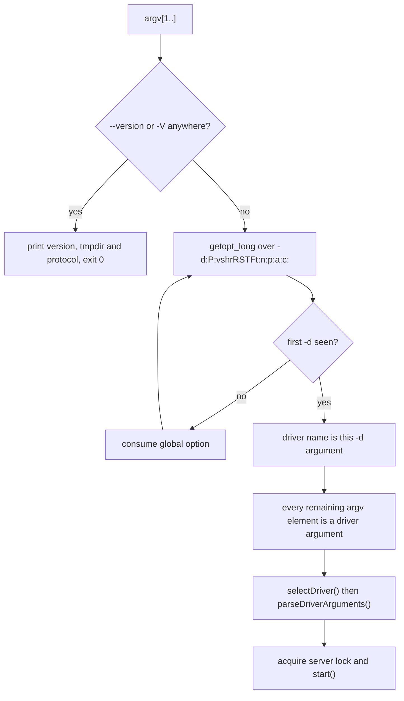
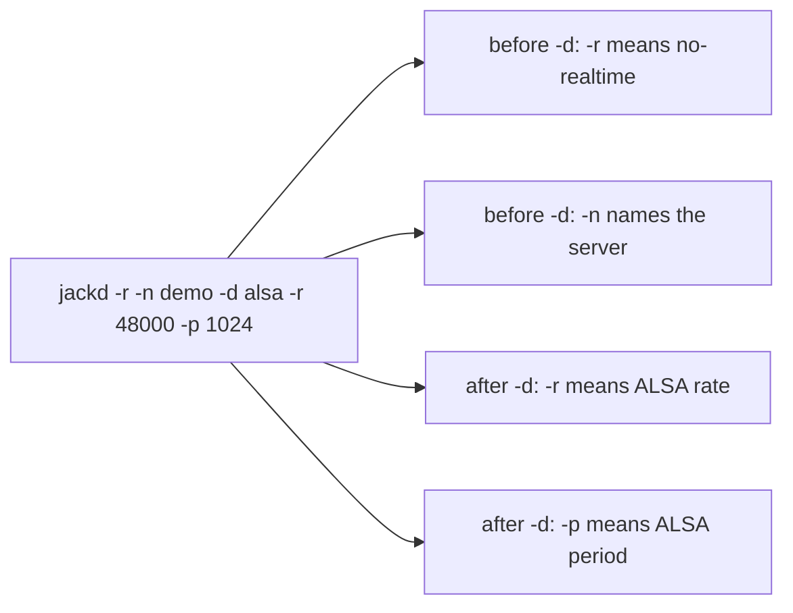
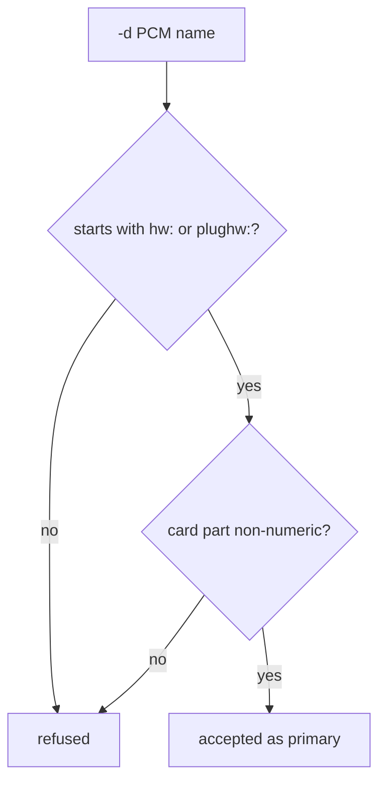
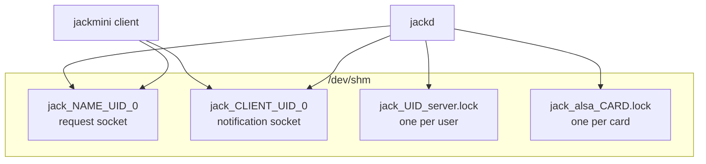
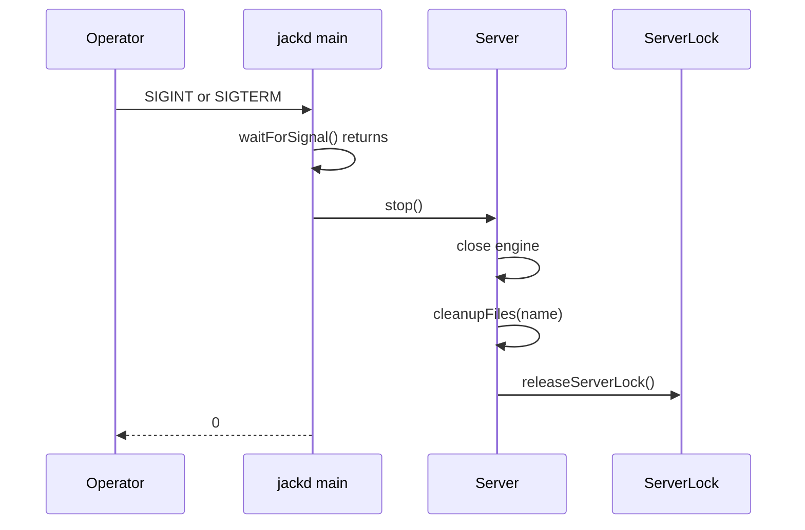

# Running `jackd`

The installed server binary is `jackd` ([CMakeLists.txt:241](../../CMakeLists.txt#L241),
[CMakeLists.txt:330](../../CMakeLists.txt#L330)); its usage banner still calls itself `jackdmp`
([Jackdmp.cpp:65](../../server/Jackdmp.cpp#L65)). This page describes the current parser, the ALSA driver arguments and
the files a running server creates.

## Option handoff

*Source: [Jackdmp.cpp:129](../../server/Jackdmp.cpp#L129),
[Jackdmp.cpp:138](../../server/Jackdmp.cpp#L138),
[Jackdmp.cpp:170](../../server/Jackdmp.cpp#L170),
[Jackdmp.cpp:252](../../server/Jackdmp.cpp#L252),
[Jackdmp.cpp:261](../../server/Jackdmp.cpp#L261),
[Jackdmp.cpp:272](../../server/Jackdmp.cpp#L272).*

The loop condition `while (!masterDriverName && ... getopt_long(...))` is the boundary: the first `-d` ends global
parsing, and arguments after it are never interpreted as global options ([Jackdmp.cpp:170](../../server/Jackdmp.cpp#L170)).
A missing `-d` fails after usage is printed ([Jackdmp.cpp:252](../../server/Jackdmp.cpp#L252)). `--version` and `-V` are
checked separately over all arguments before parsing ([Jackdmp.cpp:131](../../server/Jackdmp.cpp#L131)).

## Global options

<!-- fact: server/Jackdmp.cpp:138 pattern="-d:P:vshrRSTFt:n:p:a:c:" -->

| Short | Long | Argument | Effect | Default | Source |
|---|---|---|---|---|---|
| `-d` | `--audio-driver` | driver name | selects the master driver and ends global parsing | none; required | [Jackdmp.cpp:138](../../server/Jackdmp.cpp#L138), [Jackdmp.cpp:193](../../server/Jackdmp.cpp#L193) |
| `-n` | `--name` | name | server name, truncated to the driver string limit | `JACK_DEFAULT_SERVER`, else `default` | [Jackdmp.cpp:213](../../server/Jackdmp.cpp#L213), [Tools.cpp:64](../../common/Tools.cpp#L64) |
| `-r` | `--no-realtime` | — | sets `realtime=false` | `realtime=true` | [Jackdmp.cpp:221](../../server/Jackdmp.cpp#L221), [Control.cpp:205](../../server/control/Control.cpp#L205) |
| `-R` | `--realtime` | — | sets `realtime=true` | `true` | [Jackdmp.cpp:225](../../server/Jackdmp.cpp#L225) |
| `-P` | `--realtime-priority` | integer | realtime scheduler priority | `10` | [Jackdmp.cpp:217](../../server/Jackdmp.cpp#L217), [Control.cpp:206](../../server/control/Control.cpp#L206) |
| `-t` | `--timeout` | integer | client timeout in milliseconds | `0`; `500` when realtime is off | [Jackdmp.cpp:237](../../server/Jackdmp.cpp#L237), [Control.cpp:583](../../server/control/Control.cpp#L583) |
| `-p` | `--port-max` | integer | maximum number of ports | `kPortNum` | [Jackdmp.cpp:197](../../server/Jackdmp.cpp#L197), [Control.cpp:212](../../server/control/Control.cpp#L212) |
| `-a` | `--autoconnect` | mode char | self-connect mode | `' '`, no restriction | [Jackdmp.cpp:185](../../server/Jackdmp.cpp#L185), [Control.cpp:53](../../server/control/Control.cpp#L53) |
| `-c` | `--clock-source` | `h`, `c` or `s` | sets the clock source | `0` (parameter default) | [Jackdmp.cpp:140](../../server/Jackdmp.cpp#L140), [Control.cpp:211](../../server/control/Control.cpp#L211) |
| `-v` | `--verbose` | — | verbose logging | `false` | [Jackdmp.cpp:201](../../server/Jackdmp.cpp#L201) |
| `-s` | `--silent` | — | installs the silent error callback | off | [Jackdmp.cpp:205](../../server/Jackdmp.cpp#L205) |
| `-S` | `--sync` | — | server synchronous mode | `false` | [Jackdmp.cpp:209](../../server/Jackdmp.cpp#L209) |
| `-T` | `--temporary` | — | exit when all clients close | `false` | [Jackdmp.cpp:229](../../server/Jackdmp.cpp#L229), [Control.cpp:207](../../server/control/Control.cpp#L207) |
| `-F` | `--freewheel` | — | start in freewheel mode | `false` | [Jackdmp.cpp:233](../../server/Jackdmp.cpp#L233) |
| `-h` | `--help` | — | print usage and return 0 | — | [Jackdmp.cpp:241](../../server/Jackdmp.cpp#L241) |
| `-V` | `--version` | — | print version, tmpdir and protocol and return 0 | — | [Jackdmp.cpp:131](../../server/Jackdmp.cpp#L131), [Jackdmp.cpp:106](../../server/Jackdmp.cpp#L106) |

Valid `-a` mode characters are `' '`, `E`, `e`, `A` and `a`; an invalid character prints usage and fails
([Control.cpp:53](../../server/control/Control.cpp#L53), [Jackdmp.cpp:185](../../server/Jackdmp.cpp#L185)).

### Clock-source spelling drift

| Spelling | Status | Source |
|---|---|---|
| `--clock-source` | the registered long option, mapped to `c` | [Jackdmp.cpp:140](../../server/Jackdmp.cpp#L140) |
| `--clocksource` | printed in the usage text, not registered | [Jackdmp.cpp:73](../../server/Jackdmp.cpp#L73) |

Values beginning with `h` select HPET; values beginning with `c` or `s` select the system clock (the cycle clock is not
offered and maps to the system clock). Anything else prints usage and fails ([Jackdmp.cpp:173](../../server/Jackdmp.cpp#L173)).

## The driver argument boundary

*Source: [Jackdmp.cpp:170](../../server/Jackdmp.cpp#L170),
[Jackdmp.cpp:221](../../server/Jackdmp.cpp#L221),
[Jackdmp.cpp:261](../../server/Jackdmp.cpp#L261),
[AlsaDriver.cpp:1382](../../server/drivers/alsa/AlsaDriver.cpp#L1382),
[AlsaDriver.cpp:1386](../../server/drivers/alsa/AlsaDriver.cpp#L1386).*

`jackd -d alsa --help` prints the driver's own options; a third argument asks for one named parameter
([Control.cpp:453](../../server/control/Control.cpp#L453)).

## ALSA driver arguments

All parameters come from the driver descriptor; each has one stored value
([AlsaDriver.cpp:1367](../../server/drivers/alsa/AlsaDriver.cpp#L1367),
[Control.cpp:511](../../server/control/Control.cpp#L511)).

| Short | Parameter | Default | Meaning | Source |
|---|---|---|---|---|
| `-d` | `device` | empty | primary ALSA device, by card id | [AlsaDriver.cpp:1376](../../server/drivers/alsa/AlsaDriver.cpp#L1376) |
| `-C` | `capture` | `none` | capture device; presence enables capture | [AlsaDriver.cpp:1379](../../server/drivers/alsa/AlsaDriver.cpp#L1379) |
| `-P` | `playback` | `none` | playback device; presence enables playback | [AlsaDriver.cpp:1380](../../server/drivers/alsa/AlsaDriver.cpp#L1380) |
| `-r` | `rate` | `48000` | sample rate | [AlsaDriver.cpp:1382](../../server/drivers/alsa/AlsaDriver.cpp#L1382) |
| `-p` | `period` | `1024` | frames per period | [AlsaDriver.cpp:1386](../../server/drivers/alsa/AlsaDriver.cpp#L1386) |
| `-n` | `nperiods` | `2` | periods of playback latency | [AlsaDriver.cpp:1388](../../server/drivers/alsa/AlsaDriver.cpp#L1388) |
| `-D` | `duplex` | on | both capture and playback | [AlsaDriver.cpp:1397](../../server/drivers/alsa/AlsaDriver.cpp#L1397) |
| `-H` | `hwmon` | off | hardware monitoring | [AlsaDriver.cpp:1392](../../server/drivers/alsa/AlsaDriver.cpp#L1392) |
| `-M` | `hwmeter` | off | hardware metering | [AlsaDriver.cpp:1394](../../server/drivers/alsa/AlsaDriver.cpp#L1394) |
| `-s` | `softmode` | off | no xrun handling | [AlsaDriver.cpp:1400](../../server/drivers/alsa/AlsaDriver.cpp#L1400) |
| `-m` | `monitor` | off | output monitor ports | [AlsaDriver.cpp:1404](../../server/drivers/alsa/AlsaDriver.cpp#L1404) |
| `-z` | `dither` | `n` | dithering mode | [AlsaDriver.cpp:1406](../../server/drivers/alsa/AlsaDriver.cpp#L1406) |
| `-i` | `inchannels` | `0` | capture channels, `0` means hardware maximum | [AlsaDriver.cpp:1421](../../server/drivers/alsa/AlsaDriver.cpp#L1421) |
| `-o` | `outchannels` | `0` | playback channels, `0` means hardware maximum | [AlsaDriver.cpp:1422](../../server/drivers/alsa/AlsaDriver.cpp#L1422) |
| `-S` | `shorts` | off | try 16-bit samples before 32-bit | [AlsaDriver.cpp:1425](../../server/drivers/alsa/AlsaDriver.cpp#L1425) |
| `-I` | `input-latency` | `0` | extra input latency in frames | [AlsaDriver.cpp:1428](../../server/drivers/alsa/AlsaDriver.cpp#L1428) |
| `-O` | `output-latency` | `0` | extra output latency in frames | [AlsaDriver.cpp:1429](../../server/drivers/alsa/AlsaDriver.cpp#L1429) |
| `-Y` | `secondary` | `none` | one secondary card specification | [AlsaDriver.cpp:1432](../../server/drivers/alsa/AlsaDriver.cpp#L1432) |
| `-Z` | `exclude-card` | `none` | one comma-separated list of card ids | [AlsaDriver.cpp:1435](../../server/drivers/alsa/AlsaDriver.cpp#L1435), [AlsaDriver.cpp:1573](../../server/drivers/alsa/AlsaDriver.cpp#L1573) |
| `-K` | `secondary-file` | `none` | file with one secondary card per line | [AlsaDriver.cpp:1439](../../server/drivers/alsa/AlsaDriver.cpp#L1439), [AlsaDriver.cpp:1590](../../server/drivers/alsa/AlsaDriver.cpp#L1590) |

The descriptor's help text for `secondary` is stale about supplying several values: the parser has one `kDriverParamString`
slot per parameter, so a later occurrence overwrites an earlier one. Use `--secondary-file cards.conf` for several
cards: blank lines and lines starting with `#` are ignored ([AlsaDriver.cpp:1441](../../server/drivers/alsa/AlsaDriver.cpp#L1441),
[Control.cpp:511](../../server/control/Control.cpp#L511)). The same single-value rule applies to `exclude-card` and
`secondary-file`; list card ids as `--exclude-card=PCH,NVidia`. Matching ignores case
([AlsaSecondaryConfig.cpp:134](../../server/drivers/alsa/AlsaSecondaryConfig.cpp#L134)).

Duplex is the default when neither capture nor playback was requested
([AlsaDriver.cpp:1602](../../server/drivers/alsa/AlsaDriver.cpp#L1602)). Full secondary-card configuration is in
[secondary-cards.md](secondary-cards.md).

## Primary device must be by id

*Source: [AlsaSecondaryConfig.cpp:113](../../server/drivers/alsa/AlsaSecondaryConfig.cpp#L113),
[AlsaDriver.cpp:1611](../../server/drivers/alsa/AlsaDriver.cpp#L1611),
[AlsaSecondaryUnit.cpp:351](../../tests/AlsaSecondaryUnit.cpp#L351).*

| Name | Result | Source |
|---|---|---|
| `hw:CARD=PCH` | accepted | [AlsaSecondaryUnit.cpp:351](../../tests/AlsaSecondaryUnit.cpp#L351) |
| `hw:CARD=PCH,DEV=0` | accepted | [AlsaSecondaryUnit.cpp:352](../../tests/AlsaSecondaryUnit.cpp#L352) |
| `hw:PCH,0` | accepted | [AlsaSecondaryUnit.cpp:353](../../tests/AlsaSecondaryUnit.cpp#L353) |
| `plughw:CARD=Loopback,DEV=1` | accepted | [AlsaSecondaryUnit.cpp:354](../../tests/AlsaSecondaryUnit.cpp#L354) |
| `hw:0`, `hw:2,0`, `hw:CARD=0` | refused | [AlsaSecondaryUnit.cpp:355](../../tests/AlsaSecondaryUnit.cpp#L355) |
| `default`, `hw:`, `hw:CARD=` | refused | [AlsaSecondaryUnit.cpp:359](../../tests/AlsaSecondaryUnit.cpp#L359) |

The refusal is issued before the driver opens any device and names `-d hw:CARD=PCH` as the example
([AlsaDriver.cpp:1611](../../server/drivers/alsa/AlsaDriver.cpp#L1611)).

## Runtime artifacts

<!-- fact: ipc/protocol/Constants.h:61 pattern="/dev/shm" -->

| Artifact | Name | Source |
|---|---|---|
| Server request socket | `/dev/shm/jack_<name>_<uid>_0`, or `/dev/shm/jack_<name>_0` in promiscuous mode | [Constants.h:60](../../ipc/protocol/Constants.h#L60), [IpcName.h:34](../../ipc/IpcName.h#L34) |
| Client notification socket | same pattern with the client name instead of the server name | [IpcName.h:34](../../ipc/IpcName.h#L34), [ClientSession.cpp:167](../../client/session/ClientSession.cpp#L167) |
| Client futex | `jack_sem.<uid>_<server>_<client>`, or `jack_sem.<server>_<client>` in promiscuous mode | [IpcName.h:47](../../ipc/IpcName.h#L47) |
| Server lock | `/dev/shm/jack_<uid>_server.lock` | [ServerLock.cpp:42](../../server/core/ServerLock.cpp#L42) |
| ALSA card lock | `/dev/shm/jack_alsa_<card>.lock`, non-alphanumeric characters replaced by `_` | [AlsaControl.cpp:45](../../server/drivers/alsa/AlsaControl.cpp#L45) |
| Driver modules | `${libdir}/jack/jack_alsa.so` and `jack_dummy.so` | [CMakeLists.txt:122](../../CMakeLists.txt#L122), [CMakeLists.txt:246](../../CMakeLists.txt#L246) |

*Source: [Constants.h:60](../../ipc/protocol/Constants.h#L60),
[IpcName.h:34](../../ipc/IpcName.h#L34),
[ServerLock.cpp:42](../../server/core/ServerLock.cpp#L42),
[AlsaControl.cpp:45](../../server/drivers/alsa/AlsaControl.cpp#L45).*

The server lock is held for the process lifetime and released on exit
([ServerLock.cpp:32](../../server/core/ServerLock.cpp#L32), [ServerLock.cpp:63](../../server/core/ServerLock.cpp#L63)).
A stale request socket is removed at startup and at shutdown
([Control.cpp:568](../../server/control/Control.cpp#L568), [Tools.cpp:96](../../common/Tools.cpp#L96)).

## Driver discovery

| Setting | Behaviour | Source |
|---|---|---|
| `JACK_DRIVER_DIR` | replaces the compiled-in addon directory when loading driver modules | [DriverLoader.cpp:182](../../server/drivers/DriverLoader.cpp#L182) |
| compiled-in default | `${CMAKE_INSTALL_FULL_LIBDIR}/jack` | [CMakeLists.txt:122](../../CMakeLists.txt#L122) |
| build tree | `build/lib/jack`, used together with `LD_LIBRARY_PATH=build/lib` | [tools_e2e.sh:20](../../tests/tools_e2e.sh#L20) |
| filename filter | entries starting with `jack_` and ending in the shared-object extension | [DriverLoader.cpp:197](../../server/drivers/DriverLoader.cpp#L197) |

`JACK_INTERNAL_DIR`, then `JACK_DRIVER_DIR`, then the addon directory are used when building internal client paths
([Tools.cpp:200](../../common/Tools.cpp#L200)).

## Shutdown sequence

*Source: [Jackdmp.cpp:270](../../server/Jackdmp.cpp#L270),
[Jackdmp.cpp:277](../../server/Jackdmp.cpp#L277),
[Control.cpp:311](../../server/control/Control.cpp#L311),
[ServerLock.cpp:63](../../server/core/ServerLock.cpp#L63).*

A failed `server.stop()` prints `Cannot stop server...` and the process still returns 0
([Jackdmp.cpp:279](../../server/Jackdmp.cpp#L279)).
