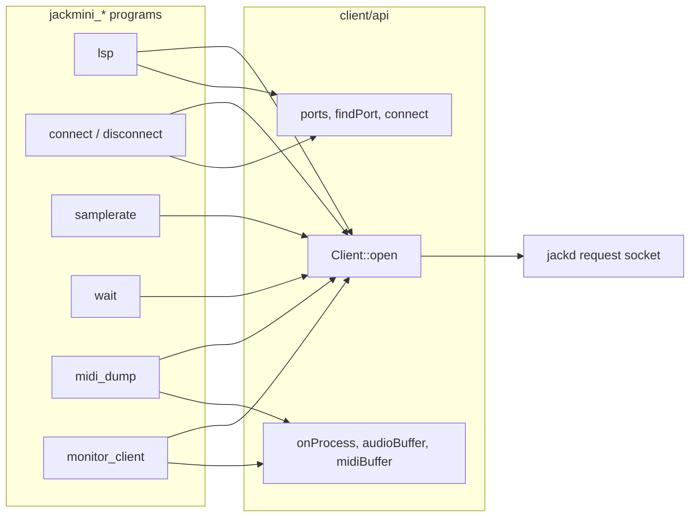
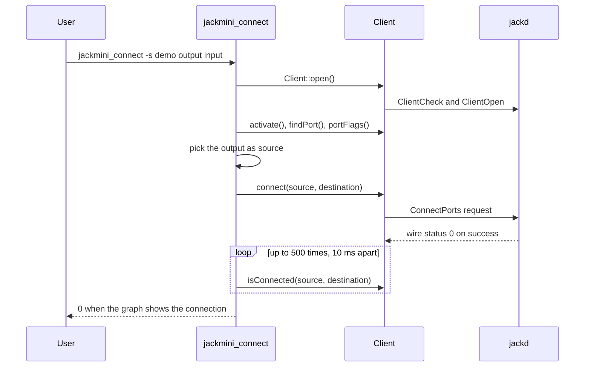
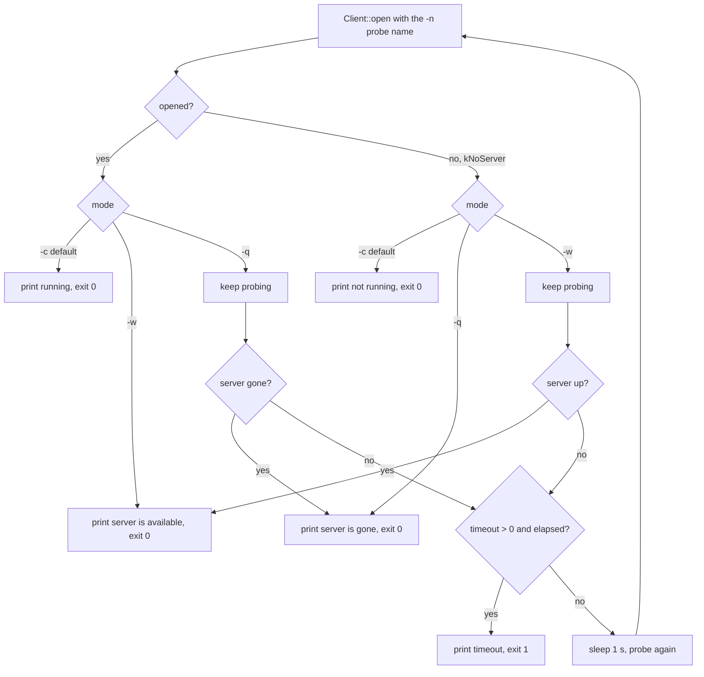

# Command-line tools

Seven programs are installed when `JACK_TOOLS=ON` (the default): one executable per tool, each linking `jack`,
`jackmini_base` and `Threads::Threads` ([tools/CMakeLists.txt:6](../../tools/CMakeLists.txt#L6),
[tools/CMakeLists.txt:14](../../tools/CMakeLists.txt#L14), [CMakeLists.txt:14](../../CMakeLists.txt#L14)).
They are client programs: they open a connection to an existing server and never start one
([ToolCommon.hpp:28](../../tools/ToolCommon.hpp#L28), [ClientSession.cpp:147](../../client/session/ClientSession.cpp#L147)).

*Source: [ToolCommon.hpp:30](../../tools/ToolCommon.hpp#L30),
[Lsp.cpp:175](../../tools/Lsp.cpp#L175), [Connect.cpp:123](../../tools/Connect.cpp#L123),
[Samplerate.cpp:74](../../tools/Samplerate.cpp#L74), [Wait.cpp:114](../../tools/Wait.cpp#L114),
[MidiDump.cpp:136](../../tools/MidiDump.cpp#L136), [MonitorClient.cpp:94](../../tools/MonitorClient.cpp#L94).*

## Common options

Every tool accepts `-s`/`--server`, `-v`/`--version` and `-h`/`--help`
([Lsp.cpp:50](../../tools/Lsp.cpp#L50), [Connect.cpp:46](../../tools/Connect.cpp#L46),
[Samplerate.cpp:34](../../tools/Samplerate.cpp#L34), [Wait.cpp:40](../../tools/Wait.cpp#L40),
[MidiDump.cpp:61](../../tools/MidiDump.cpp#L61), [MonitorClient.cpp:52](../../tools/MonitorClient.cpp#L52)).
`-s` becomes `OpenOptions::m_serverName`; an empty value selects `JACK_DEFAULT_SERVER`, or `default`
([ToolCommon.hpp:30](../../tools/ToolCommon.hpp#L30), [Tools.cpp:64](../../common/Tools.cpp#L64),
[ClientSession.cpp:144](../../client/session/ClientSession.cpp#L144)).

Only `lsp`, `connect`/`disconnect`, `samplerate` and `wait` define all three long forms; `midi_dump` and
`monitor_client` register long options only for `--server`, `--help` and `--version`
([MidiDump.cpp:104](../../tools/MidiDump.cpp#L104), [MonitorClient.cpp:63](../../tools/MonitorClient.cpp#L63)).

## Tool-to-API map

| Tool | Extra options and arguments | Client API calls | Source |
|---|---|---|---|
| `jackmini_lsp` | `-A`, `-c`, `-l`, `-L`, `-p`, `-t`, `-u`, `-U`; trailing filter strings must all occur in a port name | `Client::open`, `Client::ports`, `Client::portFlags`, `Client::connections`, `Client::totalLatency` | [Lsp.cpp:115](../../tools/Lsp.cpp#L115), [Lsp.cpp:173](../../tools/Lsp.cpp#L173), [Lsp.cpp:185](../../tools/Lsp.cpp#L185) |
| `jackmini_connect` | `-u` takes `<client UUID>:<port>`; two port names, either order | `Client::activate`, `Client::findPort`, `Client::portFlags`, `Client::connect`, `Client::isConnected` | [Connect.cpp:85](../../tools/Connect.cpp#L85), [Connect.cpp:139](../../tools/Connect.cpp#L139), [Connect.cpp:186](../../tools/Connect.cpp#L186) |
| `jackmini_disconnect` | same as `connect`; built from the same source with `JACKMINI_DISCONNECT` | `Client::disconnect`, `Client::isConnected` | [tools/CMakeLists.txt:16](../../tools/CMakeLists.txt#L16), [Connect.cpp:176](../../tools/Connect.cpp#L176) |
| `jackmini_samplerate` | none; no positional arguments | `Client::sampleRate` | [Samplerate.cpp:44](../../tools/Samplerate.cpp#L44), [Samplerate.cpp:69](../../tools/Samplerate.cpp#L69) |
| `jackmini_wait` | `-n` probe name, `-w` start, `-q` quit, `-c` check once (default), `-t` seconds | `Client::open` only; `kNoServer` means "not running" | [Wait.cpp:60](../../tools/Wait.cpp#L60), [Wait.cpp:109](../../tools/Wait.cpp#L109) |
| `jackmini_midi_dump` | `-a` absolute time, `-r` relative time, optional client name | `Client::registerPort` with `PortType::kMidi`, `Client::onProcess`, `Client::midiBuffer`, `Client::activate` | [MidiDump.cpp:103](../../tools/MidiDump.cpp#L103), [MidiDump.cpp:134](../../tools/MidiDump.cpp#L134), [MidiDump.cpp:142](../../tools/MidiDump.cpp#L142) |
| `jackmini_monitor_client` | exactly one client name | `Client::ports`, `Client::findPort`, `Client::registerPort`, `Client::onProcess`, `Client::audioBuffer`, `Client::activate` | [MonitorClient.cpp:87](../../tools/MonitorClient.cpp#L87), [MonitorClient.cpp:100](../../tools/MonitorClient.cpp#L100), [MonitorClient.cpp:124](../../tools/MonitorClient.cpp#L124) |

`jackmini_lsp -A` prints the aliases from each `PortInfo::m_aliases` entry
([Lsp.cpp:204](../../tools/Lsp.cpp#L204), [Port.hpp:80](../../client/api/Port.hpp#L80),
[Client.cpp:307](../../client/api/Client.cpp#L307)). The fields come from `Client::ports()`, which reads one snapshot of
the graph ([Client.hpp:130](../../client/api/Client.hpp#L130)).

`jackmini_midi_dump` registers `input`, so the default full port name is `midi-monitor:input`
([MidiDump.cpp:134](../../tools/MidiDump.cpp#L134), [MidiDump.cpp:142](../../tools/MidiDump.cpp#L142)).
`jackmini_monitor_client` registers `monitor_1`, `monitor_2`, … and copies each audio input of the named client in its
process callback until SIGINT or SIGTERM ([MonitorClient.cpp:117](../../tools/MonitorClient.cpp#L117),
[MonitorClient.cpp:136](../../tools/MonitorClient.cpp#L136)).

## Connecting a port

*Source: [Connect.cpp:123](../../tools/Connect.cpp#L123),
[Connect.cpp:139](../../tools/Connect.cpp#L139),
[Connect.cpp:154](../../tools/Connect.cpp#L154),
[Connect.cpp:186](../../tools/Connect.cpp#L186),
[ClientSession.cpp:152](../../client/session/ClientSession.cpp#L152),
[RequestDecoder.h:29](../../server/ipc/RequestDecoder.h#L29).*

Two inputs or two outputs are rejected before the connection request is sent, after the client is opened, activated and
the ports are looked up ([Connect.cpp:139](../../tools/Connect.cpp#L139),
[Connect.cpp:169](../../tools/Connect.cpp#L169)); an existing connection maps `kInvalidState` to the message
`already connected` ([Connect.cpp:186](../../tools/Connect.cpp#L186)).

## Probing for a server

*Source: [Wait.cpp:109](../../tools/Wait.cpp#L109),
[Wait.cpp:122](../../tools/Wait.cpp#L122),
[Wait.cpp:131](../../tools/Wait.cpp#L131),
[Wait.cpp:142](../../tools/Wait.cpp#L142),
[Wait.cpp:146](../../tools/Wait.cpp#L146).*

`jackmini_wait -c` and `jackmini_wait -q` therefore exit 0 when no server is running. Any open error other than
`kNoServer` is reported and exits 1 ([Wait.cpp:117](../../tools/Wait.cpp#L117)). The other tools report a failed
`Client::open()` with status 1 ([ToolCommon.hpp:37](../../tools/ToolCommon.hpp#L37)).

| Invocation with no server | Output | Status | Source |
|---|---|---|---|
| `jackmini_wait -c` | `not running` | 0 | [Wait.cpp:136](../../tools/Wait.cpp#L136) |
| `jackmini_wait -q` | `server is gone` | 0 | [Wait.cpp:132](../../tools/Wait.cpp#L132) |
| `jackmini_lsp` | `Error: cannot connect to JACK, server is not running.` | 1 | [Lsp.cpp:177](../../tools/Lsp.cpp#L177) |

Help and version handling is not uniform: `-v` exits 0 in all tools, while `-h` exits 1 in `lsp`, `connect`,
`disconnect`, `samplerate` and `wait`, and 0 in `midi_dump` and `monitor_client`
([Lsp.cpp:161](../../tools/Lsp.cpp#L161), [Connect.cpp:103](../../tools/Connect.cpp#L103),
[Samplerate.cpp:61](../../tools/Samplerate.cpp#L61), [Wait.cpp:96](../../tools/Wait.cpp#L96),
[MidiDump.cpp:126](../../tools/MidiDump.cpp#L126), [MonitorClient.cpp:79](../../tools/MonitorClient.cpp#L79)).

## Real examples

These commands and expected outputs come from the end-to-end tool checks
([tests/tools_e2e.sh:105](../../tests/tools_e2e.sh#L105)).

| Command (server named `demo`) | Expected result | Source |
|---|---|---|
| `jackmini_lsp -s demo` | `system:capture_1` and `system:playback_2` among the lines | [tools_e2e.sh:107](../../tests/tools_e2e.sh#L107) |
| `jackmini_lsp -s demo capture _2` | `system:capture_2`; every filter string must match | [tools_e2e.sh:109](../../tests/tools_e2e.sh#L109) |
| `jackmini_lsp -s demo -t capture_1` | tab, then `32 bit float mono audio` | [tools_e2e.sh:111](../../tests/tools_e2e.sh#L111) |
| `jackmini_samplerate -s demo` | `48000` for the default dummy server | [tools_e2e.sh:144](../../tests/tools_e2e.sh#L144) |
| `jackmini_connect -s demo system:capture_1 system:playback_1` | exit 0; `jackmini_lsp -c capture_1` then lists the link | [tools_e2e.sh:125](../../tests/tools_e2e.sh#L125) |
| `jackmini_disconnect -s demo system:capture_1 system:playback_1` | exit 0; the link disappears | [tools_e2e.sh:128](../../tests/tools_e2e.sh#L128) |

To run the tools from a build tree, set `LD_LIBRARY_PATH=build/lib` and use the binaries in `build/bin`, exactly as
[tests/tools_e2e.sh:16](../../tests/tools_e2e.sh#L16) does. See [quickstart.md](quickstart.md) for a first session and
[troubleshooting.md](troubleshooting.md) when a tool cannot connect.
