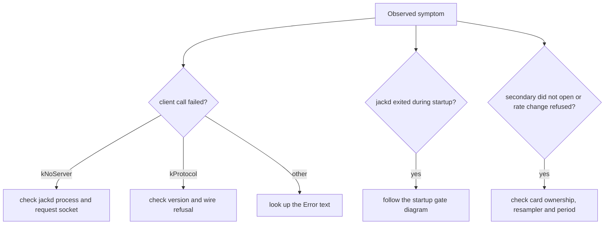
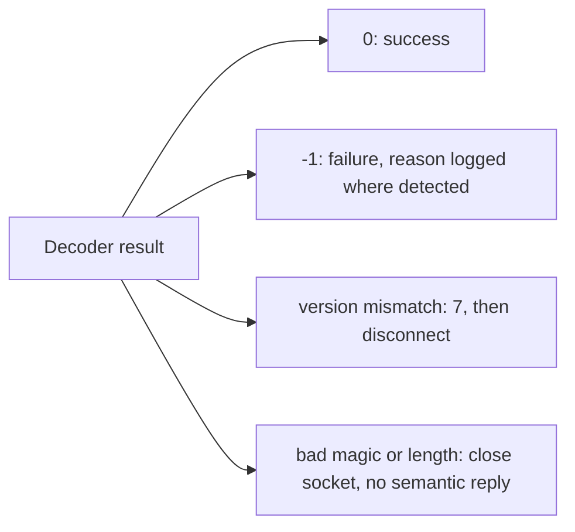
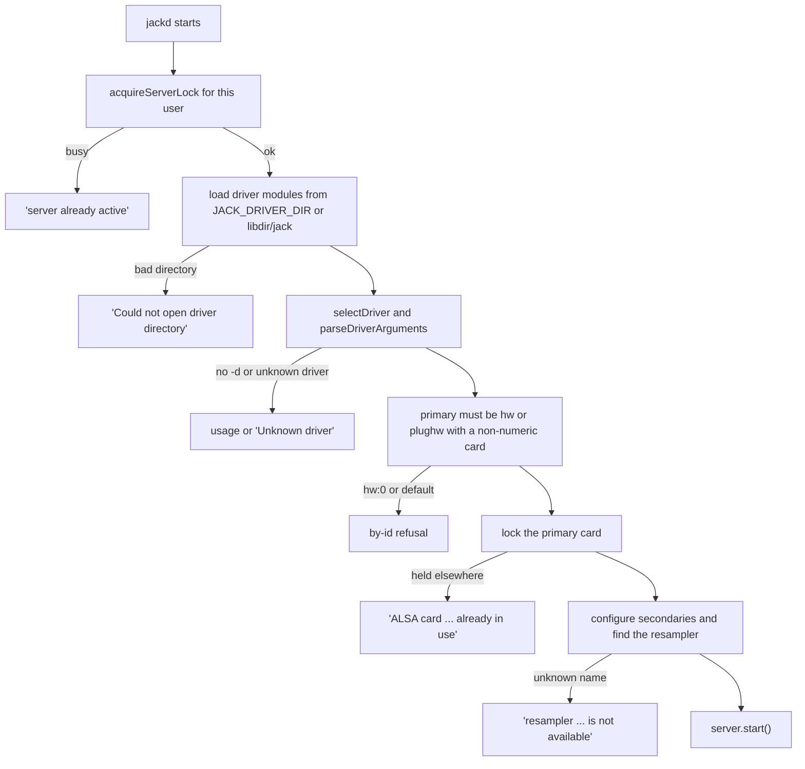
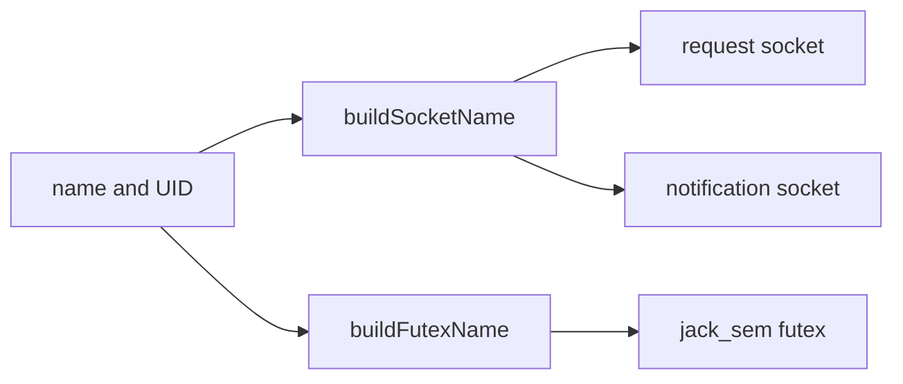

# Troubleshooting

Diagnose from the symptom, not from older JACK2 descriptions: this tree uses protocol 13, C++ `jackmini` API names and a
single-owner ALSA model ([Constants.h:66](../../ipc/protocol/Constants.h#L66),
[Client.hpp:63](../../client/api/Client.hpp#L63), [README.rst:58](../../README.rst#L58)).

*Source: [Error.hpp:26](../../client/api/Error.hpp#L26),
[Error.cpp:21](../../client/api/Error.cpp#L21),
[ClientSession.cpp:147](../../client/session/ClientSession.cpp#L147),
[AlsaDriver.cpp:1608](../../server/drivers/alsa/AlsaDriver.cpp#L1608).*

## Client error codes

<!-- fact: client/api/Error.hpp:31 pattern="kNoServer" -->

| `Error` | `toString()` text | What the caller should check | Source |
|---|---|---|---|
| `kInvalidArgument` | `invalid argument` | name, port or value | [Error.hpp:27](../../client/api/Error.hpp#L27), [Error.cpp:24](../../client/api/Error.cpp#L24) |
| `kInvalidState` | `operation not allowed in the current state` | client lifecycle; callbacks cannot be set while active | [Error.hpp:28](../../client/api/Error.hpp#L28), [Error.cpp:26](../../client/api/Error.cpp#L26), [Client.hpp:89](../../client/api/Client.hpp#L89) |
| `kNameTaken` | `name already in use` | another client with the same name | [Error.hpp:29](../../client/api/Error.hpp#L29), [Error.cpp:28](../../client/api/Error.cpp#L28) |
| `kNotFound` | `not found` | client, port or parameter name | [Error.hpp:30](../../client/api/Error.hpp#L30), [Error.cpp:30](../../client/api/Error.cpp#L30) |
| `kNoServer` | `server not running and could not be started` | only that the connect failed; start `jackd` yourself | [Error.hpp:31](../../client/api/Error.hpp#L31), [Error.cpp:32](../../client/api/Error.cpp#L32) |
| `kServerFailure` | `server failed the request` | server log | [Error.hpp:32](../../client/api/Error.hpp#L32), [Error.cpp:34](../../client/api/Error.cpp#L34) |
| `kProtocol` | `unexpected reply from the server` | version mismatch or a non-jackmini server | [Error.hpp:33](../../client/api/Error.hpp#L33), [Error.cpp:36](../../client/api/Error.cpp#L36) |
| `kIo` | `connection to the server failed` | socket path, permissions, server still alive | [Error.hpp:34](../../client/api/Error.hpp#L34), [Error.cpp:38](../../client/api/Error.cpp#L38) |

The `kNoServer` comment says the server "could not be started", but a client never starts one: a failed `connect()` to the
request socket returns this error directly ([Error.hpp:31](../../client/api/Error.hpp#L31),
[ClientSession.cpp:147](../../client/session/ClientSession.cpp#L147)). `jackmini_wait` handles this case specially
([Wait.cpp:117](../../tools/Wait.cpp#L117)).

## Wire status values

*Source: [RequestDecoder.h:29](../../server/ipc/RequestDecoder.h#L29),
[RequestDecoder.cpp:64](../../server/ipc/RequestDecoder.cpp#L64),
[Message.h:46](../../ipc/protocol/Message.h#L46),
[SocketServerChannel.cpp:222](../../server/ipc/SocketServerChannel.cpp#L222).*

| Wire status | Meaning | Source |
|---|---|---|
| `0` | success | [RequestDecoder.h:30](../../server/ipc/RequestDecoder.h#L30) |
| `-1` | failure; the reason is logged at the detection point | [RequestDecoder.h:29](../../server/ipc/RequestDecoder.h#L29) |
| `7` | `kJackMsgProtocolError` on a version mismatch | [Message.h:46](../../ipc/protocol/Message.h#L46), [RequestDecoder.cpp:64](../../server/ipc/RequestDecoder.cpp#L64) |

There is no 1–8 mapping of `Error` onto wire statuses, and no negotiation on mismatch: the server refuses the request
([RequestDecoder.cpp:71](../../server/ipc/RequestDecoder.cpp#L71),
[protocol.md:113](../reference/protocol.md#L113)). Use the verified reference at
[protocol.md](../reference/protocol.md) for the frame layout.

## Startup gates

*Source: [Control.cpp:557](../../server/control/Control.cpp#L557),
[DriverLoader.cpp:182](../../server/drivers/DriverLoader.cpp#L182),
[Control.cpp:380](../../server/control/Control.cpp#L380),
[AlsaDriver.cpp:1611](../../server/drivers/alsa/AlsaDriver.cpp#L1611),
[AlsaDriver.cpp:677](../../server/drivers/alsa/AlsaDriver.cpp#L677),
[AlsaDriver.cpp:750](../../server/drivers/alsa/AlsaDriver.cpp#L750),
[Jackdmp.cpp:272](../../server/Jackdmp.cpp#L272).*

## Known drift and what to check

| Symptom | Cause in the current code | Check | Source |
|---|---|---|---|
| `server already active`, even with a different `-n` | The server lock is **per user**, not per name: `/dev/shm/jack_<uid>_server.lock` | `pgrep -a jackd`; `ls -l /dev/shm/jack_$(id -u)_server.lock` | [ServerLock.cpp:42](../../server/core/ServerLock.cpp#L42), [Control.cpp:557](../../server/control/Control.cpp#L557) |
| `ALSA card ... is already in use by another JACK server or by this server` | Each card has a lock at `/dev/shm/jack_alsa_<card>.lock`; primary and secondary opens both take it | `ls -l /dev/shm/jack_alsa_*.lock`; stop the other server or PulseAudio/another application holding the card | [AlsaControl.cpp:45](../../server/drivers/alsa/AlsaControl.cpp#L45), [AlsaDriver.cpp:740](../../server/drivers/alsa/AlsaDriver.cpp#L740) |
| A JACK2 client cannot connect, or the client reports `kProtocol` | The wire version is 13 and JACK2 is not compatible; a mismatch gets wire status 7 | `jackd -V` prints the protocol number; rebuild both sides from this tree | [Jackdmp.cpp:106](../../server/Jackdmp.cpp#L106), [Constants.h:66](../../ipc/protocol/Constants.h#L66), [RequestDecoder.cpp:64](../../server/ipc/RequestDecoder.cpp#L64), [README.rst:172](../../README.rst#L172) |
| `the primary ALSA device must be given by card id` | Primary names must be `hw:`/`plughw:` with a non-numeric card part; `hw:0` and `default` are refused | `cat /proc/asound/cards`; use `-d hw:CARD=PCH` as the driver argument, after the first `-d` | [AlsaSecondaryConfig.cpp:113](../../server/drivers/alsa/AlsaSecondaryConfig.cpp#L113), [AlsaDriver.cpp:1611](../../server/drivers/alsa/AlsaDriver.cpp#L1611) |
| `secondary card 'x': resampler 'n' is not available` | Only `pipewire` is built in; the factory lookup happens before `optional` is considered, so `optional=1` does not skip the failure | Remove the `resampler` key or set `resampler=pipewire` | [AlsaDriver.cpp:750](../../server/drivers/alsa/AlsaDriver.cpp#L750), [AlsaDriver.cpp:760](../../server/drivers/alsa/AlsaDriver.cpp#L760) |
| `cannot run at R Hz; restoring Q Hz` after a rate write | The secondary period is `primary buffer * rate / primary rate`; devices often refuse the resulting period | Check the primary `-p`, the requested rate and the server log; see [secondary-cards.md](secondary-cards.md) | [AlsaSecondaryCard.cpp:205](../../server/drivers/alsa/AlsaSecondaryCard.cpp#L205), [AlsaDriver.cpp:733](../../server/drivers/alsa/AlsaDriver.cpp#L733) |
| `Could not open driver directory` or `Unknown driver "alsa"` from a build tree | `JACK_DRIVER_DIR` selects the module directory; without it the compiled-in `${libdir}/jack` is used | `ls build/lib/jack`; export `JACK_DRIVER_DIR=build/lib/jack` (and `LD_LIBRARY_PATH=build/lib`) | [DriverLoader.cpp:182](../../server/drivers/DriverLoader.cpp#L182), [CMakeLists.txt:122](../../CMakeLists.txt#L122), [tools_e2e.sh:20](../../tests/tools_e2e.sh#L20) |
| A tool prints `server not running and could not be started` | That is the text of `kNoServer`; the tool only tried to connect | Start `jackd`, then check `jackmini_wait -c` and the request socket | [Error.cpp:32](../../client/api/Error.cpp#L32), [ClientSession.cpp:147](../../client/session/ClientSession.cpp#L147) |
| Repeating `--secondary` or `--exclude-card` appears to lose a value | Each driver parameter has one string slot; the last occurrence replaces the earlier one | Put one card per line in `--secondary-file`; use a comma-separated id list for card exclusion | [Control.cpp:511](../../server/control/Control.cpp#L511), [AlsaDriver.cpp:1573](../../server/drivers/alsa/AlsaDriver.cpp#L1573), [AlsaDriver.cpp:1590](../../server/drivers/alsa/AlsaDriver.cpp#L1590) |

## Runtime artifact names

<!-- fact: ipc/IpcName.h:35 pattern="buildSocketName" -->

| Object | Pattern | Source |
|---|---|---|
| Request socket | `/dev/shm/jack_<name>_<uid>_0`; promiscuous: `/dev/shm/jack_<name>_0` | [Constants.h:60](../../ipc/protocol/Constants.h#L60), [IpcName.h:34](../../ipc/IpcName.h#L34) |
| Notification socket | same pattern with the client name | [IpcName.h:34](../../ipc/IpcName.h#L34), [ClientSession.cpp:167](../../client/session/ClientSession.cpp#L167) |
| Futex | `jack_sem.<uid>_<server>_<client>`; promiscuous: `jack_sem.<server>_<client>` | [IpcName.h:47](../../ipc/IpcName.h#L47) |
| Server lock | `/dev/shm/jack_<uid>_server.lock` | [ServerLock.cpp:42](../../server/core/ServerLock.cpp#L42) |
| Card lock | `/dev/shm/jack_alsa_<card>.lock` | [AlsaControl.cpp:45](../../server/drivers/alsa/AlsaControl.cpp#L45) |

*Source: [IpcName.h:34](../../ipc/IpcName.h#L34),
[IpcName.h:47](../../ipc/IpcName.h#L47),
[Constants.h:60](../../ipc/protocol/Constants.h#L60).*

For the default server name the socket is `/dev/shm/jack_default_<uid>_0`
([Constants.h:58](../../ipc/protocol/Constants.h#L58), [IpcName.h:34](../../ipc/IpcName.h#L34)). `JACK_DEFAULT_SERVER`
and `JACK_PROMISCUOUS_SERVER` change the name and whether the UID component is present
([Tools.cpp:64](../../common/Tools.cpp#L64), [Tools.cpp:77](../../common/Tools.cpp#L77)).

## Secondary-card failures

| Message or symptom | Cause | Source |
|---|---|---|
| `invalid --secondary "...": ...` | The key/value string did not parse; the message names the bad field | [AlsaDriver.cpp:1560](../../server/drivers/alsa/AlsaDriver.cpp#L1560) |
| `automatic secondary card 'x' is skipped: its card is held by another server` | The card lock could not be taken; automatic cards never stop the server | [AlsaDriver.cpp:741](../../server/drivers/alsa/AlsaDriver.cpp#L741) |
| `secondary ALSA card 'x' is configured more than once` | Two specifications resolve to the same port base | [AlsaDriver.cpp:725](../../server/drivers/alsa/AlsaDriver.cpp#L725) |
| `secondary ALSA card 'x' uses a device already used by the primary card` | The explicit secondary overlaps the primary device | [AlsaDriver.cpp:732](../../server/drivers/alsa/AlsaDriver.cpp#L732) |
| `all 8 secondary card slots are in use` | The slot table has eight entries, shared by automatic and configured cards | [AlsaDriver.cpp:204](../../server/drivers/alsa/AlsaDriver.cpp#L204), [AlsaDriver.h:44](../../server/drivers/alsa/AlsaDriver.h#L44) |
| `cannot create a ... rate control` | No JACK ALSA element could be created; the card keeps its startup rate | [AlsaSecondaryCard.cpp:489](../../server/drivers/alsa/AlsaSecondaryCard.cpp#L489) |

A rate-change notification exists in the wire enum but the public C++ client has no callback for it; inspect the server
log and the ALSA control instead ([Notification.h:42](../../ipc/protocol/Notification.h#L42),
[ClientSession.cpp:291](../../client/session/ClientSession.cpp#L291),
[secondary-cards.md](secondary-cards.md)).
